# CAPSTONE PROJECT FINAL REPORT (REPORT 7)

**PROJECT: VEGGIEPAL - A COMPREHENSIVE DIGITAL ECOSYSTEM SUPPORTING 100% VEGAN LIFESTYLE**

- Course Code: PRM393
- Institution: FPT University
- Academic Year: 2025 - 2026

---

## TABLE OF CONTENTS

- Acknowledgement
- Definitions and Acronyms
- I. Project Introduction
  1. Overview
  2. Product Background
  3. Existing Systems & Competitive Analysis
  4. Business Opportunity
  5. Software Product Vision
  6. Project Scope & Limitations
- II. Project Management Plan
  1. Overview & Estimation
  2. Management Approach & Process
  3. Project Deliverables & RACI
  4. Configuration & Source Code Management
- III. Software Requirement Specification (SRS)
  1. Product Overview
  2. User Requirements & Actors
  3. Functional Requirements (FR Matrix)
  4. Non-Functional Requirements
  5. Requirement Appendix & Business Rules
- IV. Software Design Description (SDD)
  1. System Design & Architecture
  2. Database Design (Database-per-Service)
  3. Detailed Design & Sequence Specifications
  4. API Design
- V. Software Testing Documentation
  1. Scope & Test Strategy
  2. Test Environment & Supporting Tools
  3. Test Inventory
  4. Quality Controls Built Into the Design
- VI. Release Package & User Guides
  1. Deliverable Package
  2. System Requirements & Installation Instructions
  3. User Manual & Core Workflows
  4. CI/CD Deployment Process
- VII. Appendix
  1. References
  2. Project Metrics Summary
  3. Results Achieved & Future Development

---

## ACKNOWLEDGEMENT

We would like to express our deepest gratitude to our project supervisor and the lecturers of FPT University for their continuous guidance, technical critiques, and invaluable feedback throughout the development of the VeggiePal project. We also thank our team members for their dedication, collaboration, and discipline in applying modern software engineering practices, microservices architecture, and automated CI/CD to turn this project into an operational platform.

---

## DEFINITIONS AND ACRONYMS

| Acronym / Term | Definition |
|---|---|
| API | Application Programming Interface |
| BMI | Body Mass Index |
| BMR | Basal Metabolic Rate (minimal daily calories needed at rest) |
| CI / CD | Continuous Integration / Continuous Deployment |
| CORS | Cross-Origin Resource Sharing |
| ERD | Entity Relationship Diagram |
| FR / NFR | Functional Requirement / Non-Functional Requirement |
| GPS | Global Positioning System |
| Groq | Cloud inference provider hosting the LLM and speech-to-text models used by ai-service |
| JWT | JSON Web Token (RFC 7519) |
| LLM | Large Language Model |
| PayOS | Payment gateway integrating Vietnamese banking QR code (VietQR) |
| SDD | Software Design Description |
| SRS | Software Requirement Specification |
| ST_Distance_Sphere | MySQL function used by location-service to calculate spherical distance between two coordinates |
| TDEE | Total Daily Energy Expenditure |

---

## I. PROJECT INTRODUCTION

### 1. Overview

#### 1.1. Project Information

- **Project Title:** VeggiePal - Digital Ecosystem Supporting 100% Vegan Lifestyle
- **Project Code:** PRM393_VeggiePal
- **Platform Targets:** Backend microservices (Spring Boot, Java 21), cross-platform mobile app (Flutter), web application (React / Vite)
- **Repository:** Single Git repository (monorepo) containing `/backend`, `/frontend` and `/mobile`

#### 1.2. Project Team

| Full Name | Role | Email | MSSV |
|---|---|---|---|
| Nguyen Xuân Huy | Lecturer |  |  |
| Lê Gia Hưng | Leader | legiahung86@gmail.com | SE192147 |
| Trương Hoàng Phú | Member | hoangphulk2005@gmail.com | SE192049 |
| Phạm Gia Huy | Member | phamgiahuy2707@gmail.com | SE192043 |
| Diệp Khai | Member | aicungduoc49@gmail.com | SE193097 |

### 2. Product Background

Veganism and plant-based nutrition are being adopted rapidly worldwide and in Vietnam, driven by health awareness, environmental concerns and ethical values. Despite this momentum, vegan practitioners face daily hurdles:

1. **Nutritional deficiencies:** Inadequately planned plant-based diets can cause shortages of vitamin B12, bioavailable iron, zinc, essential amino acids and omega-3.
2. **Food allergies:** Heavy reliance on nuts, soy products and wheat gluten creates allergy risks without automated ingredient exclusion.
3. **Information fragmentation:** Mainstream map services do not distinguish pure vegan establishments from vegetarian restaurants serving dairy and eggs.
4. **Lack of a verified community:** Social media recipes often contain hidden animal-derived components (for example gelatin or fish-sauce derivatives).

VeggiePal addresses these challenges through personal health profiling, AI-assisted meal planning, restaurant discovery, a moderated community, and domestic subscription payments.

### 3. Existing Systems & Competitive Analysis

| Evaluation Dimension | HappyCow | MyFitnessPal | Generic Social Networks | VeggiePal |
|---|---|---|---|---|
| Vegan specialization | High (places only) | Low (all food types) | Unmoderated | Vegan-dedicated ecosystem |
| Allergy-aware meal planner | No | Generic calorie counter | No | 7-day plan generated from the user's allergen profile; candidate recipes containing a declared allergen are excluded |
| Available-ingredient input | No | No | No | Optional list of ingredients on hand; recipes that match more of them are ranked first |
| AI nutrition assistant | No | Limited | No | Groq-hosted LLM assistant with server-side quota control |
| Community moderation | Manual reviews | User forums | Keyword filters only | LLM-based moderation check with an admin review queue |
| Integrated local payments | No (foreign subscription) | Credit card only | None | VietQR payments through PayOS |

### 4. Business Opportunity

The plant-based food market in Southeast Asia is growing steadily. By consolidating allergen-aware meal planning, recipe browsing, community blogging, video recipe extraction and a restaurant locator into one microservices backend with a freemium subscription model (FREE / PLUS / PRO, paid through PayOS), VeggiePal targets a high-retention niche audience.

### 5. Software Product Vision

> "To provide every individual practicing or transitioning to a plant-based lifestyle with an intelligent, trustworthy, and comprehensive digital companion that safeguards nutritional adequacy, eliminates allergen hazards, and connects a verified vegan community."

### 6. Project Scope & Limitations

#### 6.1. Major Features (In Scope)

- Stateless authentication and authorization with JWT, opaque refresh-token rotation and revocation, Google sign-in, and 6-digit email OTP password reset and email verification.
- Health profiling: height/weight history with BMI, BMR/TDEE-based nutrition targets, and allergen declarations.
- Social community: blogs, videos, multilevel nested comments and up/down voting on both blogs and videos, and image upload.
- AI-assisted 7-day meal plan (breakfast, lunch and dinner for each day, 21 meals) based on nutrition targets, declared allergens and optional available ingredients, with version history and restoration.
- Recipe catalog with per-serving nutrition calculation, image upload and popular/liked ranking; restaurant keyword search and nearby search using MySQL `ST_Distance_Sphere`.
- AI-driven video recipe extraction: audio extraction with FFmpeg, transcription, and structured recipe extraction.
- AI-assisted content moderation with an administrator review queue.
- Domestic payment processing and subscription management through PayOS VietQR.

#### 6.2. Limitations & Exclusions (Out of Scope)

- The system does not sell or deliver groceries; it provides recipe and ingredient information.
- Barcode scanning is not provided.
- Message streaming and event brokers (Kafka and similar) are not used; they are earmarked for possible future scaling.
- AI features depend on the external Groq cloud API; no AI model is hosted locally.

---

## II. PROJECT MANAGEMENT PLAN

### 1. Overview & Estimation

The project was executed across 15 academic weeks using Scrum-inspired iterations. The work was organised into six work packages:

| Work package | Content |
|---|---|
| 1 | Requirement engineering, domain modelling, initial SRS / SPMP documentation |
| 2 | Core backend foundation, database schemas, Docker containerization, API gateway |
| 3 | Domain services: Identity, Nutrition, Blog, Recipe, Location |
| 4 | AI service integration, LLM-based meal planning, video processing, PayOS payment service |
| 5 | Client applications: React web and Flutter mobile; backend test suites |
| 6 | GitHub Actions CI/CD automation, Docker Compose deployment, final documentation |

### 2. Management Approach & Process

The team combined an iterative Scrum-style workflow with GitFlow-style branching:

- `main`: release branch.
- `dev`: integration branch; every push and pull request targeting `dev` or `main` triggers the GitHub Actions workflow.
- `feat/*`: feature branches merged into `dev` through pull requests.

**Figure II.1. Scrum sprint lifecycle and GitFlow workflow**

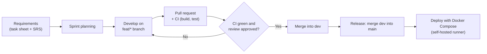

*Figure II.1 shows one iteration: requirements are planned into a sprint, implemented on a feature branch, validated by a pull request with CI, merged into `dev`, and released from `main`. A failed CI run or review sends the work back to the feature branch.*

**Figure II.2. Branching model**

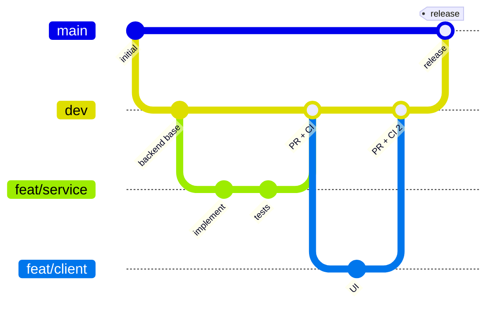

*Figure II.2 shows the branch model: feature branches are merged into `dev` after pull-request checks, and `dev` is merged into `main` for a release.*

### 3. Project Deliverables & RACI Matrix

| Deliverable Item | Backend Eng. | AI Eng. | Mobile Dev. | QA / Web |
|---|---|---|---|---|
| SRS Document (Report 3) | Responsible | Accountable | Consulted | Informed |
| System Design Document (Report 4) | Accountable | Responsible | Consulted | Informed |
| Backend microservices & Docker Compose | Accountable | Responsible | Informed | Consulted |
| AI integration and validation logic | Consulted | Accountable | Informed | Responsible |
| Automated test suites | Accountable | Responsible | Consulted | Responsible |
| Flutter mobile application | Informed | Informed | Accountable | Consulted |
| React web application (user features and admin) | Informed | Informed | Consulted | Accountable |
| Final Project Report (Report 7) | Accountable | Responsible | Responsible | Responsible |

### 4. Configuration & Source Code Management

- **Repository hosting:** GitHub.
- **CI/CD platform:** GitHub Actions (`.github/workflows/ci-cd.yml`).
- **Cloud assets:** Cloudinary stores user avatars, blog thumbnails, recipe images and uploaded videos.
- **Local tunnel:** An Ngrok container tunnels public traffic to `api-gateway:8080` so that PayOS can deliver webhooks to the local deployment. Its inspector UI is published on host port 5041.
- **Secrets:** Stored in `backend/.env` (not committed; template in `backend/.env.example`) or in the `BACKEND_ENV_FILE` repository secret for the deploy job.

---

## III. SOFTWARE REQUIREMENT SPECIFICATION (SRS)

### 1. Product Overview

VeggiePal is a REST-based, API-first microservices platform. The React web application and the Flutter mobile application reach all backend capabilities through a single Spring Cloud Gateway. Services communicate with each other through synchronous REST calls; no event broker is used.

### 2. User Requirements & Actors

Authorization has two roles (`USER`, `ADMIN`) plus unauthenticated guests. Subscription plans (FREE / PLUS / PRO) are not roles; they only define usage quotas.

| Actor | Core responsibilities and privileges |
|---|---|
| Guest | Browse public blogs, videos, recipes (including popular recipes) and the restaurant map/search; create a guest session to try the AI chatbot (3 chat requests per day per IP) |
| USER | Maintain health records and allergens; generate, edit and restore meal-plan versions; inspect remaining AI quotas; use the AI chatbot; publish recipes, blogs, comments, votes and likes; process videos; buy a subscription |
| ADMIN | Manage user accounts (search, lock/unlock status, role assignment), moderate flagged content, take down blogs/videos, manage categories and ingredients, view AI monitoring and payment statistics |
| Subscription plan (FREE / PLUS / PRO) | Defines per-user quotas for AI chat, meal plans and video processing |

**Figure III.1. VeggiePal actors and use cases**

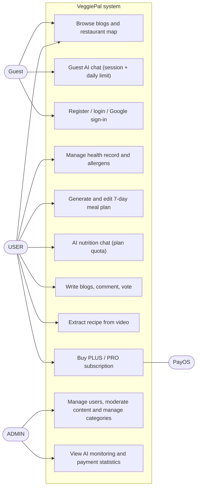

*Figure III.1 shows what each actor can do. Guests can browse and try the chatbot in a limited way and may register. USER covers the personal features. ADMIN covers moderation and operational dashboards. PayOS is the external system that confirms payments for the subscription use case.*

### 3. Functional Requirements (FR Matrix)

| Req ID | Feature | Responsible service | Description & acceptance criteria |
|---|---|---|---|
| FR-01 | Account & Auth | identity-service | Profile extras: saved favorites (`/users/me/favorites`) and green badges (`/users/me/badges`, derived from profile/email state plus unlocked badges). Registration with BCrypt-hashed passwords (cost 10); newly registered accounts start `ACTIVE` (`emailVerified = false`) and receive a 6-digit email verification OTP (`/auth/send-verification`, `/auth/verify-email`); 6-digit email OTP password recovery (`/auth/forgot-password`, `/auth/verify-otp`, `/auth/reset-password`); login and Google sign-in verify that the account is `ACTIVE` (rejecting `BLOCKED` or non-active accounts with HTTP 403 / error 1021) and issue an HS256 JWT (claims `userId`, `role`, valid 24 hours) together with an opaque refresh token (SHA-256 hashed in `refresh_tokens`, rotated via `/auth/refresh` and revoked on `/auth/logout` or password change); profile update, password change and avatar upload to Cloudinary; each account carries a status (`PENDING`, `ACTIVE`, `INACTIVE`, `BLOCKED`) and a role (`USER`, `ADMIN`). |
| FR-02 | Guest trial usage | ai-service, api-gateway | Public blog and map browsing without login. A guest creates a session with `POST /ai/chat/guest-sessions` (valid 24 hours, at most 3 sessions per IP per day) and sends the returned `guestSession` with each guest chat request. Guest chat is limited to 3 requests per day per IP; when the quota is exceeded the API returns error 6003 with HTTP 429. |
| FR-03 | Blog publishing | blog-service | Markdown blog creation with Cloudinary thumbnail, update, submit for review, and status workflow `DRAFT`, `PENDING`, `PUBLISHED`, `REJECTED`, `BANNED` (admin takedown). Category binding is required. |
| FR-04 | Comments & votes | blog-service | Community extras: leaderboard ranked by published posts and likes, author follow/unfollow (`user_follows`), trending topics from category counts, community stats, video channels (`/videos/channels`), a 7-day check-in challenge persisted in `user_challenges`, and per-video nutrition facts (`/videos/{id}/nutrition`). Multilevel comments (parent/child) with pagination on blogs and videos; one vote per user per target (`+1` / `-1` / `0`) enforced by a unique constraint on both blogs and videos; `blogs.vote_score` and `videos.vote_score` are updated with atomic SQL increments. |
| FR-05 | Recipe & restaurant search | recipe-service, location-service | Recipe browsing, keyword search, Cloudinary recipe image upload, per-serving nutrition calculation (`kcal`, `protein`, `carbs`, `fat`, `fiber` converted across weight, volume, spoon and piece units), recipe likes and popular ranking (`/recipes/popular`, `sort=popular`); ingredient catalog; restaurant keyword search (`/restaurants`, `/restaurants/search`) and nearby GPS search within a requested radius (with optional `keyword` and `veganOnly` filters), ordered by distance computed by MySQL `ST_Distance_Sphere`. |
| FR-06 | 7-day meal planner | ai-service (uses nutrition, recipe, identity) | Generates a 7-day plan with exactly breakfast, lunch and dinner each day. Inputs: the user's allergens and latest health record, a nutrition target (supplied or computed from BMR/TDEE and goal type), preferences, and optional available ingredients. Recipes containing a declared allergen are excluded before generation; recipes matching more available ingredients are ranked first; the LLM proposes the plan from real recipe IDs and the server validates and enriches it. If the LLM call fails, a deterministic planner builds the plan instead. Plans can be edited, replaced per meal, versioned, restored from any historical version (`POST /ai/meal-plans/{id}/versions/{version}/restore`) and favorited; daily food diary, water and exercise tracking and a combined "today" nutrition summary are served by nutrition-service (`/nutrition/me/food-logs`, `/water`, `/daily-activity`, `/daily-summary`); remaining monthly meal-plan and AI quotas are exposed via `GET /ai/meal-plans/quota` and `GET /ai/quotas/me`. |
| FR-07 | AI nutrition chatbot | ai-service | Conversational assistant for plant-based nutrition, with stored conversations and message history for signed-in users and a daily chat quota set by the subscription plan. |
| FR-08 | Video recipe extraction | ai-service, blog-service | Asynchronous video jobs: FFmpeg/FFprobe extract the audio track, a speech-to-text model transcribes it, and an LLM extracts ingredients, steps and nutrition highlights as structured JSON. Default limits: 100 MB and 30 minutes per video. Quota is reserved per job and refunded when a job fails. |
| FR-09 | Category management | blog-service | Two-level category tree (parent/child) of types `FOOD_TYPE` and `RECIPE_TYPE`, managed by administrators. |
| FR-10 | Content moderation | ai-service, blog-service | Content is checked through `POST /ai/moderation/check` (LLM-based, looking for profanity and animal-derived content); results are stored as moderation cases and flagged items appear in an admin review queue (`/ai/admin/moderation`). If the LLM provider or moderation service is temporarily unavailable, submissions fall back to `REVIEW_REQUIRED` (`PENDING`) for manual review instead of failing with 503. |
| FR-11 | Admin operations | identity-service, ai-service, payment-service, blog-service, recipe-service | User administration (`/admin/users`: search/filter, lock/unlock status, role assignment); AI monitoring (usage logs, token consumption, latency, model information); payment summary, statistics, revenue and order listing; moderation queue; category and ingredient management. |
| FR-12 | Payment & subscription quotas | payment-service | PayOS VietQR checkout creates an order and payment link; a signed PayOS webhook marks the order paid and activates the subscription. Plans: FREE (0 VND), PLUS (29,000 VND / 30 days), PRO (59,000 VND / 30 days). Quotas: chat per day 5 / 20 / 50, meal plans per month 2 / 8 / 20, videos per month 0 / 3 / 8. |

### 4. Non-Functional Requirements (NFR)

1. **Performance & scalability:** Services are stateless (JWT), so they can be replicated behind the gateway. List endpoints are paginated and frequent queries are covered by database indexes (for example blog status/publish date, comment target). AI response time depends on the Groq API; ai-service applies a 5-second connect timeout and a 45-second read timeout with limited retries.
2. **Security:** Passwords are hashed with BCrypt (cost 10), and OTP codes and opaque refresh tokens are stored as SHA-256 hashes. JWTs are signed with HS256 and validated by every service as an OAuth2 resource server; refresh tokens are rotated on `/auth/refresh` and revoked on `/auth/logout` or password changes. Inter-service calls that must not be public (for example subscription lookup) use an internal service token. PayOS webhooks are accepted only after signature verification. CORS is configured only at the gateway. Uploaded images are validated by content type and magic bytes. Secrets are supplied through environment variables.
3. **Availability & resilience:** Each service runs in its own container with an HTTP health check, and Docker Compose starts them in dependency order. ai-service falls back to FREE-plan quotas if the payment service cannot be reached, falls back to a deterministic planner if the LLM call fails, and queues moderated content as `REVIEW_REQUIRED` (`PENDING`) when LLM moderation is unavailable.
4. **Data integrity:** Database-per-service isolation with no cross-database foreign keys; user identifiers are stored as plain IDs. Unique constraints protect votes, recipe likes, refresh-token hashes, allergen selections, plan codes and payment order codes. Payment orders are updated under a row lock, and `vote_score` / `like_count` counters are updated with atomic SQL statements.
5. **Maintainability:** Layered code per service (controller, service, repository, DTO/mapper), consistent response envelope and error codes, OpenAPI documentation per service aggregated at the gateway.
6. **Portability:** The entire backend starts with a single Docker Compose command.

### 5. Requirement Appendix & Business Rules

- **BR-01 (Plant-based catalog):** The ingredient and recipe catalog contains plant-based content; each ingredient carries a `vegan` flag and an `allergen` flag.
- **BR-02 (Strict allergen exclusion):** A recipe is excluded from the candidate list for meal planning if it contains an ingredient matching the user's declared allergens. The generated plan is validated again on the server.
- **BR-03 (Guest limits):** A guest session lasts 24 hours; one IP can create at most 3 sessions per day and send at most 3 guest chat requests per day.
- **BR-04 (Content ownership):** Only the author or an administrator may edit or remove content.
- **BR-05 (Idempotent webhook execution):** A payment order that is already `PAID` or `CANCELLED` is not changed or credited again when a duplicate webhook arrives; the amount in the webhook must match the order amount.
- **BR-06 (Quota by plan):** Chat, meal-plan and video usage are limited by the user's active subscription; an expired or unavailable subscription is treated as FREE.

---

## IV. SOFTWARE DESIGN DESCRIPTION (SDD)

### 1. System Design & Architecture

VeggiePal uses a REST-based microservices architecture: seven business services and one API gateway. Clients call only the gateway. Services call each other synchronously through REST where needed, and no message broker is used.

| Service | Container port | Gateway routes | Responsibility |
|---|---|---|---|
| api-gateway | 8080 (host 9080) | — | Routing, CORS, aggregated Swagger UI |
| identity-service | 8081 | `/api/auth/**`, `/api/users/**`, `/api/admin/users/**` | Accounts, login, OTP password reset & email verification, refresh tokens, profile, user administration |
| nutrition-service | 8082 | `/api/nutrition/**` | Health records, BMI, allergen catalog and user allergens |
| blog-service | 8083 | `/api/blogs/**`, `/api/categories/**`, `/api/comments/**`, `/api/videos/**` | Blogs, videos, categories, comments, votes |
| recipe-service | 8084 | `/api/recipes/**`, `/api/ingredients/**` | Recipes (per-serving nutrition, image upload, likes & popular), ingredients, steps |
| location-service | 8085 | `/api/restaurants/**` | Restaurant data, keyword search and nearby search |
| ai-service | 8086 | `/api/ai/**`, `/ai/**` | Chatbot, meal plans, video extraction, moderation, quotas, monitoring |
| payment-service | 8087 | `/api/payments/**`, `/api/subscriptions/**`, `/api/admin/payments/**` | Plans, PayOS orders and webhook, subscriptions, admin payment statistics |

**Figure IV.1. REST-based microservices architecture**

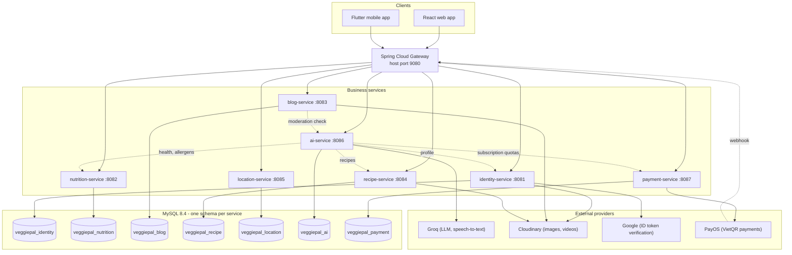

*Figure IV.1 shows that every client request enters through the gateway, which fans out to seven independent services. Each service owns exactly one MySQL schema. Dotted arrows are synchronous REST calls between services (ai-service reads nutrition, recipe, identity and payment data; blog-service asks ai-service to check content). External providers are reached directly by the service that needs them; PayOS reaches the system by sending a webhook to the gateway.*

**Figure IV.2. Docker networking and infrastructure**

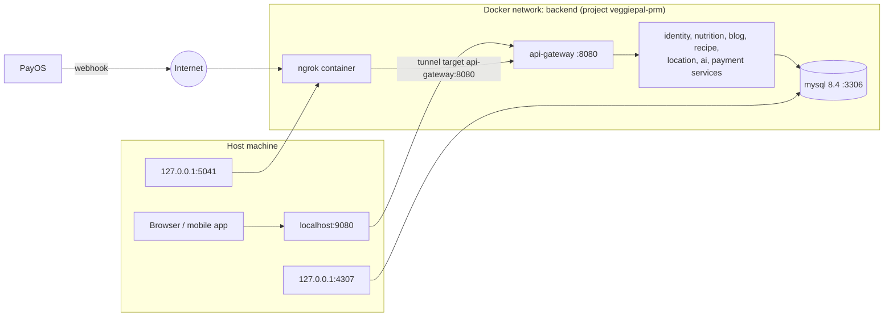

*Figure IV.2 shows the container network. Only three ports are published to the host: 9080 (gateway), 4307 (MySQL, bound to 127.0.0.1) and 5041 (Ngrok inspector, bound to 127.0.0.1). All other services are reachable only inside the Docker network. The Ngrok container forwards public traffic, such as the PayOS webhook, to `api-gateway:8080`.*

### 2. Database Design (Database-per-Service)

Each microservice owns its private schema on MySQL 8.4. The AI schema is created by Flyway migrations V1–V7 and validated by Hibernate (`ddl-auto=validate`); the other services let Hibernate update the schema (`ddl-auto=update`) and seed reference data with `data.sql`.

| Schema | Tables |
|---|---|
| `veggiepal_identity` | `users`, `user_otps`, `refresh_tokens`, `user_favorites`, `user_badges` |
| `veggiepal_nutrition` | `allergens`, `user_allergies`, `health_records`, `food_logs`, `daily_wellness_logs` |
| `veggiepal_blog` | `categories`, `blogs`, `videos`, `comments`, `content_votes`, `user_follows`, `user_challenges` |
| `veggiepal_recipe` | `recipes`, `ingredients`, `recipe_ingredients`, `recipe_steps`, `recipe_likes` |
| `veggiepal_location` | `vegetarian_restaurants` |
| `veggiepal_ai` | `ai_meal_plans`, `ai_meal_plan_versions`, `ai_meal_plan_favorites`, `ai_conversations`, `ai_chat_messages`, `ai_guest_sessions`, `ai_daily_quotas`, `ai_usage_logs`, `ai_moderation_cases`, `ai_video_jobs` |
| `veggiepal_payment` | `subscription_plans`, `user_subscriptions`, `payment_orders` |

**Figure IV.3. Database-per-service overview and logical references**

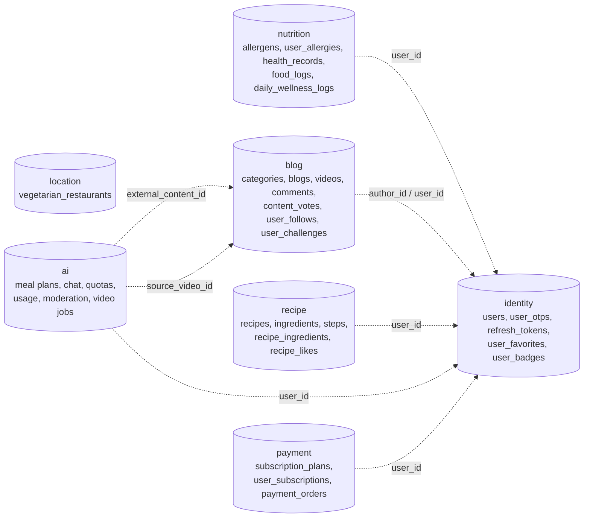

*Figure IV.3 shows the seven independent schemas. Dotted lines are logical references stored as plain numeric IDs (mostly the user ID from the JWT); they are not database foreign keys, which keeps every service independently deployable. Real foreign keys exist only inside a schema and are shown in Figures IV.3a–IV.3e.*

**Figure IV.3a. ERD of identity and nutrition schemas**

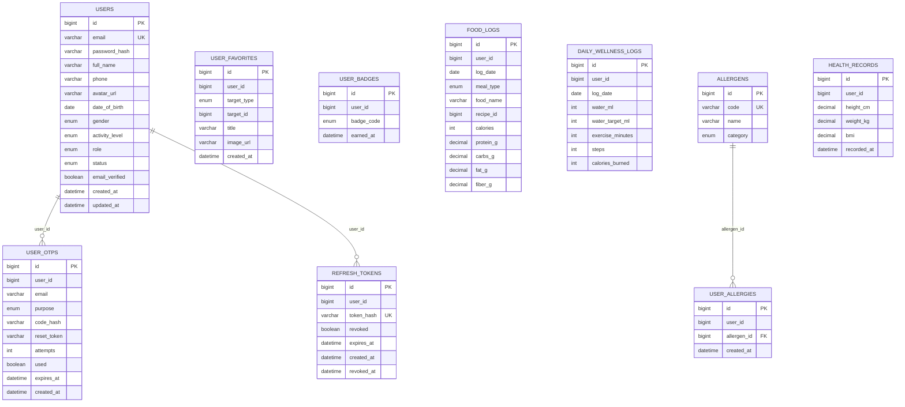

*Figure IV.3a: `users`, `user_otps` (hashed 6-digit OTPs for password reset and email verification) and `refresh_tokens` (SHA-256-hashed opaque refresh tokens for rotation and revocation) belong to identity-service. In nutrition-service, a user's allergen choices are rows in `user_allergies` pointing to the seeded `allergens` catalog; health records form a history of height, weight and BMI per user. `user_favorites` and `user_badges` hold profile collections and unlocked badges; nutrition-service also keeps the food diary (`food_logs`) and daily water/exercise tracking (`daily_wellness_logs`). `user_id` across these tables refers to `users.id` logically rather than through cross-table foreign keys.*

**Figure IV.3b. ERD of the blog schema**

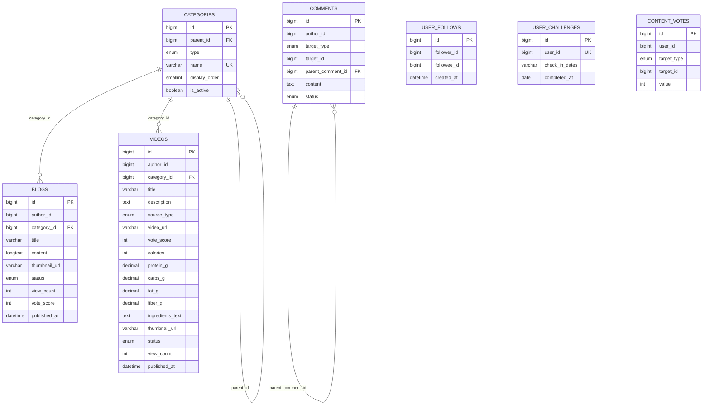

*Figure IV.3b: Categories form a two-level tree and every blog or video belongs to one category. Both `blogs` and `videos` carry a denormalized `vote_score` updated atomically; `videos` also stores optional nutrition facts and an ingredients list, and `user_follows` / `user_challenges` back author follows and the 7-day challenge. Comments and votes are polymorphic: `target_type` (BLOG or VIDEO) and `target_id` identify the content, so no foreign key is declared; comments reference their parent comment for nested replies. A unique constraint on votes allows one vote per user per target.*

**Figure IV.3c. ERD of the recipe and location schemas**

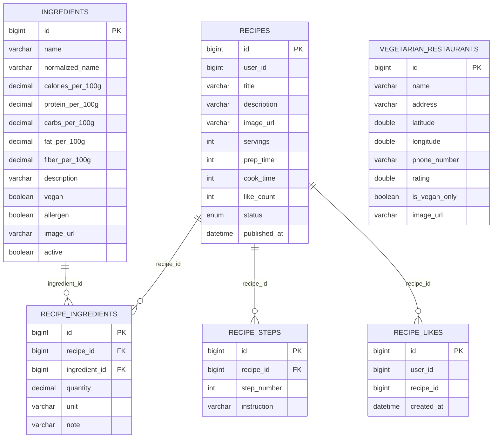

*Figure IV.3c: `recipe_ingredients` is the associative table that gives each recipe its ingredients with quantity and unit (used together with `ingredients.*_per_100g` to compute per-serving nutrition), `recipe_steps` stores ordered cooking steps, and `recipe_likes` records per-user likes (unique on `user_id, recipe_id`) paired with the denormalized `recipes.like_count`. `vegetarian_restaurants` is a standalone table in location-service; its name, address, vegan flag and coordinates feed keyword search and `ST_Distance_Sphere` nearby search.*

**Figure IV.3d. ERD of the AI schema**

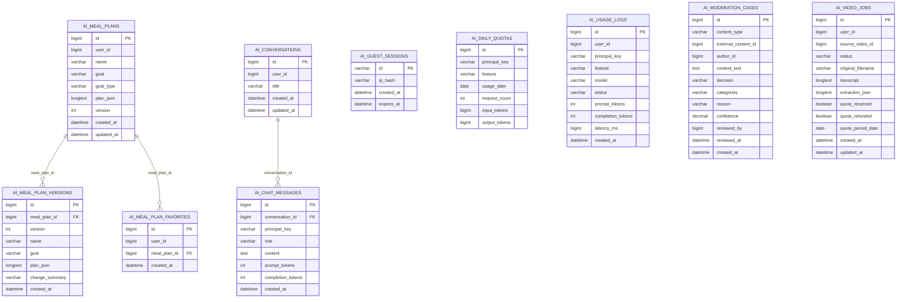

*Figure IV.3d: A meal plan keeps its current JSON and a history of versions, and users can favorite plans (one favorite per user and plan). Conversations own their chat messages. `ai_guest_sessions` stores only a hash of the guest's IP address. `ai_daily_quotas` is unique per (principal, feature, date) and enforces usage limits; `ai_usage_logs` records every AI call with its token counts and latency for admin monitoring. Moderation cases and video jobs reference content by ID only.*

**Figure IV.3e. ERD of the payment schema**

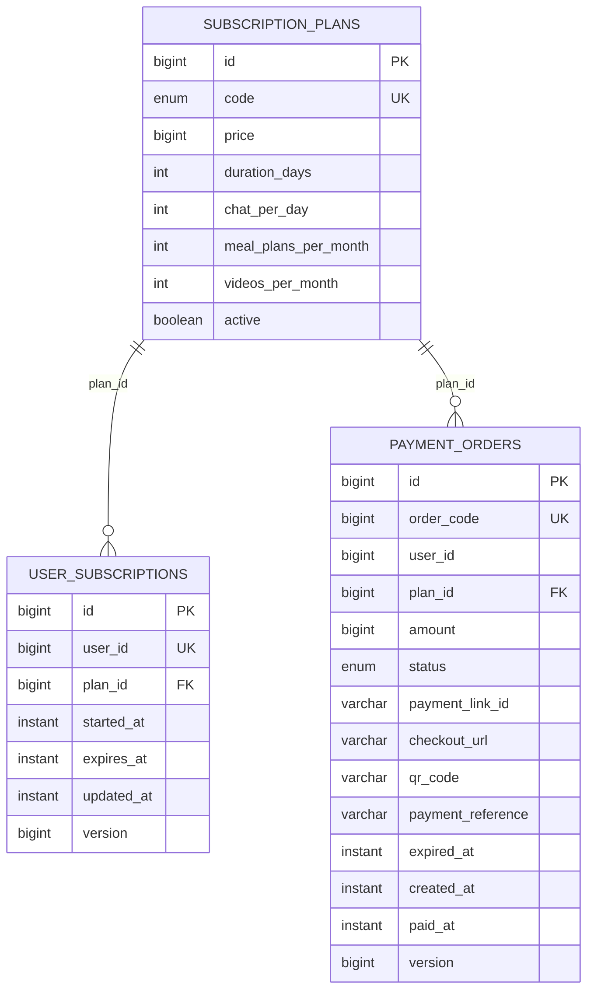

*Figure IV.3e: The plan catalog (FREE, PLUS, PRO) holds price, duration and quotas. Each user has at most one current subscription row, and every checkout creates a payment order tied to a plan. The `version` columns provide optimistic locking.*

### 3. Detailed Design & Sequence Specifications

#### 3.1. Authentication & Token Verification Flow

**Figure IV.4. Login and JWT issuance sequence**

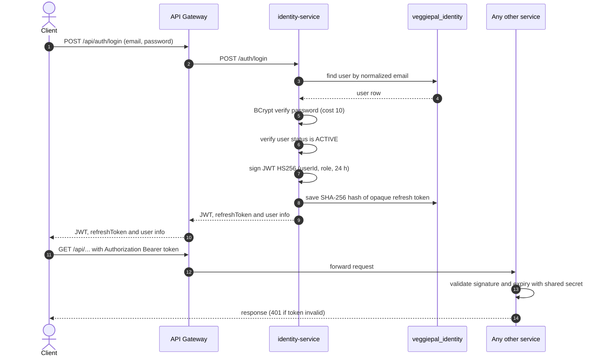

*Figure IV.4 shows the login sequence. Identity-service verifies the password hash and confirms that the account status is `ACTIVE` (rejecting locked or inactive accounts with HTTP 403), then signs a 24-hour HS256 JWT carrying `userId` and `role` and issues an opaque refresh token stored as a SHA-256 hash in `refresh_tokens` (rotatable via `POST /api/auth/refresh` and revocable via `POST /api/auth/logout`). Every later request carries the JWT as a Bearer header; each service validates the signature locally with the shared secret, so no service has to call identity-service for authentication. Google sign-in follows the same pattern, except identity-service verifies a Google ID token (including `email_verified`) instead of a password before checking status and issuing its own JWT and refresh token.*

#### 3.2. AI 7-Day Allergen-Safe Meal Plan Generation Flow

1. The client sends `POST /api/ai/meal-plans` with a Bearer token (public gateway path; the service route is `/ai/meal-plans`).
2. ai-service calls recipe-service for the recipe list and calls nutrition-service with the user's token to read the user's allergens and latest health record.
3. If the request has no daily nutrition target, ai-service computes one from the user's profile and health record (BMR/TDEE adjusted by the goal type: weight loss, muscle gain or maintenance) and validates it.
4. ai-service reserves one meal-plan unit from the user's monthly quota (plan limits are read from payment-service; an unavailable lookup is treated as the FREE plan).
5. The validator removes every recipe that contains a declared allergen and ranks the remaining recipes so that those matching more of the user's available ingredients come first.
6. ai-service asks the Groq LLM (default model `openai/gpt-oss-20b`) to build a plan from these real recipe IDs. If the call fails, a deterministic planner is used instead.
7. The validator checks and enriches the plan: exactly seven days with breakfast, lunch and dinner, only allowed recipe IDs, allergen safety, and calories scaled toward the daily meal budgets.
8. The plan is stored in `ai_meal_plans` and returned to the client; later edits create new versions.

**Figure IV.5. Meal plan generation sequence**

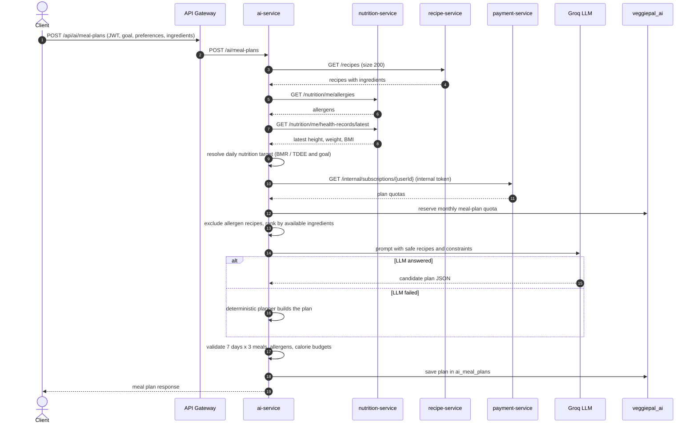

*Figure IV.5 shows how the plan is produced. ai-service gathers data from three services, reserves quota, filters unsafe recipes before the LLM sees them, lets the LLM choose among real recipes only, and validates the result again on the server. When the LLM is unavailable the deterministic planner still produces a valid plan.*

#### 3.3. PayOS Asynchronous Webhook Payment Processing Flow

**Figure IV.6. PayOS webhook processing**

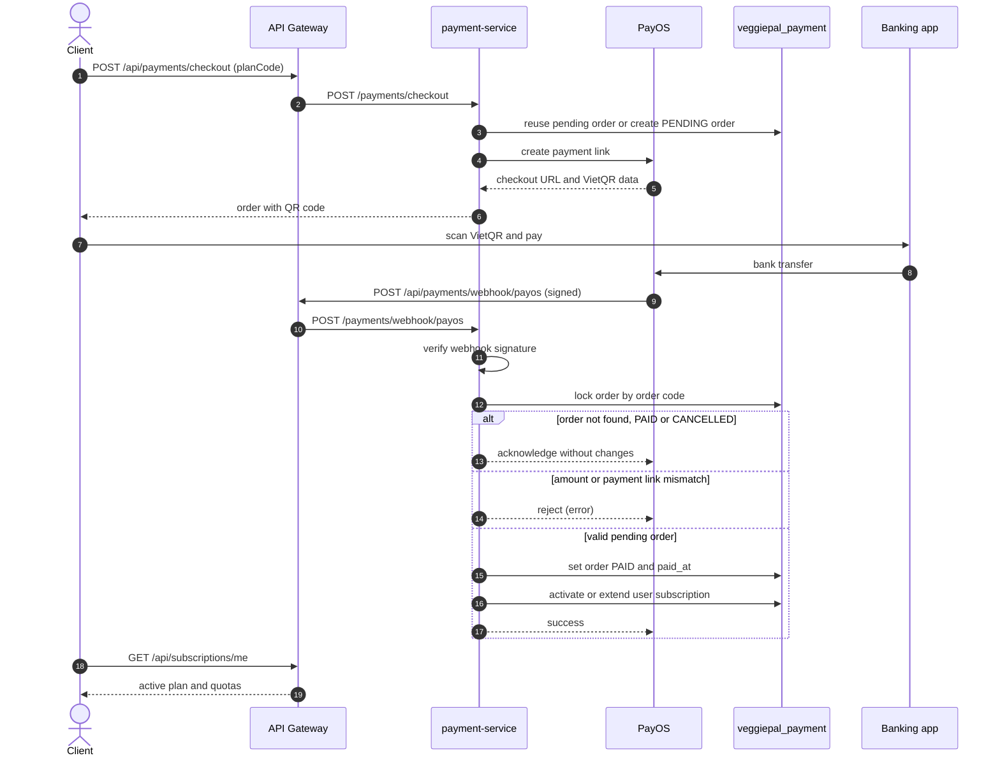

*Figure IV.6 shows the payment flow. A checkout creates a pending order and a VietQR code. After the bank transfer, PayOS calls the webhook through the Ngrok tunnel. payment-service verifies the signature, locks the order row, rejects mismatching amounts, and ignores orders that are already paid or cancelled, so a duplicate webhook cannot grant a subscription twice.*

### 4. API Design

All clients use the gateway at `http://localhost:9080`; the aggregated Swagger UI is at `http://localhost:9080/swagger-ui.html`. Services answer with a common envelope (`code`, `message`, `result`) and use enum-based error codes grouped per service. Protected endpoints require `Authorization: Bearer <JWT>`.

| Group | Examples (gateway path) | Access |
|---|---|---|
| Identity | `/api/auth/register`, `/api/auth/login`, `/api/auth/google`, `/api/auth/forgot-password`, `/api/auth/verify-otp`, `/api/auth/reset-password`, `/api/auth/send-verification`, `/api/auth/verify-email`, `/api/auth/refresh`, `/api/auth/logout`, `/api/users/me` (profile, password, avatar), `/api/users/me/favorites`, `/api/users/me/badges`, `/api/users/batch`, `/api/admin/users/**` | Public for auth/OTP/refresh/batch; JWT for `/api/users/me`; ADMIN for `/api/admin/users/**` |
| Nutrition | `/api/nutrition/me/allergies`, `/api/nutrition/me/health-records/**`, `/api/nutrition/me/food-logs`, `/api/nutrition/me/daily-activity`, `/api/nutrition/me/water`, `/api/nutrition/me/daily-summary`, allergen catalog | JWT |
| Blog and community | `/api/blogs/**` (including `/community/leaderboard`, `/community/trending-topics`, `/community/stats`, `/authors/{id}/follow`, `/me/following`, `/challenge/me`, `/challenge/check-in`), `/api/categories/**`, `/api/comments/**`, `/api/videos/**` (including `/channels`, `/{id}/nutrition`, `/{id}/vote`, `/me/votes`) | Public reads of published content, community stats and video channels; JWT to write/vote/follow/check in; ADMIN for categories and takedowns |
| Recipes | `/api/recipes/**` (`/popular`, `/{id}/image`, `/images`, `/{id}/like`, `/me/likes`), `/api/ingredients/**` | Public reads of recipe list/popular/detail and ingredients; JWT for recipe authoring, image upload and likes; ADMIN for ingredient changes |
| Restaurants | `/api/restaurants`, `/api/restaurants/search`, `/api/restaurants/nearby` (`keyword`, `veganOnly`, `lat`, `lng`, `radiusKm`) | Public |
| AI chat | `/api/ai/chat/guest-sessions`, guest chat, member chat, conversations | Guest session or JWT |
| AI meal plans & quotas | `POST /api/ai/meal-plans`, `GET /api/ai/meal-plans`, `/quota`, `GET /api/ai/quotas/me`, `/nutrition-target`, `/favorites`, `/{id}/versions`, `/{id}/versions/{version}/restore`, `/{id}/preview-edit`, `/{id}/edit`, `/{id}/replace` | JWT |
| AI video | `POST /api/ai/videos/process` (multipart), job status endpoints | JWT |
| AI moderation and monitoring | `/api/ai/moderation/check`, `/ai/admin/moderation`, `/ai/admin/monitoring/**` | Service call / ADMIN |
| Payments | `GET /api/payments/plans`, `POST /api/payments/checkout`, `/api/payments/orders/{id}`, `/history`, `GET /api/subscriptions/me`, `POST /api/payments/webhook/payos`, `/api/admin/payments/**` | JWT; ADMIN for `/api/admin/payments/**`; webhook is public but signature-verified |
| Internal | `/internal/subscriptions/{userId}` (not routed through the gateway) | Internal service token |

Request and response schemas, status codes and examples for every endpoint are published in Swagger UI, generated from the OpenAPI definitions of each service.

---

## V. SOFTWARE TESTING DOCUMENTATION

### 1. Scope & Test Strategy

- **Unit tests:** business logic such as BMI calculation (nutrition-service), BMR/TDEE target calculation (ai-service `NutritionTargetCalculator`), allergen detection and meal-plan validation, and quota handling.
- **Controller slice tests:** `@WebMvcTest` with MockMvc and Spring Security Test to check routing, validation, authentication (JWT) and authorization per endpoint.
- **Integration tests:** repository and service tests against a database; several services have a `contextLoads`/integration test that needs a real MySQL.
- **CI automation:** GitHub Actions runs `mvn test` for every backend service on each push and pull request to `dev` or `main`.

### 2. Test Environment & Supporting Tools

- **Frameworks:** JUnit 5, Mockito, Spring Security Test, AssertJ.
- **Execution engine:** Maven Surefire on OpenJDK 21 (Temurin in CI).
- **Databases in tests:** ai-service, payment-service and recipe-service tests run on in-memory H2 in MySQL mode. identity-service, nutrition-service, blog-service and location-service use a MySQL 8.4 instance; in CI it is a service container on port 3307. Testcontainers is not used.
- **CI runners:** GitHub-hosted `ubuntu-latest` for build, test, Docker build and compose validation; a self-hosted Windows x64 runner for deployment.

### 3. Test Inventory

The repository contains 106 test classes with 712 test methods (counted from `@Test`, `@ParameterizedTest` and `@RepeatedTest` annotations in source).

| No. | Service | Test methods | Primary test focus |
|---|---|---|---|
| 1 | blog-service | 259 | Blogs, videos, comments, votes, categories, moderation fallback, security |
| 2 | ai-service | 212 | Meal planning, version restore, validation, quota endpoints, chat, video jobs, moderation |
| 3 | identity-service | 102 | Registration, login, OTP password reset & email verification, refresh tokens, admin users, profile |
| 4 | nutrition-service | 47 | Health records, BMI, allergen mapping |
| 5 | recipe-service | 38 | Recipe CRUD, per-serving nutrition, image upload, likes & popular, ingredient data and units |
| 6 | payment-service | 26 | PayOS signature, webhook handling, subscriptions |
| 7 | location-service | 19 | Restaurant keyword search, vegan filter and nearby distance search |
| 8 | api-gateway | 9 | Routing rules (including admin routes) and Swagger aggregation |
| | **Total** | **712** | |

The result of each test run is recorded by the "Run tests" step of the `maven` job in GitHub Actions (see Figure VI.5).

### 4. Quality Controls Built Into the Design

| Risk | Control in the implementation |
|---|---|
| Concurrent votes corrupting the vote score | Unique constraint per (user, target) and an atomic SQL update of `vote_score` |
| Duplicate payment webhooks granting a subscription twice | Row lock on the order, early return for `PAID` / `CANCELLED` orders, amount and payment-link checks, optimistic `version` columns |
| Allergen exposure in AI meal plans | Allergen recipes removed before the LLM call, and the generated plan is validated again on the server |
| LLM outage or malformed output | Deterministic planner fallback and structural validation of every plan |
| Guest abuse of the free chatbot | Hashed-IP guest sessions, session TTL, per-IP session cap and a daily chat quota |
| Quota lost when a video job fails | Quota reservation flags on the job and automatic refund |
| Unsafe image uploads | Content-type and magic-byte validation before uploading to Cloudinary |

---

## VI. RELEASE PACKAGE & USER GUIDES

### 1. Deliverable Package

| Deliverable | Path in repository | Description |
|---|---|---|
| Backend source code | `/backend` | 7 Spring Boot business services + 1 API gateway, each with its own Dockerfile |
| Web frontend | `/frontend` | React 19, Vite, Tailwind CSS web application |
| Mobile application | `/mobile` | Flutter cross-platform client application |
| Database provisioning | `/backend/docker-compose.yml` | Starts an empty MySQL 8.4; Flyway (ai-service) and Hibernate create the schemas and `data.sql` seeds reference data |
| CI/CD pipeline | `/.github/workflows/ci-cd.yml` | Backend Maven matrix, Docker build, Compose validation, deployment to a self-hosted runner |
| API documentation | `http://localhost:9080/swagger-ui.html` | Aggregated OpenAPI / Swagger specification |

### 2. System Requirements & Installation Instructions

#### 2.1. System Requirements

- **Operating system:** Windows 10/11 64-bit, macOS, or Ubuntu 22.04 LTS.
- **Hardware:** at least 8 GB RAM, 4-core CPU and 20 GB free disk space. No local AI model is hosted; AI features need internet access and a `GROQ_API_KEY`.
- **Software:** Docker Desktop (Docker Compose v2+), Git, OpenJDK 21 (only for running services outside Docker), Node.js (web frontend), and a Flutter SDK compatible with the Dart constraint `^3.13.2` in `mobile/pubspec.yaml`.

#### 2.2. Installation Instructions

1. Clone the repository:

   ```bash
   git clone https://github.com/Phu0312/VeggiePal-Microservice.git
   cd VeggiePal-Microservice
   ```

2. Create the environment file and fill it in:

   ```bash
   cp backend/.env.example backend/.env
   ```

   Required for the stack to start: `DB_PASSWORD`, `JWT_SECRET`, `NGROK_AUTHTOKEN`. Needed for the related features: `INTERNAL_SERVICE_TOKEN`, `GROQ_API_KEY` (AI), `CLOUDINARY_*` (images and videos), `GOOGLE_CLIENT_ID` (Google sign-in), `MAIL_*` (SMTP delivery for OTP emails; falls back to application logs when `MAIL_HOST` is omitted in local development) and the `PAYOS_*` credentials (payments).

3. Start the whole backend with Docker Compose:

   ```bash
   cd backend
   docker compose --project-name veggiepal-prm up -d --build --wait
   ```

4. Open the system endpoints:

   | Endpoint | Address |
   |---|---|
   | API gateway and Swagger UI | http://localhost:9080/swagger-ui.html |
   | MySQL | 127.0.0.1:4307 |
   | Ngrok inspector | http://localhost:5041 |

5. Register the PayOS webhook as `https://<ngrok-domain>/api/payments/webhook/payos`.

6. Run the clients: `cd frontend && npm install && npm run dev` for the web app, and `cd mobile && flutter pub get && flutter run` for the mobile app.

### 3. User Manual & Core Workflows

#### 3.1. Workflow 1: Registration, Login & Allergen Setup

1. Open the VeggiePal application.
2. Register with email and password, or sign in with Google.
3. Open Profile > Health Profile and enter height (cm) and weight (kg).
4. Select all personal allergens (for example soybeans, peanuts, wheat gluten, mushrooms).

**Figure VI.1. Registration and health profile workflow**

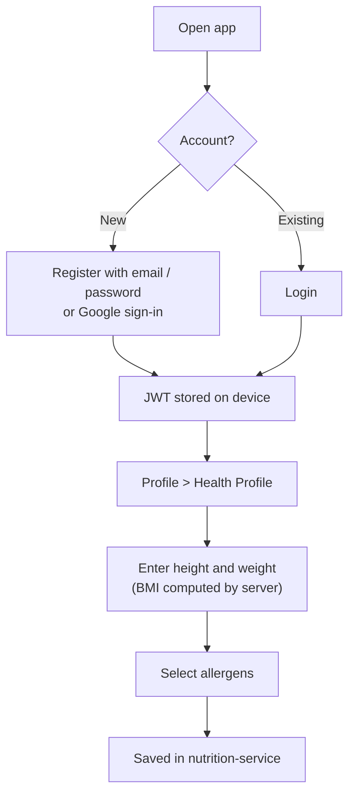

*Figure VI.1 shows the first-use workflow: authenticate, store the token, then enter body measurements and allergens, which later drive meal planning.*

#### 3.2. Workflow 2: Generating a 7-Day Personalized Meal Plan

1. Navigate to Menu Planner > Generate Plan.
2. Select a goal (weight loss, muscle gain or maintenance) and optionally list preferences and ingredients you have on hand.
3. The system computes the nutrition target, excludes recipes containing your allergens, and shows a plan with breakfast, lunch and dinner for seven days.
4. Open any recipe to see its ingredient quantities, per-serving nutrition and cooking steps. Plans can be edited, a single meal can be replaced, historical versions can be restored, and plans can be favorited.

**Figure VI.2. Meal plan workflow**

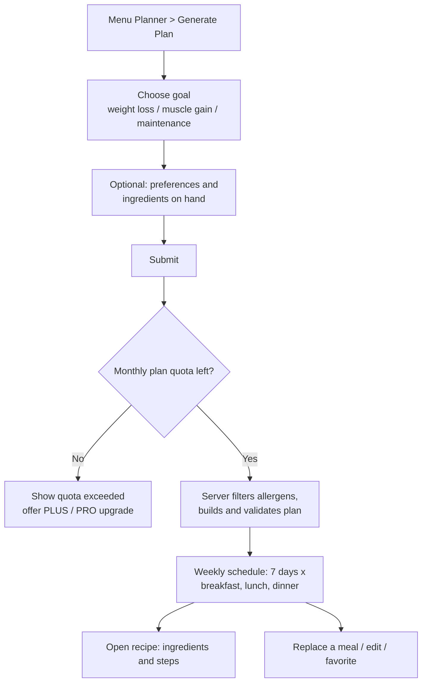

*Figure VI.2 shows the planner workflow, including the quota check that can send the user to the subscription screen.*

#### 3.3. Workflow 3: Finding Nearby Vegan Restaurants via GPS

1. Open the Places / Map tab and allow location access.
2. The app asks location-service for restaurants matching an optional keyword or vegan-only filter, or within the chosen radius around the user's coordinates.
3. Results are ordered by distance, which is computed by MySQL `ST_Distance_Sphere`, together with their rating and a vegan-only flag.

**Figure VI.3. Nearby restaurant discovery workflow**

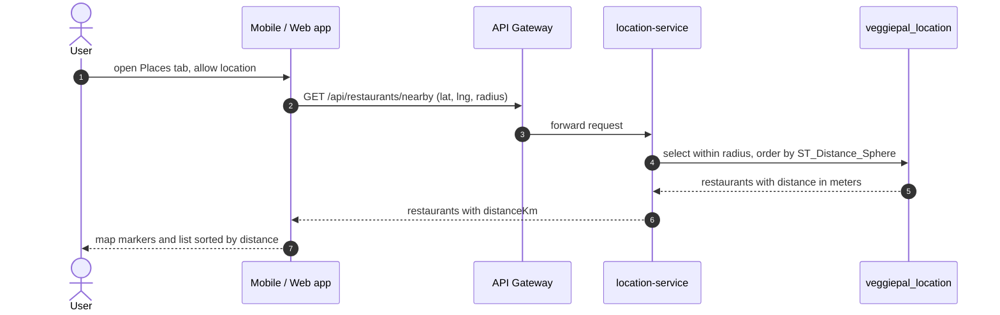

*Figure VI.3 shows that the client sends its coordinates and radius, the database computes the spherical distance, and the app renders the results sorted by proximity.*

#### 3.4. Workflow 4: Upgrading to a PLUS or PRO Subscription via VietQR PayOS

1. Navigate to Profile > Subscription.
2. Select PLUS or PRO and choose to pay with PayOS.
3. Scan the dynamic VietQR code with any Vietnamese banking app.
4. After PayOS confirms the payment through the webhook, the subscription is activated for 30 days.

| Plan | Price | Chat per day | Meal plans per month | Videos per month |
|---|---|---|---|---|
| FREE | 0 VND | 5 | 2 | 0 |
| PLUS | 29,000 VND / 30 days | 20 | 8 | 3 |
| PRO | 59,000 VND / 30 days | 50 | 20 | 8 |

**Figure VI.4. PayOS subscription workflow**

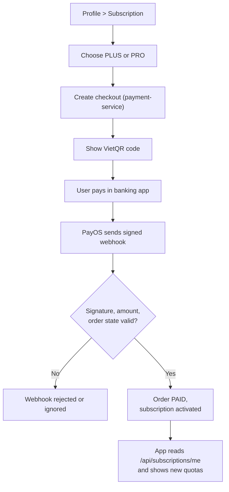

*Figure VI.4 shows the paying workflow from plan selection to activation. The subscription changes only after the signed webhook has been verified.*

### 4. CI/CD Deployment Process

The workflow `.github/workflows/ci-cd.yml` is named "VeggiePal CI/CD" and runs on every push and pull request to `dev` and `main`.

| Job | Runs on | What it does |
|---|---|---|
| `maven` | ubuntu-latest, matrix of 8 modules (api-gateway, identity, nutrition, blog, recipe, location, ai, payment) | Starts a MySQL 8.4 service container, sets up Java 21 with Maven cache, restores dependencies, runs `mvn test`, builds the Spring Boot package |
| `docker` | ubuntu-latest, same matrix, after `maven` | Builds the Docker image of each module from its Dockerfile |
| `compose-check` | ubuntu-latest, after `maven` | Validates the resolved Docker Compose configuration |
| `deploy` | self-hosted Windows x64 runner, only on push to `dev` or `main`, after `docker` and `compose-check` | Writes `.env` from the `BACKEND_ENV_FILE` secret, runs `docker compose up -d --build --wait`, then checks that every container is running and healthy; prints logs and fails otherwise |

**Figure VI.5. CI/CD pipeline**

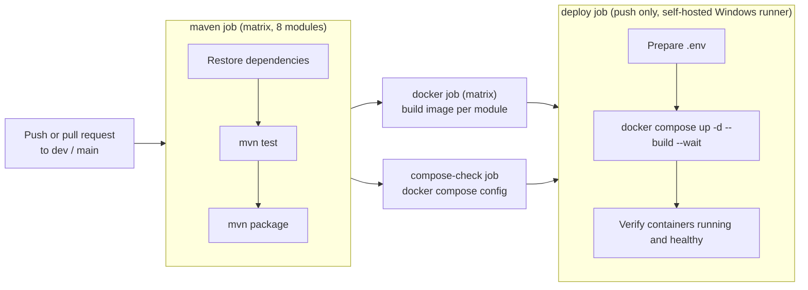

*Figure VI.5 shows the pipeline stages. Test and package run in parallel for every backend module; Docker image builds and Compose validation run next; deployment to the local runner runs only for pushes to `dev` or `main`. The pipeline currently covers the backend only; the web and mobile clients are built and run manually.*

---

## VII. APPENDIX

### 1. References

1. Dietary Guidelines for Americans, U.S. Department of Agriculture (USDA) - guidance on vegetarian eating patterns.
2. Spring Cloud Gateway Reference Documentation, VMware Tanzu.
3. Flutter documentation, Google Developers.
4. MySQL 8.4 Reference Manual - spatial function `ST_Distance_Sphere`.
5. RFC 7519 - JSON Web Token (JWT), Internet Engineering Task Force (IETF).
6. PayOS developer documentation - payment link creation and webhook verification.
7. Groq API documentation - chat completions and speech-to-text.

### 2. Project Metrics Summary

| Metric | Value |
|---|---|
| Backend modules | 8 (7 business services + 1 API gateway) |
| Database schemas | 7 isolated MySQL schemas |
| Database tables | 36 |
| Test classes / test methods | 106 / 712 |
| Subscription plans | 3 (FREE, PLUS, PRO) |
| CI jobs | `maven` and `docker` (matrix of 8 modules each), `compose-check`, `deploy` |
| Published host ports | 9080 (gateway), 4307 (MySQL), 5041 (Ngrok inspector) |
| Client applications | React web app, Flutter mobile app |

### 3. Results Achieved & Future Development

#### 3.1. Results Achieved

- A complete microservices backend (7 services and a gateway) that starts with one Docker Compose command and exposes aggregated Swagger documentation.
- Secure authentication with BCrypt, HS256 JWT validation in every service, opaque refresh-token rotation and revocation, 6-digit email OTP password recovery and email verification, and Google sign-in.
- Allergen-aware AI meal planning with server-side validation and a fallback planner; AI chatbot, video recipe extraction and moderation backed by Groq.
- A community module with nested comments, voting and administrator moderation.
- A domestic payment flow with PayOS VietQR, signed and idempotent webhook processing, and plan-based quotas.
- An automated GitHub Actions pipeline that tests, packages, builds images, validates Compose and deploys to a local runner.

#### 3.2. Future Development

- **Quality:** archive Surefire reports from CI, add JaCoCo to measure code coverage (target at least 60%), and add reproducible load tests for the gateway and the AI endpoints.
- **CI/CD:** add build and lint steps for the React and Flutter projects, and publish test reports as workflow artifacts.
- **Resilience and observability:** add retry and circuit-breaker policies and monitoring for the external Groq, Cloudinary, Google and PayOS dependencies.
- **Scalability:** introduce asynchronous messaging only if measured throughput requires it, for example for video processing and moderation.
- **Product:** richer nutrition analysis (micronutrient tracking), more recipe and restaurant data, and push notifications.
