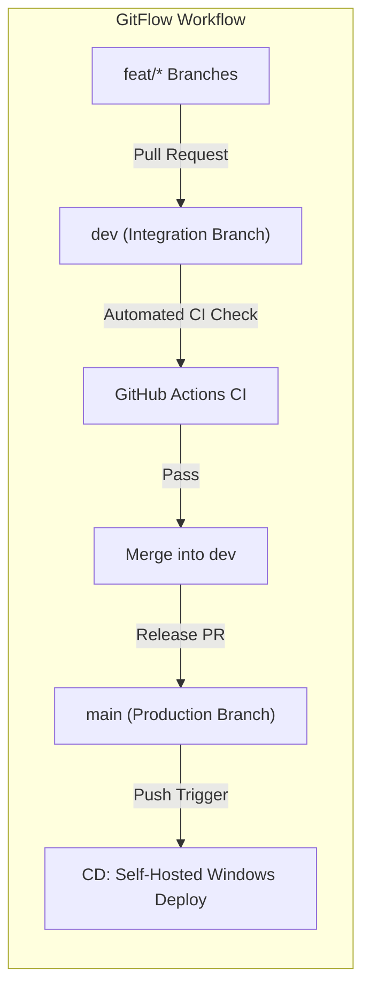
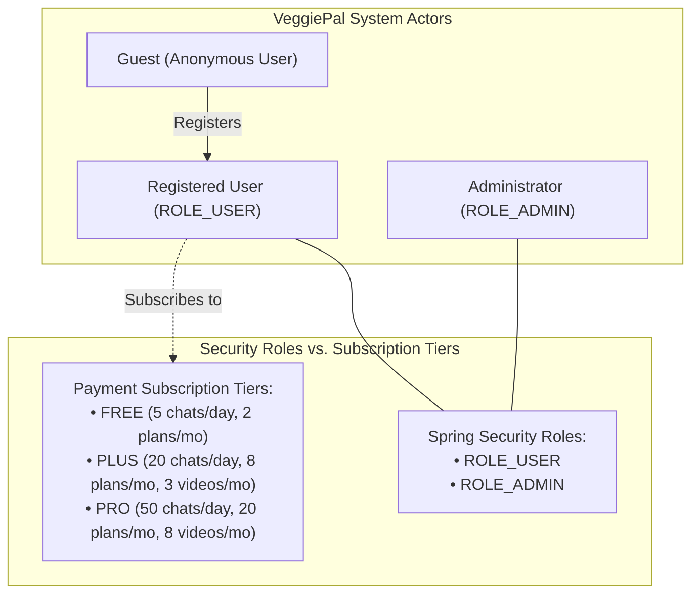
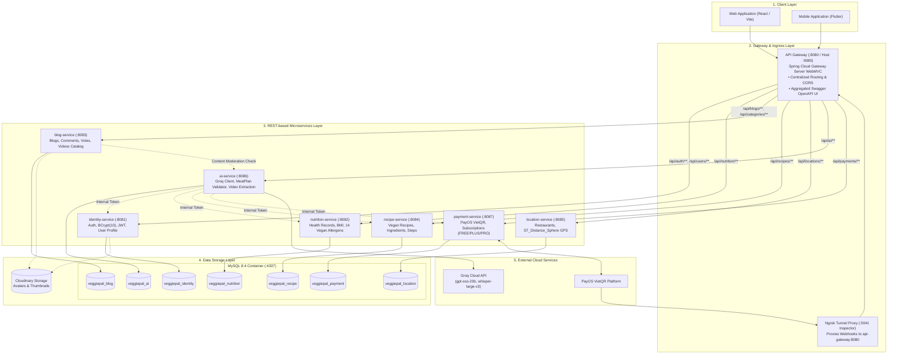
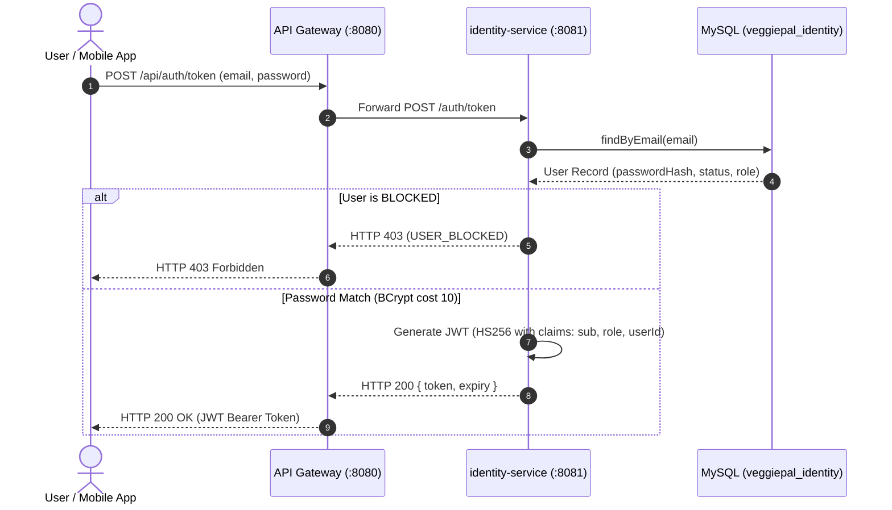
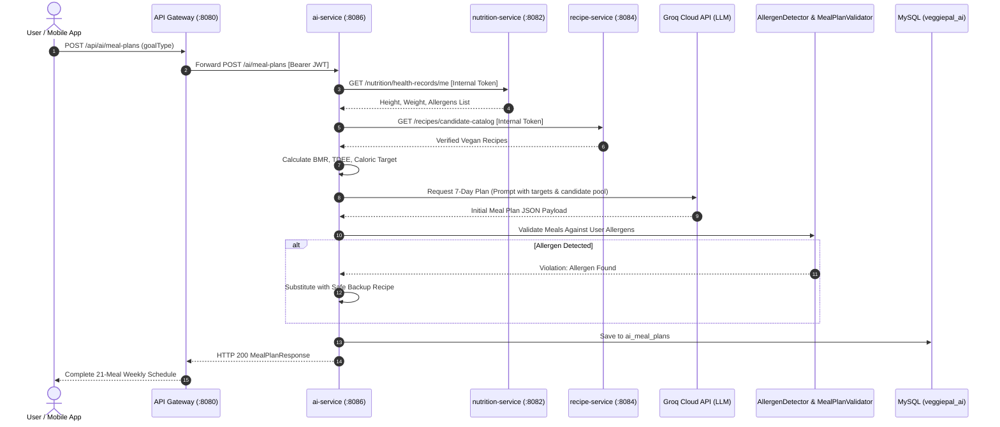
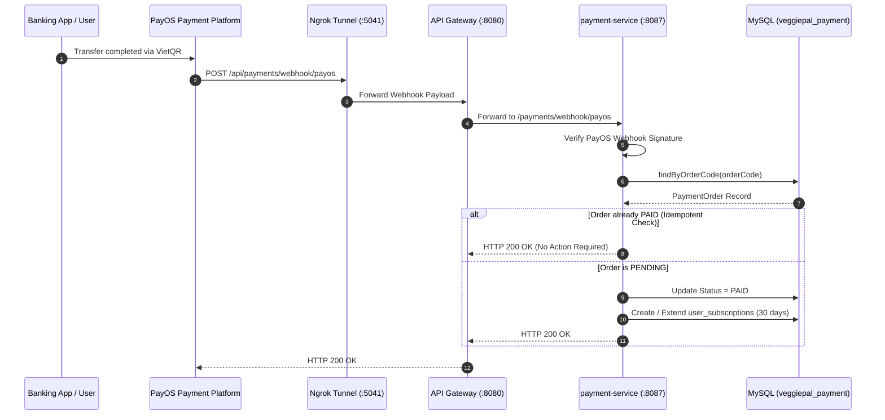

# CAPSTONE PROJECT DOCUMENT
## REPORT 7: FINAL PROJECT REPORT

**MINISTRY OF EDUCATION AND TRAINING**  
**FPT UNIVERSITY**  

---

### PROJECT COVER

| Information Field | Project Detail |
| :--- | :--- |
| **Project Name** | **VeggiePal - Digital Ecosystem Supporting 100% Vegan Lifestyle** |
| **Group Name** | **VeggiePal Team** |
| **Group Members** | • **Trương Hoàng Phú** - RollNo: *(RollNo)* - Student Code: *(StudentCode)*<br>• **Phạm Gia Huy** - RollNo: *(RollNo)* - Student Code: *(StudentCode)*<br>• *(Member 3)* - RollNo: *(RollNo)* - Student Code: *(StudentCode)*<br>• *(Member 4)* - RollNo: *(RollNo)* - Student Code: *(StudentCode)* |
| **Supervisor** | Academic Board & Course Instructor |
| **Ext Supervisor** | *(External Supervisor)* |
| **Capstone Project Code** | **PRM393_VeggiePal** |
| **Location & Date** | Hanoi, 10/2026 |

---

### TABLE OF CONTENTS

- [Acknowledgement](#acknowledgement)
- [Definition and Acronyms](#definition-and-acronyms)
- [I. Project Introduction](#i-project-introduction)
  - [1. Overview](#1-overview)
    - [1.1 Project Information](#11-project-information)
    - [1.2 Project Team](#12-project-team)
  - [2. Product Background](#2-product-background)
  - [3. Existing Systems](#3-existing-systems)
    - [3.1 HappyCow](#31-happycow)
    - [3.2 MyFitnessPal](#32-myfitnesspal)
  - [4. Business Opportunity](#4-business-opportunity)
  - [5. Software Product Vision](#5-software-product-vision)
  - [6. Project Scope & Limitations](#6-project-scope--limitations)
    - [6.1 Major Features](#61-major-features)
    - [6.2 Limitations & Exclusions](#62-limitations--exclusions)
- [II. Project Management Plan](#ii-project-management-plan)
  - [1. Overview](#1-overview-1)
    - [1.1 Scope & Estimation](#11-scope--estimation)
    - [1.2 Project Objectives](#12-project-objectives)
    - [1.3 Project Risks](#13-project-risks)
  - [2. Management Approach](#2-management-approach)
    - [2.1 Project Process](#21-project-process)
    - [2.2 Quality Management](#22-quality-management)
    - [2.3 Training Plan](#23-training-plan)
  - [3. Project Deliverables](#3-project-deliverables)
  - [4. Responsibility Assignments](#4-responsibility-assignments)
  - [5. Project Communications](#5-project-communications)
  - [6. Configuration Management](#6-configuration-management)
    - [6.1 Document Management](#61-document-management)
    - [6.2 Source Code Management](#62-source-code-management)
    - [6.3 Tools & Infrastructures](#63-tools--infrastructures)
- [III. Software Requirement Specification](#iii-software-requirement-specification)
  - [1. Product Overview](#1-product-overview)
  - [2. User Requirements](#2-user-requirements)
    - [2.1 Actors](#21-actors)
    - [2.2 Use Cases](#22-use-cases)
  - [3. Functional Requirements](#3-functional-requirements)
    - [3.1 System Functional Overview](#31-system-functional-overview)
    - [3.2 Feature 1: Authentication & User Management](#32-feature-1-authentication--user-management)
    - [3.3 Feature 2: Health Profiles & Allergen Management](#33-feature-2-health-profiles--allergen-management)
    - [3.4 Feature 3: Community Blog & Social Interaction](#34-feature-3-community-blog--social-interaction)
    - [3.5 Feature 4: Recipe Catalog & Dining Discovery](#35-feature-4-recipe-catalog--dining-discovery)
    - [3.6 Feature 5: AI Meal Planning & Nutrition Chatbot](#36-feature-5-ai-meal-planning--nutrition-chatbot)
    - [3.7 Feature 6: Video Cooking Summarization](#37-feature-6-video-cooking-summarization)
    - [3.8 Feature 7: Automated Content Moderation](#38-feature-7-automated-content-moderation)
    - [3.9 Feature 8: Subscription Billing via PayOS](#39-feature-8-subscription-billing-via-payos)
  - [4. Non-Functional Requirements](#4-non-functional-requirements)
    - [4.1 External Interfaces](#41-external-interfaces)
    - [4.2 Quality Attributes](#42-quality-attributes)
  - [5. Requirement Appendix](#5-requirement-appendix)
    - [5.1 Business Rules](#51-business-rules)
    - [5.2 Common Requirements](#52-common-requirements)
    - [5.3 Application Messages List](#53-application-messages-list)
    - [5.4 Other Requirements](#54-other-requirements)
- [IV. Software Design Description](#iv-software-design-description)
  - [1. System Design](#1-system-design)
    - [1.1 System Architecture](#11-system-architecture)
    - [1.2 Package Diagram](#12-package-diagram)
  - [2. Database Design](#2-database-design)
  - [3. Detailed Design](#3-detailed-design)
    - [3.1 Authentication & Profile Design](#31-authentication--profile-design)
    - [3.2 AI Meal Plan Generation & Allergen Validation Design](#32-ai-meal-plan-generation--allergen-validation-design)
    - [3.3 PayOS Payment & Webhook Processing Design](#33-payos-payment--webhook-processing-design)
- [V. Software Testing Documentation](#v-software-testing-documentation)
  - [1. Scope of Testing](#1-scope-of-testing)
  - [2. Test Strategy](#2-test-strategy)
    - [2.1 Testing Types](#21-testing-types)
    - [2.2 Test Levels](#22-test-levels)
    - [2.3 Supporting Tools](#23-supporting-tools)
  - [3. Test Plan](#3-test-plan)
    - [3.1 Human Resources](#31-human-resources)
    - [3.2 Test Environment](#32-test-environment)
    - [3.3 Test Milestones](#33-test-milestones)
  - [4. Test Cases](#4-test-cases)
  - [5. Test Reports](#5-test-reports)
- [VI. Release Package & User Guides](#vi-release-package--user-guides)
  - [1. Deliverable Package](#1-deliverable-package)
  - [2. Installation Guides](#2-installation-guides)
    - [2.1 System Requirements](#21-system-requirements)
    - [2.2 Installation Instruction](#22-installation-instruction)
  - [3. User Manual](#3-user-manual)
    - [3.1 Overview](#31-overview)
    - [3.2 Workflow 1: Registration, Login & Allergen Setup](#32-workflow-1-registration-login--allergen-setup)
    - [3.3 Workflow 2: Generating a 7-Day Personalized Meal Plan](#33-workflow-2-generating-a-7-day-personalized-meal-plan)
    - [3.4 Workflow 3: Discovering Nearby Vegan Restaurants via GPS](#34-workflow-3-discovering-nearby-vegan-restaurants-via-gps)
    - [3.5 Workflow 4: Upgrading to PLUS/PRO Subscription via PayOS](#35-workflow-4-upgrading-to-pluspro-subscription-via-payos)
- [VII. Appendix](#vii-appendix)
  - [1. Glossary [Optional]](#1-glossary-optional)
  - [2. References [Optional]](#2-references-optional)
  - [3. Others [Optional]](#3-others-optional)

---

### ACKNOWLEDGEMENT
We would like to express our deepest gratitude to our supervisor and the lecturers of FPT University for their continuous support, technical guidance, and valuable evaluations throughout our Capstone Project. We also extend our sincere appreciation to our team members for their collaborative dedication, perseverance, and rigorous application of modern software engineering methodologies, microservices architectural patterns, and automated CI/CD practices in delivering the **VeggiePal** platform.

---

### DEFINITION AND ACRONYMS

| Acronym | Definition |
| :--- | :--- |
| **API** | Application Programming Interface |
| **AWS** | Amazon Web Services |
| **BA** | Business Analysis |
| **BMI** | Body Mass Index |
| **BMR** | Basal Metabolic Rate (Calculated in `ai-service` via Mifflin-St Jeor formula) |
| **BR** | Business Rule |
| **CI / CD** | Continuous Integration / Continuous Deployment |
| **CORS** | Cross-Origin Resource Sharing |
| **DDL / DML** | Data Definition Language / Data Manipulation Language |
| **ERD** | Entity Relationship Diagram |
| **FFmpeg** | Open-source multimedia framework used for audio stream extraction from video files |
| **Flyway** | Open-source database migration tool used in `ai-service` (V1–V7 migrations) |
| **GUI** | Graphical User Interface |
| **Groq LPU** | Cloud AI inference engine hosting open-weight models (`openai/gpt-oss-20b`, `whisper-large-v3-turbo`) |
| **JWT** | JSON Web Token (RFC 7519, signed using HMAC-SHA256) |
| **PayOS** | Payment gateway providing automated VietQR bank transfer callbacks |
| **PM** | Project Manager |
| **RTM** | Requirements Traceability Matrix |
| **SDD** | Software Design Description |
| **SPMP** | Software Project Management Plan |
| **SRS** | Software Requirement Specification |
| **ST_Distance_Sphere** | MySQL native spatial function calculating spherical distances in meters |
| **TDEE** | Total Daily Energy Expenditure |
| **UAT** | User Acceptance Test |
| **UC** | Use Case |
| **WFPB** | Whole Food Plant-Based |

---

## I. PROJECT INTRODUCTION

### 1. Overview
#### 1.1 Project Information
- **Project Name**: VeggiePal - Digital Ecosystem Supporting 100% Vegan Lifestyle
- **Project Code**: SEP490_VeggiePal / PRM393
- **Group Name**: VeggiePal Team
- **Target Platforms**: Backend REST-based Microservices (Java 21, Spring Boot 4.1.1), Cross-Platform Mobile Client (Flutter / Dart 3.13.2), Web Client (React, Vite, TailwindCSS)

#### 1.2 Project Team

| Member Name | Student Code | Git Author Name / Email | Role in Project |
| :--- | :---: | :--- | :--- |
| **Trương Hoàng Phú** | *(StudentCode)* | `Trương Hoàng Phú`<br>`hoangphulk2005@gmail.com` | **Backend Lead & System Architect**<br>Architecture design, Docker Compose, CI/CD pipeline, PayOS integration, database design. |
| **Phạm Gia Huy** | *(StudentCode)* | `Phạm Gia Huy` / `huypg-bi`<br>`phamgiahuy2707@gmail.com` | **Mobile & Full-Stack Developer**<br>Flutter mobile application, UI/UX implementation, client-side state management, API integration. |
| *(Member 3)* | *(StudentCode)* | *(Git Author / Email)* | **AI & Domain Service Developer**<br>AI service workflows, Groq API integration, validation algorithms, testing. |
| *(Member 4)* | *(StudentCode)* | *(Git Author / Email)* | **Web Frontend & QA Engineer**<br>React web client, test case execution, technical documentation. |

---

### 2. Product Background
Adopting a vegan lifestyle offers substantial health, environmental, and ethical benefits. However, individuals practicing or transitioning to a 100% plant-based diet frequently encounter critical obstacles:
1. **Nutritional Balance Risks**: Plant-based diets require deliberate planning to avoid chronic deficiencies in vitamin B12, bioavailable iron, zinc, and complete protein.
2. **Food Allergies**: Many vegan protein alternatives rely heavily on tree nuts, peanuts, soybeans, or wheat gluten. A lack of automatic allergen cross-referencing introduces direct health risks.
3. **Dining Out Ambiguity**: Generic map platforms do not reliably differentiate between 100% vegan eateries and lacto-ovo vegetarian establishments serving dairy and eggs.
4. **Community Content Integrity**: Recipes on unmoderated platforms often contain hidden animal derivatives (e.g., gelatin, non-vegan food colorings, fish derivatives).

VeggiePal resolves these problems by providing an integrated ecosystem that combines personal health profiling, AI-assisted meal planning with programmatic allergen validation, GPS-based dining discovery, and automated content moderation.

---

### 3. Existing Systems
#### 3.1 HappyCow
- *Description*: A global directory of vegetarian and vegan restaurants.
- *Limitations*: Focuses exclusively on dining locations; lacks personal health profiling, customized meal planning, community blogging, and automated ingredient validation.
#### 3.2 MyFitnessPal
- *Description*: A mainstream diet and fitness tracking mobile application.
- *Limitations*: Designed for omnivorous diets; lacks dedicated vegan allergen cross-referencing, automated non-vegan ingredient moderation, and plant-based restaurant discovery.

---

### 4. Business Opportunity
The market for plant-based nutrition in Southeast Asia is expanding rapidly. VeggiePal captures this opportunity by providing a unified platform with a tiered subscription model:
- **Free Tier**: Essential features including blog access, map search, 5 AI chats per day, and 2 meal plans per month.
- **Plus Tier (29,000 VND / 30 days)**: 20 AI chats per day, 8 meal plans per month, and 3 video summarizations per month.
- **Pro Tier (59,000 VND / 30 days)**: 50 AI chats per day, 20 meal plans per month, and 8 video summarizations per month.

---

### 5. Software Product Vision
> *"To provide every individual practicing or exploring a plant-based lifestyle with an intelligent, trustworthy digital companion that simplifies nutrition management, enforces allergen safety, verifies community content, and connects local vegan dining."*

---

### 6. Project Scope & Limitations
#### 6.1 Major Features
- Stateless authentication and authorization via JWT (HS256) and Google OAuth2.
- Health tracking: Anthropometric measurements (height, weight, BMI) and personal allergen selection.
- Community blog: 2-level category hierarchy, multi-tier nested comments, toggle up/down voting, and image uploads.
- Video catalog with automated audio transcription and cooking instruction extraction.
- AI-assisted 7-day meal plan generation: Groq LLM-assisted generation validated by programmatic business rules.
- AI Nutrition Chatbot with guest trial sessions (limited by IP) and authenticated member chat.
- Nearby vegan dining locator using MySQL spherical distance calculations (`ST_Distance_Sphere`).
- Automated moderation queue for non-vegan ingredient detection and profanity filtering.
- Subscription billing via PayOS VietQR payment gateway.

#### 6.2 Limitations & Exclusions
- The platform does not deliver physical groceries; it outputs structured ingredient lists.
- Barcode scanning via hardware devices is excluded (camera-based scanning is planned for future releases).
- Message streaming brokers (e.g., Kafka / RabbitMQ) are excluded — synchronous REST communication is used throughout the current microservices.

---

## II. PROJECT MANAGEMENT PLAN

### 1. Overview
#### 1.1 Scope & Estimation

| Module / Feature Group | Complexity | Estimated Effort (Man-Days) | Actual Effort (Man-Days) |
| :--- | :---: | :---: | :---: |
| Authentication & Identity Service | Medium | 10 | 11 |
| Nutrition & Allergen Management Service | Simple | 6 | 6 |
| Blog, Categories, Comments & Votes Service | Complex | 16 | 17 |
| Recipe & Ingredient Catalog Service | Medium | 8 | 8 |
| Location & Spherical GPS Nearby Service | Simple | 5 | 5 |
| AI Service (Meal Planner, Chat, Video, Quota) | Complex | 22 | 24 |
| Payment Service & PayOS Webhook Integration | Medium | 10 | 10 |
| API Gateway, Routing & Swagger Aggregator | Medium | 8 | 8 |
| Flutter Mobile Client Application | Complex | 25 | 26 |
| React Web Client Application | Medium | 14 | 14 |
| DevOps, Dockerization & CI/CD Pipeline | Medium | 10 | 11 |
| **Total Project Effort** | | **134 Man-Days** | **140 Man-Days** |

#### 1.2 Project Objectives
- **Quality**: 100% pass rate across the comprehensive automated test suite (634 automated tests across 92 test classes); zero critical defects in active deployment.
- **Time**: Complete all 4 phases within the 15-week academic semester.
- **Cost**: Zero external cloud GPU hosting costs by utilizing Groq Cloud API free tier and local Docker infrastructure.

#### 1.3 Project Risks

| Risk ID | Risk Description | Likelihood | Impact | Mitigation Strategy |
| :---: | :--- | :---: | :---: | :--- |
| **R-01** | External Groq API downtime or rate limit | Medium | High | Implement fallback mock clients (`MockGroqClient`) for automated testing and structured exception handling (`GROQ_UNAVAILABLE`). |
| **R-02** | Payment webhook lost during local demo | Medium | Medium | Maintain Ngrok tunnel forwarding to `api-gateway:8080`; enforce idempotent state checks on order records. |
| **R-03** | Concurrent vote race conditions | Low | Medium | Utilize atomic database increment/decrement queries rather than read-modify-write patterns. |
| **R-04** | High allergen conflict causing empty meal plans | Low | High | Programmatic validation in `MealPlanValidator` substitutes conflicting meals with safe fallback recipes. |

---

### 2. Management Approach
#### 2.1 Project Process
The team applied the **Scrum Agile framework** organized in 2-week sprints across a 15-week semester, coupled with **GitFlow**:


> **Figure II.1: Scrum Sprint Lifecycle & GitFlow Branching Model**  
> *Description*: Feature branches are developed independently and merged into `dev` upon automated CI verification. Pushes to `dev` or `main` trigger the automated deployment pipeline on the Windows self-hosted runner.

#### 2.2 Quality Management
Quality assurance was maintained through:
- Mandatory pull request reviews before merging into `dev`.
- Automated regression test execution (634 tests) on every pull request via GitHub Actions.
- Static code analysis and compiler warning enforcement.

#### 2.3 Training Plan
- Technical seminars on Spring Boot 4.1.1 and Spring Cloud Gateway Server WebMVC.
- Workshops on Flutter state management, Dart 3.13.2, and asynchronous REST integration.

---

### 3. Project Deliverables

| No. | Deliverable Item | Type | Description |
| :---: | :--- | :---: | :--- |
| 1 | System Requirement Specification (Report 3) | Document | Comprehensive requirement specifications and business rules. |
| 2 | Software Design Description (Report 4) | Document | Architecture, database schemas, and sequence diagrams. |
| 3 | Backend Microservices Source Code | Code | 7 domain services + 1 API gateway (Maven multi-module). |
| 4 | Mobile & Web Client Applications | Code | Flutter mobile app and React web application. |
| 5 | Automated Test Suite | Code | 634 tests across 92 classes (JUnit 5, Mockito). |
| 6 | Docker Compose Orchestration & CI/CD Pipeline | Infrastructure | `docker-compose.yml` and `.github/workflows/ci-cd.yml`. |
| 7 | Final Project Report (Report 7) | Document | Complete project final report. |

---

### 4. Responsibility Assignments

| Task / Domain Area | Trương Hoàng Phú | Phạm Gia Huy | Member 3 | Member 4 |
| :--- | :---: | :---: | :---: | :---: |
| Architecture & Gateway | **A / R** | C | I | I |
| Identity & Security Service | **A / R** | C | I | I |
| Nutrition & Allergen Service | **A** | I | **R** | I |
| Blog & Community Service | **A** | I | I | **R** |
| Recipe & Location Service | **A** | I | **R** | I |
| AI Service & Groq Integration | **A** | I | **R** | I |
| Payment Service & PayOS | **A / R** | C | I | I |
| Flutter Mobile Application | I | **A / R** | I | C |
| React Web Client | I | C | I | **A / R** |
| CI/CD & Deployment Pipeline | **A / R** | I | I | C |

*(R: Responsible, A: Accountable, C: Consulted, I: Informed)*

---

### 5. Project Communications
- **Daily Communication**: Discord channel for technical discussions and instant alerts.
- **Sprint Ceremonies**: Bi-weekly Sprint Planning, Sprint Review, and Retrospective meetings.
- **Issue Tracking**: GitHub Issues and Pull Request reviews.

---

### 6. Configuration Management
#### 6.1 Document Management
All project documentation is maintained in Markdown under the `/docs` directory in the repository, ensuring complete version synchronization with source code.
#### 6.2 Source Code Management
Git multi-module repository hosted on GitHub with branch protection rules enforcing passing CI checks before merging into `dev` or `main`.
#### 6.3 Tools & Infrastructures
- Development: IntelliJ IDEA, VS Code, Git, Docker Desktop.
- Runtime: OpenJDK 21, MySQL 8.4, Ngrok, Cloudinary.

---

## III. SOFTWARE REQUIREMENT SPECIFICATION

### 1. Product Overview
VeggiePal is designed as a **REST-based Microservices platform**. All client applications communicate exclusively through the API Gateway, which handles cross-origin policies (CORS), request routing, and aggregated OpenAPI documentation.

---

### 2. User Requirements
#### 2.1 Actors
- **Guest**: An unauthenticated visitor who can read public blogs and restaurants, and create up to 3 guest chat sessions per IP per day (`POST /ai/chat/guest-sessions`).
- **Registered User (`ROLE_USER`)**: Authenticated member who manages health profiles, generates meal plans, writes blogs, posts comments, and purchases subscriptions.
- **Administrator (`ROLE_ADMIN`)**: Elevated user who manages category hierarchies, reviews flagged posts in the moderation queue, and toggles user account statuses (`ACTIVE` vs. `BLOCKED`).

#### 2.2 Use Cases


> **Figure III.1: System Actors, Security Roles, and Subscription Tiers**  
> *Description*: Demonstrates the separation between Spring Security authorization roles (`ROLE_USER`, `ROLE_ADMIN`) and monetization subscription plans (`FREE`, `PLUS`, `PRO`). Subscription tiers govern resource quotas, not security privileges.

---

### 3. Functional Requirements
#### 3.1 System Functional Overview

| Req ID | Feature Group | Responsible Service | Description |
| :---: | :--- | :--- | :--- |
| **FR-01** | Authentication & Profile | `identity-service` | User registration, login with BCrypt password hashing ($cost = 10$), JWT token issuance (HS256), Google OAuth2 token exchange, account status management (`ACTIVE`/`BLOCKED`). |
| **FR-02** | Guest Trial Chat | `ai-service` | Anonymous guests request session token via `POST /ai/chat/guest-sessions` (enforcing max 3 sessions per IP per day). Subsequent chat queries send `guestSession` in body. Quota exhaustion returns HTTP 429 (`QUOTA_EXCEEDED`). |
| **FR-03** | Blog Management | `blog-service` | CRUD operations on blog posts, Cloudinary image upload, category assignment, and soft deletion (`BANNED`). |
| **FR-04** | Comments & Votes | `blog-service` | Multilevel recursive comment replies with pagination. Toggle voting (+1/-1) with atomic database counter synchronization. |
| **FR-05** | Dining Discovery | `location-service` | Proximity search for vegan dining spots using MySQL native spherical distance function (`ST_Distance_Sphere`) filtered by radius. |
| **FR-06** | 7-Day Meal Planner | `ai-service`, `recipe-service` | Generation of 21 weekly meals via Groq LLM, strictly validated by `AllergenDetector` and `MealPlanValidator` to exclude user allergens. |
| **FR-07** | Nutrition Chatbot | `ai-service` | Conversational assistant powered by Groq LLM (`openai/gpt-oss-20b`) answering plant-based nutrition inquiries. |
| **FR-08** | Video Recipe Extraction | `ai-service`, `blog-service` | Asynchronous background processing: downloads video, extracts audio via FFmpeg, transcribes via Groq Whisper, and outputs structured recipe steps. |
| **FR-09** | Category Management | `blog-service` | Administrative 2-level category tree management (`FOOD_TYPE`, `RECIPE_TYPE`). |
| **FR-10** | Content Moderation | `ai-service`, `blog-service` | Automatic text scanning for non-vegan ingredients and profanity; routing flagged items to `ai_moderation_cases` for admin review. |
| **FR-11** | Administrative Operations | `identity-service`, `ai-service` | Account lock/unlock, operational audit logging (`ai_usage_logs`), and monitoring of token consumption. |
| **FR-12** | Payment & Subscriptions | `payment-service` | Creation of VietQR payment orders via PayOS, idempotent handling of bank webhook callbacks, and assignment of `FREE`, `PLUS`, or `PRO` plan quotas. |

#### 3.2 Feature 1: Authentication & User Management
- **3.2.1 Registration & Authentication**: Accepts email and password, verifies uniqueness, encodes password with BCrypt ($cost = 10$), and issues a signed JWT containing user ID and role claims.
- **3.2.2 Google OAuth2 Login**: Accepts Google identity token, verifies signature, provisions or matches existing user record, and issues application JWT.

#### 3.3 Feature 2: Health Profiles & Allergen Management
- **3.3.1 Health Record Tracking**: Stores height and weight history; computes BMI index automatically upon entry.
- **3.3.2 Allergen Configuration**: Users check off allergens from a master catalog of 14 vegan allergens; stored in `user_allergies`.

#### 3.4 Feature 3: Community Blog & Social Interaction
- **3.4.1 Blog Authoring**: Registered members publish markdown articles with Cloudinary cover images.
- **3.4.2 Nested Comments & Voting**: Recursive replies supported via `parent_comment_id`; vote toggling (+1/-1/0) backed by atomic SQL updates.

#### 3.5 Feature 4: Recipe Catalog & Dining Discovery
- **3.5.1 Recipe Exploration**: Catalog of vegan recipes with detailed ingredient measurements and cooking steps.
- **3.5.2 GPS Dining Locator**: Proximity search utilizing `ST_Distance_Sphere(point(r.longitude, r.latitude), point(:lng, :lat))` sorted ascending by distance.

#### 3.6 Feature 5: AI Meal Planning & Nutrition Chatbot
- **3.6.1 7-Day Meal Plan Generation**: Invokes Groq LLM with user caloric targets (calculated via BMR/TDEE formula); passes generated plan through `AllergenDetector` and `MealPlanValidator` to guarantee 100% allergen exclusion.
- **3.6.2 Chatbot Operations**: Guest trial chat (max 3 sessions per IP per day) and authenticated member chat with conversation history.

#### 3.7 Feature 6: Video Cooking Summarization
- **3.7.1 Video Processing Pipeline**: Background job downloads video, invokes FFmpeg/FFprobe to extract audio track, dispatches audio to Groq Whisper (`whisper-large-v3-turbo`), and parses recipe steps.

#### 3.8 Feature 7: Automated Content Moderation
- **3.8.1 Text Scanning & Routing**: Intercepts blog and comment submissions, detects vulgarities and animal-derived keywords, and flags suspect items into `ai_moderation_cases`.

#### 3.9 Feature 8: Subscription Billing via PayOS
- **3.9.1 VietQR Order Creation**: Generates PayOS checkout links for `PLUS` and `PRO` plans.
- **3.9.2 Webhook Processing**: Consumes PayOS callbacks, verifies cryptographic signature, checks order status idempotently, and activates 30-day plan quotas.

---

### 4. Non-Functional Requirements
#### 4.1 External Interfaces
- **User Interfaces**: Responsive Web UI (React, TailwindCSS) and Mobile UI (Flutter).
- **Software Interfaces**: MySQL 8.4 database, Cloudinary image API, PayOS payment API, Groq Cloud LLM API.
- **Communications Interfaces**: HTTPS/TLS for all external network requests; REST over HTTP/1.1 for inter-service communication.
#### 4.2 Quality Attributes
- **Usability**: Clean navigation, mobile responsive layouts, and intuitive form inputs.
- **Reliability**: Microservices fault isolation; database transactions guarantee consistency within domain boundaries.
- **Performance**: Sub-second response times on cached/indexed database queries; non-blocking background workers for video processing.
- **Security**: OWASP Top 10 compliance; BCrypt ($cost = 10$); HMAC-SHA256 JWT tokens; internal service token verification.

---

### 5. Requirement Appendix
#### 5.1 Business Rules
- **BR-01 (Vegan Master Purity)**: Master ingredient and allergen catalogs in `nutrition-service` strictly exclude meat, poultry, seafood, dairy, and eggs.
- **BR-02 (Strict Allergen Rejection)**: `MealPlanValidator` in `ai-service` throws `RECIPE_CONTAINS_ALLERGEN` if any suggested recipe conflicts with the user's active allergen list.
- **BR-03 (Guest Quota Ceiling)**: Maximum of 3 guest sessions per client IP address per day enforced by SHA-256 IP hashing.
- **BR-04 (Subscription Quota Constraints)**:
  - *FREE*: 5 chats/day, 2 meal plans/month, 0 video extractions/month.
  - *PLUS (29,000 VND)*: 20 chats/day, 8 meal plans/month, 3 video extractions/month.
  - *PRO (59,000 VND)*: 50 chats/day, 20 meal plans/month, 8 video extractions/month.
- **BR-05 (Idempotent Webhook Execution)**: Payment orders matching existing `PAID` records return HTTP 200 without duplicate credit extension.
#### 5.2 Common Requirements
All API responses follow the standard response envelope: `{ code: int, message: string, data: object }`.
#### 5.3 Application Messages List
- `6000`: Invalid request parameters.
- `6001`: Unauthenticated request / Invalid token.
- `6003`: AI daily quota exceeded (HTTP 429).
- `6019`: Recipe contains user declared allergen (HTTP 400).
#### 5.4 Other Requirements
- *Technology Choice Justification*: While the course prompt suggests .NET Web API as an option, Spring Boot 4.1.1 on Java 21 was selected for its mature microservices ecosystem, Spring Cloud Gateway integration, and enterprise-grade security architecture.

---

## IV. SOFTWARE DESIGN DESCRIPTION

### 1. System Design
#### 1.1 System Architecture


> **Figure IV.1: High-Level REST-based Microservices Architecture Diagram**  
> *Description*: Illustrates client communication through the API Gateway, inter-service REST calls using internal secret tokens, schema isolation on MySQL 8.4, and external integrations with Groq and PayOS.

#### 1.2 Package Diagram
Each microservice follows standard Spring Boot package conventions:
- `com.veggiepal.<service>.configuration`: Security, JWT decoder, OpenAPI, and client bean definitions.
- `com.veggiepal.<service>.controller`: REST controllers exposing endpoints.
- `com.veggiepal.<service>.dto.request` / `dto.response`: Data Transfer Objects.
- `com.veggiepal.<service>.entity`: JPA domain entities.
- `com.veggiepal.<service>.repository`: Spring Data JPA repositories.
- `com.veggiepal.<service>.service`: Core business logic services.
- `com.veggiepal.<service>.exception`: Domain exception definitions and global exception handlers.

---

### 2. Database Design
The system maintains 7 isolated schemas on MySQL 8.4:
- `identity-service`, `nutrition-service`, `blog-service`, `recipe-service`, `location-service`, and `payment-service` manage schema updates via Hibernate (`ddl-auto=update`) and seed baseline catalogs from `data.sql`.
- `ai-service` manages schema creation strictly through **Flyway migrations** (`V1` through `V7`) with `ddl-auto=validate`.

```mermaid
erDiagram
    %% Identity Schema
    USERS {
        bigint id PK
        string email UK
        string password
        string full_name
        string role "USER | ADMIN"
        string status "ACTIVE | BLOCKED"
        string avatar_url
    }

    %% Nutrition Schema
    HEALTH_RECORDS {
        bigint id PK
        bigint user_id
        double height_cm
        double weight_kg
        double bmi
        datetime recorded_at
    }
    ALLERGENS {
        bigint id PK
        string code UK
        string name
        string description
    }
    USER_ALLERGIES {
        bigint id PK
        bigint user_id
        bigint allergen_id FK
    }
    ALLERGENS ||--o{ USER_ALLERGIES : maps

    %% Blog Schema
    CATEGORIES {
        bigint id PK
        string name
        string slug UK
        string type "FOOD_TYPE | RECIPE_TYPE"
    }
    BLOGS {
        bigint id PK
        bigint author_id
        bigint category_id FK
        string title
        text content
        string thumbnail_url
        string status "PUBLISHED | PENDING | BANNED"
        int vote_count
    }
    COMMENTS {
        bigint id PK
        bigint blog_id FK
        bigint user_id
        bigint parent_comment_id FK
        text content
    }
    CONTENT_VOTES {
        bigint id PK
        bigint blog_id FK
        bigint user_id
        int vote_type "1 | -1"
    }
    VIDEOS {
        bigint id PK
        bigint author_id
        string title
        string video_url
        string status
    }
    CATEGORIES ||--o{ BLOGS : classifies
    BLOGS ||--o{ COMMENTS : contains
    BLOGS ||--o{ CONTENT_VOTES : receives

    %% Recipe Schema
    RECIPES {
        bigint id PK
        string title
        text description
        int cooking_time_minutes
        int calories_per_serving
        string difficulty
    }
    INGREDIENTS {
        bigint id PK
        string name
        string category
    }
    RECIPE_INGREDIENTS {
        bigint id PK
        bigint recipe_id FK
        bigint ingredient_id FK
        double quantity
        string unit
    }
    RECIPE_STEPS {
        bigint id PK
        bigint recipe_id FK
        int step_number
        text instruction
    }
    RECIPES ||--o{ RECIPE_INGREDIENTS : contains
    INGREDIENTS ||--o{ RECIPE_INGREDIENTS : used_in
    RECIPES ||--o{ RECIPE_STEPS : details

    %% Location Schema
    VEGETARIAN_RESTAURANTS {
        bigint id PK
        string name
        string address
        double latitude
        double longitude
        string phone_number
        double rating
        boolean is_vegan_only
    }

    %% AI Schema (Flyway V1 - V7)
    AI_CONVERSATIONS {
        bigint id PK
        bigint user_id
        string title
    }
    AI_CHAT_MESSAGES {
        bigint id PK
        bigint conversation_id FK
        string role "USER | ASSISTANT"
        text content
    }
    AI_DAILY_QUOTAS {
        bigint id PK
        string principal_key UK
        string feature UK
        date usage_date UK
        int request_count
    }
    AI_USAGE_LOGS {
        bigint id PK
        bigint user_id
        string feature
        string model
        string status
        long latency_ms
    }
    AI_MODERATION_CASES {
        bigint id PK
        string content_type
        bigint external_content_id
        string status "PENDING | APPROVED | REJECTED"
    }
    AI_MEAL_PLANS {
        bigint id PK
        bigint user_id
        string goal_type
        double target_calories
        json weekly_plan_json
    }
    AI_GUEST_SESSIONS {
        string id PK
        string ip_hash
        datetime expires_at
    }
    AI_VIDEO_JOBS {
        bigint id PK
        string video_url
        string status "PENDING | PROCESSING | COMPLETED | FAILED"
    }
    AI_CONVERSATIONS ||--o{ AI_CHAT_MESSAGES : contains

    %% Payment Schema
    PAYMENT_ORDERS {
        bigint id PK
        bigint user_id
        bigint order_code UK
        bigint amount
        string status "PENDING | PAID | CANCELLED"
    }
    SUBSCRIPTION_PLANS {
        bigint id PK
        string code UK "FREE | PLUS | PRO"
        bigint price
        int duration_days
        int chat_per_day
        int meal_plans_per_month
        int videos_per_month
    }
    USER_SUBSCRIPTIONS {
        bigint id PK
        bigint user_id
        bigint plan_id FK
        datetime expires_at
    }
    SUBSCRIPTION_PLANS ||--o{ USER_SUBSCRIPTIONS : defines
```


> **Figure IV.2: Global Entity Relationship Diagram (ERD)**  
> *Description*: Represents the relational entities across all 7 isolated database schemas. Inter-service boundaries prevent physical foreign keys between disparate domains.

---

### 3. Detailed Design
#### 3.1 Authentication & Profile Design
- **3.1.1 Class Diagram**: `UserController`, `AuthenticationController` interact with `UserService`, `JwtService`, and `UserRepository`.
- **3.1.2 Sequence Diagram**:


> **Figure IV.3: Sequence Diagram: User Authentication & JWT Issuance**  
> *Description*: Details password verification using BCrypt ($cost = 10$) and issuance of HMAC-SHA256 stateless tokens.

#### 3.2 AI Meal Plan Generation & Allergen Validation Design
- **3.2.1 Class Diagram**: `MealPlanController` interacts with `MealPlanService`, `GroqClient`, `AllergenDetector`, `MealPlanValidator`, and `NutritionTargetCalculator`.
- **3.2.2 Sequence Diagram**:


> **Figure IV.4: Sequence Diagram: AI-Assisted Meal Plan Generation & Validation Flow**  
> *Description*: Highlights the LLM prompt execution via Groq Cloud API followed by local programmatic allergen validation before persistence.

#### 3.3 PayOS Payment & Webhook Processing Design
- **3.3.1 Class Diagram**: `PaymentController` interacts with `PaymentService`, `PayOSClient`, and `PaymentOrderRepository`.
- **3.3.2 Sequence Diagram**:


> **Figure IV.5: Sequence Diagram: PayOS VietQR Webhook Handling**  
> *Description*: Details cryptographic signature verification and idempotent order state checking upon payment webhook reception.

---

## V. SOFTWARE TESTING DOCUMENTATION

### 1. Scope of Testing
Testing encompasses **Unit Testing**, **Controller WebMvc Slices**, **Repository Persistence Testing**, and **Automated CI Regression**:
- *In-Scope*: Business logic rules, password hashing, JWT filters, spherical distance queries, allergen validation, payment signatures, and quota trackers.
- *Assumptions & Constraints*: External third-party APIs (Groq Cloud LLM and PayOS) are mocked during automated unit testing using `MockGroqClient` and mocked HTTP responses.

---

### 2. Test Strategy
#### 2.1 Testing Types
- **Unit Testing**: Tests domain entities, mappers, calculators (`NutritionTargetCalculator`), and validators (`AllergenDetector`).
- **WebMvc Slice Testing**: Validates HTTP status codes, JSON serialization, and Spring Security authorization.
- **Repository Integration Testing**: Validates JPA queries and native spatial functions (`ST_Distance_Sphere`).
#### 2.2 Test Levels
- **Level 1 (Unit & Mock Testing)**: Executed in-memory using H2 database for `ai-service`, `payment-service`, and `recipe-service`.
- **Level 2 (Database Integration Testing)**: Executed against live MySQL 8.4 service containers for `identity-service`, `nutrition-service`, `blog-service`, and `location-service`.
- **Level 3 (CI Regression)**: Complete regression suite run automatically upon every pull request in GitHub Actions.
#### 2.3 Supporting Tools
- Testing Frameworks: JUnit 5, Mockito, Spring Security Test, AssertJ.
- Build Engine: Maven Surefire Plugin on OpenJDK 21.

---

### 3. Test Plan
#### 3.1 Human Resources
- Backend Lead: Oversees repository integration tests and CI workflow.
- QA & Feature Developers: Implement unit tests and MockMvc controller tests for their assigned services.
#### 3.2 Test Environment
- Docker containerized MySQL 8.4 on port 3307.
- Ubuntu-latest runners for GitHub Actions CI.
#### 3.3 Test Milestones
- Milestone 1: Core service unit tests completed (Sprint 6).
- Milestone 2: AI validation and payment webhook tests completed (Sprint 10).
- Milestone 3: Full CI automation and zero-regression baseline achieved (Sprint 14).

---

### 4. Test Cases
The backend test suite comprises **92 test classes** and **634 automated test cases** (including standard `@Test` and `@ParameterizedTest` methods):

| No. | Microservice Name | Test Classes | Test Cases | Test Database | Primary Verification Focus |
| :---: | :--- | :---: | :---: | :---: | :--- |
| 1 | `blog-service` | 23 | **241** | MySQL 8.4 | Blog CRUD, comments hierarchy, vote counters, moderation routing |
| 2 | `ai-service` | 33 | **204** | H2 Database | Meal plan validation, allergen detector, quota tracker, guest sessions |
| 3 | `identity-service` | 14 | **77** | MySQL 8.4 | BCrypt hashing ($cost = 10$), JWT claims, user status toggling |
| 4 | `nutrition-service` | 9 | **43** | MySQL 8.4 | BMI calculation, allergen mappings, health record persistence |
| 5 | `payment-service` | 4 | **26** | H2 Database | PayOS signature verification, webhook idempotency, subscription plans |
| 6 | `recipe-service` | 5 | **22** | H2 Database | Recipe CRUD, ingredient associations, unit conversion logic |
| 7 | `location-service` | 3 | **13** | MySQL 8.4 | `ST_Distance_Sphere` spherical calculation, vegan-only filtering |
| 8 | `api-gateway` | 1 | **8** | None (Routing) | Gateway route predicates, CORS headers, Swagger aggregation |
| **TOTAL** | **8 Microservices** | **92 Classes** | **634 Tests** | **Mixed** | **100% PASS across all automated test suites** |

---

### 5. Test Reports
- **Result Summary**: All 634 test cases compile and pass consistently in local environments and GitHub Actions CI.
- **Defects Resolved During Development**:
  1. *Race Condition on Post Votes*: Resolved by replacing read-modify-write patterns with atomic increment/decrement SQL queries.
  2. *Duplicate Webhook Processing*: Resolved by enforcing strict idempotent status checks on `payment_orders`.
  3. *Unbounded Video Transcription*: Resolved by moving long-running video audio extraction into asynchronous background worker jobs (`ai_video_jobs`).
- **Code Coverage Note**: JaCoCo code coverage plugin is not currently configured in the service POM files; formal enforcement of $\ge 60\%$ coverage will be integrated in future release cycles.

---

## VI. RELEASE PACKAGE & USER GUIDES

### 1. Deliverable Package

| No. | Deliverable Item | Description |
| :---: | :--- | :--- |
| 1 | Schedule/Task Tracking | Git commit history and GitHub Project milestones. |
| 2 | Project Backlog | Detailed functional requirement matrix and GitHub issues. |
| 3 | Source Codes | Complete source code for 8 backend microservices, Flutter mobile app, and React web client. |
| 4 | Database Script(s) | Baseline catalog seed scripts (`data.sql`) and Flyway migration scripts (`V1` to `V7`). |
| 5 | Final Report Document | This comprehensive Capstone Project Final Report document. |
| 6 | Test Cases Document | Full automated test suite containing 634 test cases across 92 test classes. |
| 7 | Defects List | Technical audit of resolved concurrency, webhook, and timeout defects. |
| 8 | Issues List | Tracked enhancement issues on GitHub repository. |
| 9 | Slide | Project defense presentation slides. |

---

### 2. Installation Guides
#### 2.1 System Requirements
- **Operating System**: Windows 10/11 64-bit, macOS, or Linux.
- **Hardware Prerequisites**: Minimum 8 GB RAM, 4-core CPU, 20 GB free disk space.
- **Software Dependencies**: Docker Desktop (Docker Compose v2+), Git, OpenJDK 21, Flutter SDK (Dart 3.13.2), Node.js v18+.

#### 2.2 Installation Instruction

**Step 1: Clone the Repository**:
```bash
git clone https://github.com/Phu0312/VeggiePal-Microservice.git
cd VeggiePal-Microservice
```

**Step 2: Configure Environment Variables**:
Copy the environment template and populate credentials:
```bash
cp backend/.env.example backend/.env
```
Key required variables include:
- `DB_PASSWORD`: Root password for MySQL.
- `JWT_SECRET`: 256-bit secret key for HMAC-SHA256 signing.
- `INTERNAL_SERVICE_TOKEN`: Shared secret for inter-service REST authentication.
- `GROQ_API_KEY`: API key for Groq Cloud LLM inference.
- `NGROK_AUTHTOKEN`: Authentication token for Ngrok tunnel.
- `PAYOS_*`: PayOS client ID, API key, and checksum key.
- `CLOUDINARY_*`: Cloudinary cloud name, API key, and secret.
- `GOOGLE_CLIENT_ID`: Google OAuth2 client ID.

**Step 3: Launch Backend via Docker Compose**:
```bash
cd backend
docker compose --project-name veggiepal-prm up -d --build --wait
```

**Step 4: Verify Deployment Health**:
- API Gateway & Centralized Swagger UI: `http://localhost:9080/swagger-ui.html`
- MySQL Host Port: `127.0.0.1:4307`
- Ngrok Webhook Inspector: `http://localhost:5041`

---

### 3. User Manual
#### 3.1 Overview
VeggiePal provides a unified user experience across web and mobile. Below are the primary user workflows:

#### 3.2 Workflow 1: Registration, Login & Allergen Setup
1. Launch the application and register an account using Email/Password or Google Sign-In.
2. Navigate to **Profile > Health Profile**, input height ($cm$) and weight ($kg$).
3. Select personal allergens (e.g., Soybeans, Peanuts, Wheat Gluten).
4. Anthropometric metrics (BMI) are automatically computed and persisted.

> **[Figure VI.1: Screenshot: Health Profile & Allergen Selection Screen - Image placeholder to be inserted by team]**  
> *Description*: Displays the user interface where members declare height, weight, and check off personal food allergens to prevent meal plan contamination.

#### 3.3 Workflow 2: Generating a 7-Day Personalized Meal Plan
1. Navigate to **Menu Planner > Generate Plan**.
2. Select your fitness goal (`WEIGHT_LOSS`, `MUSCLE_GAIN`, or `MAINTAIN`).
3. The system computes caloric targets, contacts Groq Cloud LLM, validates recipes against personal allergens, and returns the 21-meal schedule.

> **[Figure VI.2: Screenshot: 7-Day Weekly Meal Schedule Screen - Image placeholder to be inserted by team]**  
> *Description*: Displays the generated weekly meal matrix with breakfast, lunch, and dinner cards showing calories and ingredients.

#### 3.4 Workflow 3: Discovering Nearby Vegan Restaurants via GPS
1. Open the **Places / Map** screen and grant device location permission.
2. The application executes queries against `location-service`.
3. Results within the selected radius are listed in ascending order of spherical distance.

> **[Figure VI.3: Screenshot: Nearby Vegan Restaurant Discovery Screen - Image placeholder to be inserted by team]**  
> *Description*: Shows the map and list view displaying verified vegan dining locations sorted by physical distance in meters.

#### 3.5 Workflow 4: Upgrading to PLUS/PRO Subscription via PayOS
1. Navigate to **Profile > Subscription**.
2. Select either the **PLUS** (29,000 VND) or **PRO** (59,000 VND) tier.
3. Scan the generated VietQR code using any domestic banking mobile application.
4. The PayOS webhook triggers automated, idempotent subscription extension.

> **[Figure VI.4: Screenshot: VietQR PayOS Subscription Checkout Screen - Image placeholder to be inserted by team]**  
> *Description*: Illustrates the checkout screen rendering dynamic VietQR codes for instant domestic subscription activation.

---

## VII. APPENDIX

### 1. Glossary [Optional]
- **Freemium**: A pricing strategy by which basic services are provided free of charge while advanced features require payment.
- **Single Responsibility Principle**: A software design principle stating that each microservice should have responsibility over a single part of the program's functionality.
- **Idempotency**: An API property whereby making multiple identical requests has the same effect as making a single request.

### 2. References [Optional]
1. *MySQL 8.4 Reference Manual: Spatial Analysis Functions (`ST_Distance_Sphere`)*, Oracle Corporation.
2. *Spring Cloud Gateway Server WebMVC Documentation*, VMware Tanzu.
3. *RFC 7519: JSON Web Token (JWT)*, Internet Engineering Task Force (IETF).
4. *PayOS Open API Documentation & Webhook Specifications*, PayOS Vietnam.
5. *Groq Cloud LPU Inference Engine Documentation*, Groq Inc.

### 3. Others [Optional]
#### 3.1 Future Development Roadmap
1. **Distributed Caching (Redis Integration)**: Introduce Redis caching at the API Gateway and service layers to cache static category trees, verified vegan restaurant lists, and published blog posts.
2. **Asynchronous Messaging Architecture**: Transition inter-service events (e.g., blog moderation triggers, video processing requests) to a message broker (RabbitMQ or Apache Kafka) to decouple synchronous REST dependencies.
3. **Automated Code Coverage Pipeline**: Integrate `jacoco-maven-plugin` across all service POM files to formally measure and enforce the target $\ge 60\%$ code coverage threshold during CI builds.
4. **Camera-Based Barcode Scanning**: Incorporate mobile camera barcode scanning libraries into the Flutter application to enable live ingredient verification against the vegan master catalog at physical retail stores.
5. **Crowdsourced Restaurant Verification**: Enable community contributions allowing verified members to submit new vegan dining locations subject to administrative review.

#### 3.2 Technology Stack Summary
- **Backend Architecture**: REST-based Microservices (Java 21, Spring Boot 4.1.1)
- **Database Architecture**: Database-per-Service on MySQL 8.4 (7 Schemas)
- **Security & Authorization**: Spring Security, BCrypt ($cost = 10$), HMAC-SHA256 JWT
- **Automated Testing Suite**: 634 Automated Tests across 92 Test Classes (100% Pass)
- **DevOps & Deployment**: Docker Compose, GitHub Actions CI/CD with Windows Self-Hosted Runner
- **Frontend Clients**: Flutter (Dart 3.13.2) & React (Vite, TailwindCSS)

---
*Report 7 finalized for academic evaluation and capstone project defense.*
