# FPT UNIVERSITY
## MINISTRY OF EDUCATION AND TRAINING

**Final Project Report - November 2026**

---

### Final Project Report (Report 7)
# VeggiePal: A Comprehensive Digital Ecosystem Supporting a 100% Vegan Lifestyle
**React Web Application, Flutter Mobile Application, Spring Boot Microservices Backend**

* **Group Name:** Group 7 - VeggiePal Team
* **Group Members:**
  * Lê Gia Hưng - SE192147 (Leader)
  * Trương Hoàng Phú - SE192049
  * Phạm Gia Huy - SE192043
  * Diệp Khai - SE193097
* **Supervisor:** Nguyễn Xuân Huy
* **Ext Supervisor:** N/A
* **Course / Class:** PRM393 - Mobile Programming
* **Source Code:** [github.com/Phu0312/VeggiePal-Microservice](https://github.com/Phu0312/VeggiePal-Microservice) (one monorepo)

---

## Table of Contents

- [I. Project Introduction](#i-project-introduction)
  - [1. Overview](#1-overview)
    - [1.1 Project Information](#11-project-information)
    - [1.2 Project Team](#12-project-team)
  - [2. Product Background](#2-product-background)
  - [3. Existing Systems](#3-existing-systems)
  - [4. Business Opportunity](#4-business-opportunity)
  - [5. Software Product Vision](#5-software-product-vision)
  - [6. Project Scope & Limitations](#6-project-scope--limitations)
    - [6.1 Major Features](#61-major-features)
    - [6.2 Limitations and Exclusions](#62-limitations-and-exclusions)
- [II. Project Management Plan](#ii-project-management-plan)
  - [1. Overview](#1-overview-1)
    - [1.1 Scope & Estimation](#11-scope--estimation)
    - [1.2 Project Objectives](#12-project-objectives)
    - [1.3 Project Risks](#13-project-risks)
  - [2. Management Approach](#2-management-approach)
    - [2.1 Project Process](#21-project-process)
    - [2.2 Quality Management](#22-quality-management)
    - [2.3 Training Plan](#23-training-plan)
  - [3. Master Schedule](#3-master-schedule)
  - [4. Responsibility Assignments](#4-responsibility-assignments)
  - [5. Project Communications](#5-project-communications)
  - [6. Configuration Management](#6-configuration-management)
    - [6.1 Document Management](#61-document-management)
    - [6.2 Source Code Management](#62-source-code-management)
    - [6.3 Tools & Infrastructures](#63-tools--infrastructures)
- [III. Software Requirement Specification](#iii-software-requirement-specification)
  - [1. Product Overview](#1-product-overview)
  - [2. User Requirements](#2-user-requirements)
    - [2.1 Actors](#21-actors)
    - [2.2 Use Cases](#22-use-cases)
  - [3. Functional Requirements](#3-functional-requirements)
    - [3.1 System Functional Overview](#31-system-functional-overview)
    - [3.2 Account and Authentication](#32-account-and-authentication)
    - [3.3 Health Profile and Nutrition Diary](#33-health-profile-and-nutrition-diary)
    - [3.4 Recipes and Restaurants](#34-recipes-and-restaurants)
    - [3.5 AI Meal Planner and Chatbot](#35-ai-meal-planner-and-chatbot)
    - [3.6 Community](#36-community)
    - [3.7 Subscription and Payment](#37-subscription-and-payment)
    - [3.8 Administration](#38-administration)
  - [4. Non-Functional Requirements](#4-non-functional-requirements)
    - [4.1 External Interfaces](#41-external-interfaces)
    - [4.2 Quality Attributes](#42-quality-attributes)
  - [5. Requirement Appendix](#5-requirement-appendix)
    - [5.1 Business Rules](#51-business-rules)
    - [5.2 Common Requirements](#52-common-requirements)
    - [5.3 Application Messages List](#53-application-messages-list)
- [IV. Software Design Description](#iv-software-design-description)
  - [1. System Design](#1-system-design)
    - [1.1 System Architecture](#11-system-architecture)
    - [1.2 Package Diagram](#12-package-diagram)
  - [2. Database Design](#2-database-design)
    - [2.1 Normalisation (1NF, 2NF, 3NF)](#21-normalisation-1nf-2nf-3nf)
    - [2.2 Table Descriptions](#22-table-descriptions)
    - [2.3 Seed Data](#23-seed-data)
  - [3. API Design](#3-api-design)
  - [4. Detailed Design](#4-detailed-design)
    - [4.1 Authentication and Session](#41-authentication-and-session)
    - [4.2 AI 7-Day Allergen-Safe Meal Plan](#42-ai-7-day-allergen-safe-meal-plan)
    - [4.3 Payment and Subscription](#43-payment-and-subscription)
    - [4.4 Content Moderation](#44-content-moderation)
- [V. Software Testing Documentation](#v-software-testing-documentation)
  - [1. Scope of Testing](#1-scope-of-testing)
  - [2. Test Strategy](#2-test-strategy)
    - [2.1 Testing Types](#21-testing-types)
    - [2.2 Test Levels](#22-test-levels)
    - [2.3 Supporting Tools](#23-supporting-tools)
  - [3. Test Plan](#3-test-plan)
    - [3.1 Human Resources](#31-human-resources)
    - [3.2 Test Environment](#32-test-environment)
    - [3.3 Test Milestones](#33-test-milestones)
  - [4. Test Cases](#4-test-cases)
  - [5. Test Reports](#5-test-reports)
    - [5.1 Execution Results](#51-execution-results)
    - [5.2 Code Coverage](#52-code-coverage)
    - [5.3 Continuous Integration](#53-continuous-integration)
- [VI. Release Package & User Guides](#vi-release-package--user-guides)
  - [1. Deliverable Package](#1-deliverable-package)
  - [2. Installation Guides](#2-installation-guides)
    - [2.1 System Requirements](#21-system-requirements)
    - [2.2 Installation Instruction](#22-installation-instruction)
  - [3. User Manual](#3-user-manual)
    - [3.1 Overview](#31-overview)
    - [3.2 Guest](#32-guest)
    - [3.3 User](#33-user)
    - [3.4 Administrator](#34-administrator)
- [VII. Appendix](#vii-appendix)
  - [1. Glossary](#1-glossary)
  - [2. References](#2-references)
  - [3. Others](#3-others)
    - [3.1 Project Metrics Summary](#31-project-metrics-summary)
    - [3.2 Results Achieved](#32-results-achieved)
    - [3.3 Future Development](#33-future-development)

---

## List of Figures

* **Figure 1:** Scrum sprint lifecycle and GitFlow workflow
* **Figure 2:** Branching model
* **Figure 3:** Context diagram of the VeggiePal platform
* **Figure 4:** Overall use case diagram of the VeggiePal platform
* **Figure 5:** Screen flow of the mobile application for users
* **Figure 6:** Screen flow of the mobile administrator application
* **Figure 7:** Screen flow of the web application
* **Figure 8:** Conceptual entity relationship diagram
* **Figure 9:** State diagram of a blog or video
* **Figure 10:** State diagram of a payment order
* **Figure 11:** REST-based microservices architecture
* **Figure 12:** Docker networking and infrastructure
* **Figure 13:** Package diagram of the backend services
* **Figure 14:** Package diagram of the web and mobile applications
* **Figure 15:** Database-per-service overview and logical references
* **Figure 16:** Database diagram - identity and nutrition schemas
* **Figure 17:** Database diagram - blog schema
* **Figure 18:** Database diagram - recipe and location schemas
* **Figure 19:** Database diagram - AI schema
* **Figure 20:** Database diagram - payment schema
* **Figure 21:** Class diagram of the authentication feature
* **Figure 22:** Sequence diagram - log in and JWT issuance
* **Figure 23:** Class diagram of the meal-plan feature
* **Figure 24:** Sequence diagram - meal plan generation
* **Figure 25:** Class diagram of the payment feature
* **Figure 26:** Sequence diagram - PayOS webhook payment processing
* **Figure 27:** Sequence diagram - content moderation
* **Figure 28:** CI/CD pipeline (GitHub Actions to local Docker Compose deployment)
* **Figure 29:** Registration and health profile workflow
* **Figure 30:** Meal plan workflow
* **Figure 31:** Nearby restaurant discovery workflow
* **Figure 32:** PayOS subscription workflow

---

## List of Tables

* **Table 1:** Definitions and acronyms
* **Table 2:** Project information
* **Table 3:** Contents of the source code repository
* **Table 4:** Project team
* **Table 5:** Comparison with existing systems
* **Table 6:** Major features by client and service
* **Table 7:** Scope and complexity of the work packages
* **Table 8:** Project objectives and current status
* **Table 9:** Project risks and responses
* **Table 10:** Training plan
* **Table 11:** Master schedule
* **Table 12:** Responsibility assignment matrix (RACI)
* **Table 13:** Communication plan
* **Table 14:** Tools and infrastructure
* **Table 15:** System actors
* **Table 16:** Use case descriptions
* **Table 17:** Functional requirements
* **Table 18:** Screen descriptions - web application
* **Table 19:** Screen descriptions - Flutter mobile application (user)
* **Table 20:** Screen descriptions - Flutter mobile application (administrator)
* **Table 21:** Screen and activity authorization
* **Table 22:** Non-screen functions (background jobs and services)
* **Table 23:** Entity descriptions
* **Table 24:** Software interfaces
* **Table 25:** Business rules
* **Table 26:** Common requirements
* **Table 27:** Application messages
* **Table 28:** Architecture components
* **Table 29:** Backend package descriptions
* **Table 30:** Client package descriptions
* **Table 31:** Schemas and tables
* **Table 32:** Intentional exceptions to 3NF
* **Table 33:** Table descriptions - identity and nutrition
* **Table 34:** Table descriptions - blog
* **Table 35:** Table descriptions - recipe and location
* **Table 36:** Table descriptions - AI
* **Table 37:** Table descriptions - payment
* **Table 38:** Seed data loaded at start-up
* **Table 39:** API groups and access rules
* **Table 40:** Class specifications - authentication feature
* **Table 41:** Class specifications - meal-plan feature
* **Table 42:** Class specifications - payment feature
* **Table 43:** AI safeguards
* **Table 44:** Testing types
* **Table 45:** Test types per test level
* **Table 46:** Test supporting tools
* **Table 47:** Testing roles
* **Table 48:** Test environment
* **Table 49:** Test milestones
* **Table 50:** Automated test suites
* **Table 51:** Selected test cases - authentication and quota
* **Table 52:** Selected test cases - meal planning
* **Table 53:** Selected test cases - payment and restaurants
* **Table 54:** Test execution results
* **Table 55:** CI/CD jobs
* **Table 56:** Deliverable package
* **Table 57:** System requirements
* **Table 58:** System endpoints after start-up
* **Table 59:** Subscription plans and quotas
* **Table 60:** Glossary
* **Table 61:** Project metrics summary

---

## Acknowledgement

We would like to thank our lecturer, Mr. Nguyễn Xuân Huy, for his guidance throughout the PRM393 - Mobile Programming course. His questions about how each part of a system works in code, how it is tested and how it is deployed shaped many of the design decisions described in this report.

We also thank FPT University for the learning environment, and our team members for their discipline in applying microservices architecture, automated testing and CI/CD to turn VeggiePal into a working platform.

This report describes the complete VeggiePal platform built by Group 7: the React web application, the Flutter mobile application and the Spring Boot microservices that support them.

---

## Definitions and Acronyms

The following table defines the abbreviations used in this report and in the VeggiePal source code.

##### Table 1: Definitions and acronyms

| Acronym | Definition |
| :--- | :--- |
| API | Application Programming Interface |
| BMI | Body Mass Index |
| BMR | Basal Metabolic Rate (minimal daily calories needed at rest) |
| BR | Business Rule |
| CI/CD | Continuous Integration / Continuous Deployment |
| CORS | Cross-Origin Resource Sharing |
| DTO | Data Transfer Object |
| ERD | Entity Relationship Diagram |
| FK / PK / UK | Foreign Key / Primary Key / Unique Key |
| FR / NFR | Functional Requirement / Non-Functional Requirement |
| GPS | Global Positioning System |
| JPA | Jakarta Persistence API (object-relational mapping used by the services) |
| JWT | JSON Web Token (RFC 7519) |
| llama.cpp | Open-source inference server that runs the local Qwen2.5 model in GGUF format |
| LLM | Large Language Model |
| NF | Normal Form (1NF, 2NF, 3NF) |
| OTP | One-Time Password (6-digit code sent by e-mail) |
| Qwen2.5 | Open-weight language model (1.5B Instruct, Q4_K_M quantization) served locally for chat, meal planning, recommendations and text moderation |
| PayOS | Payment gateway that creates Vietnamese VietQR bank-transfer payment links |
| REST | Representational State Transfer |
| SDD | Software Design Description |
| SRS | Software Requirement Specification |
| ST_Distance_Sphere | MySQL function used by location-service to calculate the spherical distance between two coordinates |
| TDEE | Total Daily Energy Expenditure |
| UC | Use Case |
| VietQR | Vietnamese QR bank-transfer standard used by PayOS |

---

## I. Project Introduction

VeggiePal is a digital ecosystem for people who follow or are moving towards a 100% vegan diet. A user keeps a health profile and a list of allergens, receives an AI-generated 7-day meal plan that excludes those allergens, chats with an AI nutrition assistant, finds vegan restaurants near the current position, shares blogs, videos and recipes with a moderated community, and can buy a subscription that raises the AI quotas. An administrator manages accounts, moderation and statistics.

The platform is delivered through two clients, a React web application and a Flutter mobile application, that use the same set of backend services behind one API gateway. This chapter introduces the project, its background and its scope.

### 1. Overview

#### 1.1 Project Information

##### Table 2: Project information

| Item | Value |
| :--- | :--- |
| Project name | VeggiePal - Digital Ecosystem Supporting 100% Vegan Lifestyle |
| Project code | PRM393_VeggiePal |
| Course / class | PRM393 - Mobile Programming, FPT University |
| Group | Group 7 - VeggiePal Team (4 students) |
| Lecturer | Nguyễn Xuân Huy |
| Clients | React web application (React 19, Vite), Flutter mobile application |
| Backend services | Seven Spring Boot business services behind one Spring Cloud Gateway (Java 21, Spring Boot 4.1.1) |
| Public API | The gateway at `http://localhost:9080` in the Docker Compose deployment, with the aggregated Swagger UI at `/swagger-ui.html` |
| Source code | `github.com/Phu0312/VeggiePal-Microservice`, one monorepo (Table 3) |
| Development period | 28 September 2026 - 31 October 2026 (first and latest commit dates in the repository) |

##### Table 3: Contents of the source code repository

| Path | Content |
| :--- | :--- |
| `backend/` | The API gateway and the seven business services (one Maven project each), `docker-compose.yml`, `.env.example` |
| `frontend/` | React web application |
| `mobile/` | Flutter mobile application |
| `docs/` | This report and the course documents |
| `.github/workflows/ci-cd.yml` | GitHub Actions pipeline (backend only) |

#### 1.2 Project Team

##### Table 4: Project team

| # | Full name | Student code | E-mail | Role in the project |
| :-: | :--- | :-: | :--- | :--- |
| 1 | Lê Gia Hưng | SE192147 | legiahung86@gmail.com | Leader |
| 2 | Trương Hoàng Phú | SE192049 | hoangphulk2005@gmail.com | Member |
| 3 | Phạm Gia Huy | SE192043 | phamgiahuy2707@gmail.com | Member |
| 4 | Diệp Khai | SE193097 | aicungduoc49@gmail.com | Member |

Stakeholders outside the team are the lecturer (evaluator), the end users (vegan practitioners), the platform administrator, and the external providers the system depends on: PayOS (payments), Cloudinary (media storage), Google (sign-in) and an SMTP mail server (OTP e-mails).

### 2. Product Background

Veganism and plant-based nutrition are being adopted rapidly worldwide and in Vietnam, driven by health awareness, environmental concerns and ethical values. Despite this momentum, vegan practitioners face daily hurdles:

1. **Nutritional deficiencies:** Inadequately planned plant-based diets can cause shortages of vitamin B12, bioavailable iron, zinc, essential amino acids and omega-3.
2. **Food allergies:** Heavy reliance on nuts, soy products and wheat gluten creates allergy risks without automated ingredient exclusion.
3. **Information fragmentation:** Mainstream map services do not distinguish pure vegan establishments from vegetarian restaurants serving dairy and eggs.
4. **Lack of a verified community:** Social media recipes often contain hidden animal-derived components (for example gelatin or fish-sauce derivatives).

VeggiePal addresses these challenges through personal health profiling, AI-assisted meal planning, restaurant discovery, a moderated community and domestic subscription payments.

### 3. Existing Systems

Table 5 compares VeggiePal with the tools a vegan practitioner uses today.

##### Table 5: Comparison with existing systems

| Evaluation dimension | HappyCow | MyFitnessPal | Generic social networks | VeggiePal |
| :--- | :--- | :--- | :--- | :--- |
| Vegan specialization | High (places only) | Low (all food types) | Unmoderated | Vegan-dedicated ecosystem |
| Allergy-aware meal planner | No | Generic calorie counter | No | 7-day plan generated from the user's allergen profile; candidate recipes containing a declared allergen are excluded |
| Available-ingredient input | No | No | No | Optional list of ingredients on hand; recipes that match more of them are ranked first |
| AI nutrition assistant | No | Limited | No | Assistant running on a local Qwen2.5 model with server-side quota control |
| Community moderation | Manual reviews | User forums | Keyword filters only | LLM-based moderation check with an admin review queue |
| Integrated local payments | No (foreign subscription) | Credit card only | None | VietQR payments through PayOS |

### 4. Business Opportunity

The plant-based food market in Southeast Asia is growing steadily. By consolidating allergen-aware meal planning, recipe browsing, community blogging, community videos and a restaurant locator into one microservices backend with a freemium subscription model (FREE / PLUS / PRO, paid through PayOS), VeggiePal targets a high-retention niche audience.

Revenue comes from the PLUS (29,000 VND per 30 days) and PRO (59,000 VND per 30 days) subscriptions, which raise the daily chat and monthly meal-plan quotas (Table 59).

### 5. Software Product Vision

> "To provide every individual practicing or transitioning to a plant-based lifestyle with an intelligent, trustworthy, and comprehensive digital companion that safeguards nutritional adequacy, eliminates allergen hazards, and connects a verified vegan community."

### 6. Project Scope & Limitations

#### 6.1 Major Features

##### Table 6: Major features by client and service

| Client / service | Major features |
| :--- | :--- |
| React web application | Home, community blog feed with 7-day challenge and leaderboard, blog and video pages, recipes and ingredients, AI meal planner, nutrition diary, restaurant map, AI chatbot (guest and member), profile with health record, allergens, favorites and badges, subscription pricing and VietQR checkout, my content, and an admin area (dashboard, categories, ingredients, moderation, AI monitoring, payments, users). |
| Flutter mobile application | Login, registration, Google sign-in, e-mail OTP verification and password recovery; Home with Community, Recipes and Videos segments; places map; AI chatbot; menu planner with pantry; profile, health history, allergies, favorites and badges; nutrition diary; blog, recipe and video authoring; pricing, VietQR checkout and payment history; notifications derived from content status changes; admin app with six tabs (Moderation, Categories, Ingredients, Members, Payments, AI). |
| API gateway | Single entry point, routing to seven services, CORS, aggregated Swagger UI. |
| identity-service | Registration, login, Google sign-in, JWT and refresh tokens, e-mail OTP, profile, favorites, badges, user administration. |
| nutrition-service | Health records with BMI, allergen catalog and user allergens, daily food log, water and activity, daily summary. |
| blog-service | Blogs, videos, categories, nested comments, votes, follows, 7-day challenge, community statistics. |
| recipe-service | Recipes with per-serving nutrition, ingredients, steps, likes, image upload. |
| location-service | Restaurant keyword search and nearby search by GPS. |
| ai-service | Local-model chatbot, 7-day meal plans, recommendations, content moderation, quotas, monitoring. |
| payment-service | Subscription plans, PayOS orders and signed webhook, subscriptions, admin payment statistics. |

#### 6.2 Limitations and Exclusions

* The system does not sell or deliver groceries; it provides recipe and ingredient information.
* Barcode scanning is not provided.
* Message streaming and event brokers (Kafka and similar) are not used; services call each other through synchronous REST.
* Chat, meal planning, recommendations and text moderation run on a local Qwen2.5-1.5B model served by llama.cpp; no cloud AI provider is configured. Recipes are not extracted from videos; the nutrition card of a video is entered by its author.
* The local model has a 2,048-token context and a small size, so it can misclassify nuanced Vietnamese content; uncertain moderation results go to manual review.
* Push notifications are not provided. The mobile application derives its notifications from changes in the status of the user's own blogs and videos, and the web application has no notification centre.
* The deployment targets a local Docker Compose host with a self-hosted GitHub Actions runner; payment webhooks reach it through an Ngrok tunnel.
* The user interface is in Vietnamese; prices are in VND.

---

## II. Project Management Plan

This chapter describes how the team organised and controlled the work on the VeggiePal monorepo: scope and estimation, objectives, risks, process, quality management, schedule, responsibilities, communication and configuration management.

### 1. Overview

#### 1.1 Scope & Estimation

The work was organised into eleven work packages. Each package was classified as Simple, Medium or Complex from the number of endpoints, external integrations and business rules it contains (Table 7). Effort in man-days was not recorded during the project, so no effort figures are given.

##### Table 7: Scope and complexity of the work packages

| # | Work package | Main deliverables | Complexity |
| :-: | :--- | :--- | :-: |
| 1 | Identity and access | Registration, login, Google sign-in, JWT, refresh-token rotation, e-mail OTP, profile, favorites, badges, user administration | Medium |
| 2 | Nutrition | Health records with BMI, allergen catalog, user allergens, food log, water, activity, daily summary | Medium |
| 3 | Blog and community | Blogs, videos, categories, nested comments, votes, follows, 7-day challenge | Complex |
| 4 | Recipe and ingredient catalog | Recipes, ingredients, steps, per-serving nutrition, likes, image upload | Medium |
| 5 | Location | Restaurant keyword search and nearby search with `ST_Distance_Sphere` | Simple |
| 6 | AI service | Chatbot, guest sessions, meal plans with versions, recommendations, moderation, quotas, monitoring | Complex |
| 7 | Payment and subscriptions | Plan catalog, PayOS checkout, signed webhook, subscriptions, admin statistics | Medium |
| 8 | API gateway and DevOps | Routing, CORS, aggregated Swagger, Dockerfiles, Docker Compose, GitHub Actions | Medium |
| 9 | React web application | Public pages, member features, admin area | Complex |
| 10 | Flutter mobile application | User app and admin app | Complex |
| 11 | Testing and documentation | JUnit 5 test suites, this report | Medium |

#### 1.2 Project Objectives

The objective is a working platform in which a vegan practitioner can build a health profile, receive an allergen-safe meal plan, use the community, and pay for a subscription, with the business rules enforced on the server. Table 8 states each objective and where the current code stands against it.

##### Table 8: Project objectives and current status

| Area | Objective | Status in the current code |
| :--- | :--- | :--- |
| Functional scope | Deliver the functional requirements FR-01 to FR-13 (FR-08 is retired) | Each requirement has a responsible service in Table 17 |
| Architecture | Independent services with one database each behind one gateway | 8 Maven modules (7 services and the gateway) and 7 MySQL schemas |
| Deployment | Start the whole backend with Docker Compose | `docker compose up -d --build --wait` for the services plus `docker compose -f ai-inference/compose.local-ai.yml up -d` for the local model (Section VI.2) |
| Automated testing | Unit and slice tests for every module, executed on each push | 770 test methods in 108 test classes cover all 8 backend modules and the `maven` job runs `mvn test` for each module; 25 Flutter test files (299 tests) cover the mobile application but are not run by CI (Section V) |
| Code coverage | Measure the share of code exercised by tests | Not measured: no coverage tool is configured (Section V.5.2) |
| Client builds in CI | Build the web and mobile clients automatically | Not covered: the pipeline runs for backend changes only (Section V.5.3) |

#### 1.3 Project Risks

##### Table 9: Project risks and responses

| # | Risk | Impact | Response in the implementation |
| :-: | :--- | :-: | :--- |
| 1 | The local inference server is unavailable or returns malformed output | High | ai-service uses 10-second connect and 120-second read timeouts for the local model, validates every generated plan, falls back to a deterministic planner, and queues moderated content as `REVIEW_REQUIRED` (`PENDING`); the mobile client waits up to 120 seconds for chat and meal-plan replies |
| 2 | A recipe containing a declared allergen reaches a meal plan | High | Allergen recipes are removed before the LLM call and the generated plan is validated again on the server (BR-02) |
| 3 | A payment webhook is delivered twice or with a wrong amount | High | Signature verification, amount check, row lock on the order, and no change to `PAID` or `CANCELLED` orders (BR-05) |
| 4 | The public webhook address changes in the local deployment | Medium | PayOS reaches the gateway through the Ngrok container; the Ngrok address is registered in PayOS as the webhook URL (Section VI.2) |
| 5 | A slow or unavailable service blocks its callers (synchronous REST, no broker) | Medium | Timeouts on inter-service calls; blog-service holds content as `PENDING` when moderation is unavailable; nutrition-service answers error 2012 (HTTP 503) when ai-service cannot be reached |
| 6 | The web app, the mobile app and the services drift apart | Medium | One response envelope and enum-based error codes, and OpenAPI documentation per service aggregated at the gateway |
| 7 | Secrets are committed to the repository | High | `.env` files stay local; only `backend/.env.example` is tracked; the deploy job reads the `BACKEND_ENV_FILE` secret |
| 8 | Regressions in the web or mobile client are not caught automatically | Medium | Partly accepted: the pipeline covers the backend only and the clients are built and run manually; the Flutter application has its own test suite (`flutter test`) that developers run locally, and the web application has none |
| 9 | The small local model (1.5B parameters, 2,048-token context) gives low-quality answers or misclassifies content | Medium | Recipes and allergens are filtered and the plan is validated in Java; moderation sends uncertain or failed classifications to manual review |

### 2. Management Approach

#### 2.1 Project Process

The team combined an iterative Scrum-style workflow with GitFlow-style branching:

* `main`: release branch.
* `dev`: integration branch; every push and pull request targeting `dev` or `main` that changes `backend/` triggers the GitHub Actions workflow.
* `feat/*`, `fix/*` and `chore/*`: short-lived branches merged into `dev` through pull requests. The repository history contains 64 merge commits, most of them pull requests.

A feature followed the same path through the repository:

1. Refine the requirement and its business rules.
2. Implement the backend service: controller, service, repository, DTO and mapper, with JUnit 5 tests.
3. Open a pull request; GitHub Actions runs tests, packages the service, builds the Docker images and validates the Compose file.
4. Implement the screens in the web and mobile applications against the gateway API.
5. Merge into `dev` after review; release by merging `dev` into `main`, which deploys with Docker Compose on the self-hosted runner.

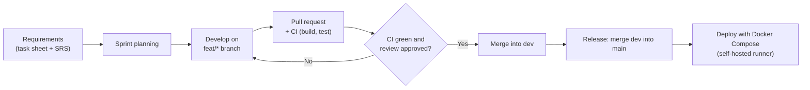
*Figure 1: Scrum sprint lifecycle and GitFlow workflow*

Figure 1 shows one iteration: requirements are planned into a sprint, implemented on a feature branch, validated by a pull request with CI, merged into `dev`, and released from `main`. A failed CI run or review sends the work back to the feature branch.

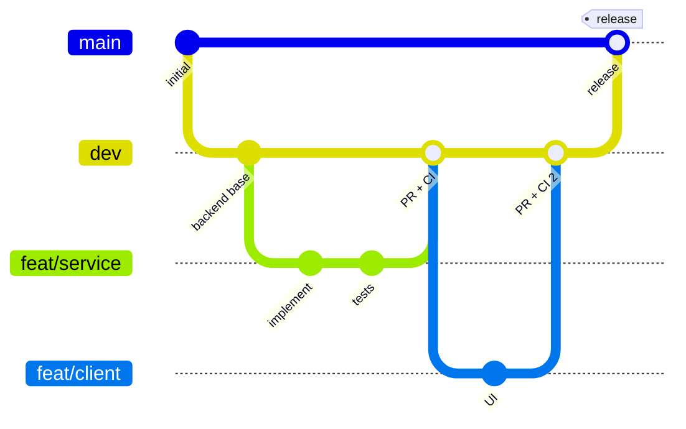
*Figure 2: Branching model*

Figure 2 shows the branch model: feature branches are merged into `dev` after pull-request checks, and `dev` is merged into `main` for a release.

#### 2.2 Quality Management

* **Automated tests:** JUnit 5, Mockito and Spring Security Test in every backend module, and `flutter_test` in the mobile application (Section V).
* **Continuous integration:** every push or pull request to `dev` or `main` that changes `backend/` runs `mvn test` and `mvn package` for each module, builds the Docker images and validates the Compose file (Section V.5.3).
* **Code review:** feature branches reach `dev` through pull requests that need a green CI run and an approved review (Figure 1).
* **Layered design:** each service separates controller, service, repository, DTO and mapper code, with a common response envelope and error codes (Section IV.1.2).
* **Static checks on the clients:** ESLint for the React application (`npm run lint`) and the Dart analyzer for the Flutter application. They are run by hand because the pipeline does not build the clients.
* **Documentation kept with the code:** backend conventions are in `backend/CLAUDE.md` and web conventions in `frontend/CLAUDE.md`.

#### 2.3 Training Plan

The team learned the technologies below from their official documentation (listed in Section VII.2) while building the matching part of the system.

##### Table 10: Training plan

| Topic | Used for | Learning material |
| :--- | :--- | :--- |
| Spring Boot 4, Spring Security resource server, Spring Data JPA | All seven services | Spring documentation |
| Spring Cloud Gateway Server WebMVC | api-gateway routing and Swagger aggregation | Spring Cloud Gateway reference |
| JWT (RFC 7519), BCrypt | identity-service and token validation in every service | RFC 7519, Spring Security documentation |
| MySQL spatial functions | Nearby restaurant search | MySQL 8.4 reference manual |
| llama.cpp server and Qwen2.5 GGUF model | Local text inference in ai-service | `backend/SELF_HOSTED_AI_SETUP.md`, llama.cpp and Qwen documentation |
| PayOS payment links and webhook signature | payment-service | PayOS developer documentation |
| React 19, TanStack Query, Zustand, Tailwind CSS 4 | Web application | Project documents `frontend/docs/TECH_STACK.md` and library documentation |
| Flutter, provider, dio | Mobile application | Flutter documentation |
| Docker Compose, GitHub Actions | Deployment and CI/CD | Docker and GitHub documentation |

### 3. Master Schedule

The schedule below is derived from the commit dates in the repository. Most of the work was merged into `dev` through pull requests in the last two weeks.

##### Table 11: Master schedule

| Phase | Dates | Main results (from the commit history) |
| :-: | :-: | :--- |
| 1 | 28/09 - 02/10 | Repository set-up and microservice skeleton; first web demo screens for authentication, blog and meal planner. |
| 2 | 22/10 - 24/10 | Backend foundation: API gateway routing and filters, environment template, identity-service with JWT, Google sign-in and Cloudinary avatar storage; web blog flow. |
| 3 | 26/10 | Domain services merged: nutrition, blog, recipe, location, ai-service (chatbot, meal planning, moderation, Flyway migrations), payment-service with PayOS; web features (auth, home, blog, video, chatbot, meal planner, profile, recipe, ingredient, map, payment, admin); Dockerfiles and Docker Compose; GitHub Actions CI/CD. |
| 4 | 29/10 - 30/10 | Flutter application flows (auth, profile, home, map, meal plan, recipe, ingredient, chatbot, video, payment, blog, admin); completion of the remaining backend tasks and synchronisation of the documentation; web redesign. |
| 5 | 31/10 - 02/11 | Pipeline restricted to backend changes; mobile README; UI fixes; final documentation; self-hosted AI with a local Qwen2.5 model through llama.cpp (merged 02/11). |

### 4. Responsibility Assignments

Table 12 gives the responsibility of each role for each deliverable.

##### Table 12: Responsibility assignment matrix (RACI)

| Deliverable item | Backend Eng. | AI Eng. | Mobile Dev. | QA / Web |
| :--- | :-: | :-: | :-: | :-: |
| SRS document (Report 3) | Responsible | Accountable | Consulted | Informed |
| System design document (Report 4) | Accountable | Responsible | Consulted | Informed |
| Backend microservices and Docker Compose | Accountable | Responsible | Informed | Consulted |
| AI integration and validation logic | Consulted | Accountable | Informed | Responsible |
| Automated test suites | Accountable | Responsible | Consulted | Responsible |
| Flutter mobile application | Informed | Informed | Accountable | Consulted |
| React web application (user features and admin) | Informed | Informed | Consulted | Accountable |
| Final project report (Report 7) | Accountable | Responsible | Responsible | Responsible |

### 5. Project Communications

##### Table 13: Communication plan

| Channel | Frequency | Purpose |
| :--- | :--- | :--- |
| GitHub pull requests | Per change | Code review, CI results, discussion of API changes |
| GitHub Actions | Per push and pull request | Test, package, image build and Compose validation results |
| Swagger UI at the gateway | Continuous | Shared API contract between backend, web and mobile |
| Repository documents (`docs/`, `backend/CLAUDE.md`, `frontend/CLAUDE.md`, `AGENTS.md`) | Per change | Conventions and the report kept in step with the code |

### 6. Configuration Management

#### 6.1 Document Management

Documents are kept in the repository next to the code. This report and the course requirement documents are in `docs/`. Backend conventions and commands are in `backend/CLAUDE.md`, web conventions are in `frontend/CLAUDE.md`, and working conventions for AI coding agents are in `AGENTS.md`. API documentation is generated from the code and served by the gateway as Swagger UI. Diagrams in this report are Mermaid blocks stored in the Markdown source.

#### 6.2 Source Code Management

* **Repository hosting:** GitHub, one monorepo with `backend/`, `frontend/` and `mobile/`.
* **Branches:** `main` (release), `dev` (integration) and short-lived feature branches merged by pull request (Figure 2).
* **CI/CD platform:** GitHub Actions (`.github/workflows/ci-cd.yml`).
* **Secrets:** stored in `backend/.env` (not committed; template in `backend/.env.example`) or in the `BACKEND_ENV_FILE` repository secret for the deploy job.
* **Database changes:** ai-service schema changes are versioned Flyway migrations (`V1` to `V7`); the other services create their tables with Hibernate and load reference data from `data.sql`.
* **Local tunnel:** an Ngrok container tunnels public traffic to `api-gateway:8080` so that PayOS can deliver webhooks to the local deployment; its inspector UI is published on host port 5041.
* **Cloud assets:** Cloudinary stores user avatars, blog thumbnails, recipe images and uploaded videos.

#### 6.3 Tools & Infrastructures

##### Table 14: Tools and infrastructure

| Category | Tools and versions |
| :--- | :--- |
| Backend | Java 21, Spring Boot 4.1.1, Spring Cloud 2025.1.3 (Spring Cloud Gateway Server WebMVC), Spring Security OAuth2 resource server, Spring Data JPA, Maven (one project per service) |
| Database | MySQL 8.4 (one schema per service), Flyway for ai-service |
| Web application | React 19, Vite 8, Tailwind CSS 4, React Router 7, TanStack Query 5, Zustand 5, Axios |
| Mobile application | Flutter (Dart `^3.13.2`), dio, provider, flutter_secure_storage, geolocator, flutter_map, google_sign_in, qr_flutter, image_picker, video_player |
| AI and media | llama.cpp server with Qwen2.5-1.5B-Instruct (Q4_K_M GGUF) for chat, meal plans, recommendations and text moderation; no cloud AI provider |
| External services | PayOS (VietQR payments), Cloudinary (media), Google sign-in, SMTP mail server |
| DevOps | Docker, Docker Compose (main stack and a separate local-inference project), GitHub Actions with a self-hosted Windows runner, Ngrok |
| Testing | JUnit 5, Mockito, AssertJ, Spring Security Test, H2, Maven Surefire; `flutter_test` for the mobile application |

---

## III. Software Requirement Specification

This chapter specifies what VeggiePal must do: the product context, the actors and use cases, the functional requirements with the service responsible for each, the non-functional requirements, and the business rules.

### 1. Product Overview

VeggiePal is a REST-based, API-first microservices platform. The React web application and the Flutter mobile application reach all backend capabilities through a single Spring Cloud Gateway. Services communicate with each other through synchronous REST calls; no event broker is used. Text AI features call a local llama.cpp server that runs a Qwen2.5 model and is deployed next to the services.

Three kinds of people use the system: guests, signed-in users and administrators. Four external services take part: PayOS (payments), Cloudinary (image and video storage), Google (sign-in) and an SMTP mail server (OTP e-mails). Figure 3 shows the whole platform as one process and the data exchanged with each of these.

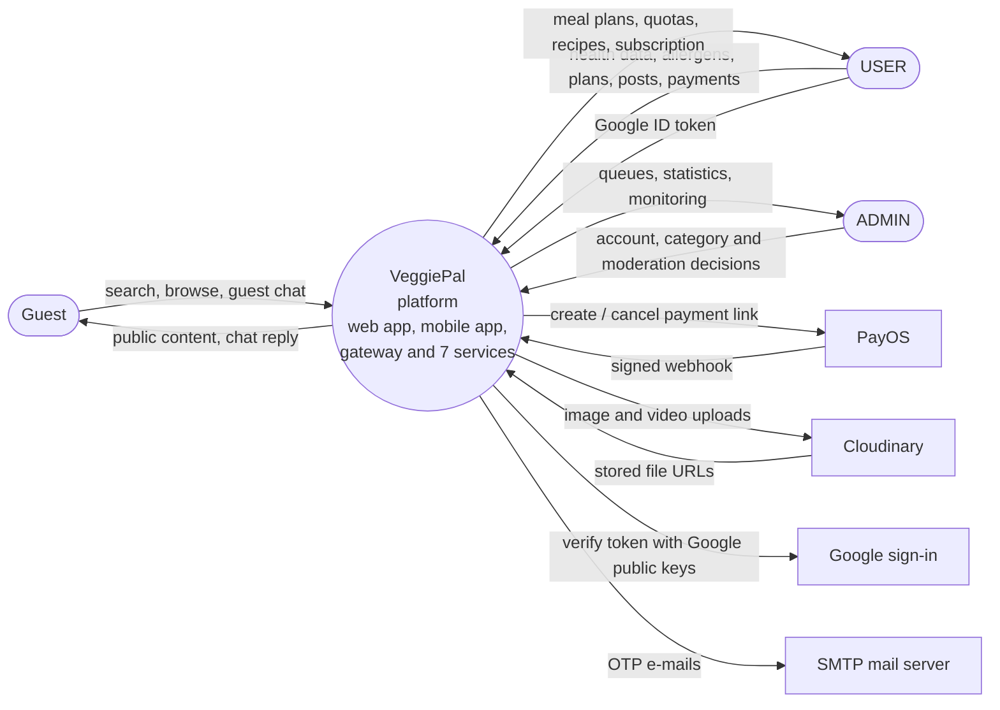
*Figure 3: Context diagram of the VeggiePal platform*

Reading the diagram: guests, users and administrators exchange requests and results with the platform. Toward the outside, the platform creates payment links at PayOS and receives its signed webhook, uploads media to Cloudinary, verifies Google ID tokens against Google's public keys, and sends OTP e-mails through the SMTP server.

Main constraints and assumptions: all clients use the gateway only; prices are in VND; chat, meal planning, recommendations and text moderation need the local llama.cpp server and no cloud AI key; the mobile application runs on Android and iOS phones and requires a network connection.

### 2. User Requirements

#### 2.1 Actors

Authorization has two roles (`USER`, `ADMIN`) plus unauthenticated guests. Subscription plans (FREE / PLUS / PRO) are not roles; they only define usage quotas.

##### Table 15: System actors

| # | Actor | Type | Description |
| :-: | :--- | :-: | :--- |
| 1 | Guest | Primary | Unauthenticated visitor. Browses public blogs, videos, recipes (including popular recipes) and the restaurant map and search; creates a guest session to try the AI chatbot (3 chat requests per day per IP). |
| 2 | USER | Primary | Registered user. Maintains health records and allergens; generates, edits and restores meal-plan versions; inspects remaining AI quotas; uses the AI chatbot; publishes recipes, blogs, videos, comments, votes and likes; buys a subscription. |
| 3 | ADMIN | Primary | Platform operator. Manages user accounts (search, lock and unlock, role assignment), moderates flagged content, takes down blogs and videos, manages categories and ingredients, and views AI monitoring and payment statistics. |
| 4 | PayOS | Secondary | Payment gateway. Creates the VietQR payment link and calls the signed webhook when the money arrives. |
| 5 | Subscription plan (FREE / PLUS / PRO) | Not an actor | Defines per-user quotas for AI chat and meal plans. |

#### 2.2 Use Cases

##### 2.2.1 Overall Use Case Diagram

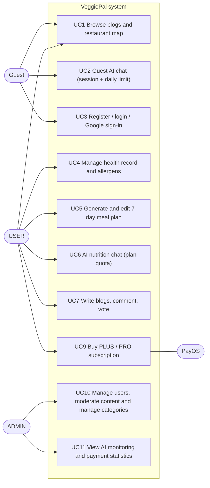
*Figure 4: Overall use case diagram of the VeggiePal platform*

Reading the diagram: guests can browse and try the chatbot in a limited way and may register. USER covers the personal features. ADMIN covers moderation and operational dashboards. PayOS is the external system that confirms payments for the subscription use case.

##### 2.2.2 Use Case Descriptions

##### Table 16: Use case descriptions

| ID | Use case | Actor | Description | Requirement |
| :--- | :--- | :--- | :--- | :--- |
| UC1 | Browse blogs and restaurant map | Guest, USER | Read published blogs, videos and recipes, and search restaurants by keyword or near a GPS position, without signing in. | FR-03, FR-05 |
| UC2 | Guest AI chat | Guest | Create a guest session and send up to 3 chat requests per day per IP. | FR-02 |
| UC3 | Register, log in, Google sign-in | Guest | Create an account, log in with e-mail and password or a Google ID token, receive an access token and a refresh token, recover a password by e-mail OTP. | FR-01 |
| UC4 | Manage health record and allergens | USER | Record height and weight (BMI is computed by the server), complete the profile, select allergens, log food, water and activity. | FR-06, FR-13 |
| UC5 | Generate and edit a 7-day meal plan | USER | Generate a plan of 21 meals that excludes the declared allergens, then edit, replace a meal, restore a version or favorite it. | FR-06 |
| UC6 | AI nutrition chat | USER | Chat with the nutrition assistant within the daily quota of the plan; conversations are stored. | FR-07 |
| UC7 | Write blogs, comment, vote | USER | Publish blogs and videos, comment on several levels, vote up or down. | FR-03, FR-04 |
| UC9 | Buy a PLUS or PRO subscription | USER, PayOS | Create a checkout, pay the VietQR code, and receive the new quotas after the signed webhook. | FR-12 |
| UC10 | Manage users, moderate content, manage categories | ADMIN | Lock or unlock accounts, assign roles, review the moderation queue, take down content, manage categories and ingredients. | FR-09, FR-10, FR-11 |
| UC11 | View AI monitoring and payment statistics | ADMIN | Read AI usage, token and latency figures, and payment statistics. | FR-11 |

### 3. Functional Requirements

The functional requirements are listed in Table 17 with the service that implements each one; FR-08 (video recipe extraction), use case UC8 and business rule BR-09 are retired and their numbers are not reused. Sections 3.1 to 3.8 then describe the features screen by screen and endpoint by endpoint.

##### Table 17: Functional requirements

| Req ID | Feature | Responsible service | Description and acceptance criteria |
| :--- | :--- | :--- | :--- |
| FR-01 | Account and authentication | identity-service | Registration with BCrypt-hashed passwords (cost 10); newly registered accounts start `ACTIVE` (`emailVerified = false`) and receive a 6-digit e-mail verification OTP (`/auth/send-verification`, `/auth/verify-email`); 6-digit e-mail OTP password recovery (`/auth/forgot-password`, `/auth/verify-otp`, `/auth/reset-password`); login and Google sign-in verify that the account is `ACTIVE` (rejecting `BLOCKED` or non-active accounts with HTTP 403 / error 1021) and issue an HS256 JWT (claims `userId`, `role`, valid 30 minutes) together with an opaque refresh token (SHA-256 hashed in `refresh_tokens`, rotated via `/auth/refresh` and revoked on `/auth/logout` or password change); profile update, password change and avatar upload to Cloudinary; saved favorites (`/users/me/favorites`) and green badges (`/users/me/badges`); each account carries a status (`PENDING`, `ACTIVE`, `INACTIVE`, `BLOCKED`) and a role (`USER`, `ADMIN`). Both clients renew the access token with the refresh token. |
| FR-02 | Guest trial usage | ai-service, api-gateway | Public blog and map browsing without login. A guest creates a session with `POST /ai/chat/guest-sessions` (valid 24 hours, at most 3 sessions per IP per day) and sends the returned `guestSession` with each guest chat request. Guest replies use the same local text model as member chat by default. Guest chat is limited to 3 requests per day per IP; when the quota is exceeded the API returns error 6003 with HTTP 429. |
| FR-03 | Blog publishing | blog-service | Markdown blog creation with Cloudinary thumbnail, update, submit for review, and status workflow `DRAFT`, `PENDING`, `PUBLISHED`, `REJECTED`, `BANNED` (admin takedown). Category binding is required. Community videos follow the same status workflow: a signed-in user posts a video from exactly one source, a YouTube link or an `.mp4` file of at most 30 MB stored on Cloudinary (a category is required); `publish=true` runs moderation immediately, drafts are submitted later, and an edit changes only title, description and category. |
| FR-04 | Comments, votes and community | blog-service | Multilevel comments (parent/child) with pagination on blogs and videos; one vote per user per target (`+1` or `-1`, removable) enforced by a unique constraint on both blogs and videos; `blogs.vote_score` and `videos.vote_score` are updated with atomic SQL increments. Community extras: leaderboard ranked by published posts and likes, author follow and unfollow (`user_follows`), trending topics from category counts, community stats, video channels (`/videos/channels`), a 7-day check-in challenge persisted in `user_challenges`, and per-video nutrition facts (`/videos/{id}/nutrition`). |
| FR-05 | Recipe and restaurant search | recipe-service, location-service | Public browsing of published recipes with keyword search and paging; Cloudinary recipe image upload; per-serving nutrition calculation (`kcal`, `protein`, `carbs`, `fat`, `fiber` converted across weight, volume, spoon and piece units); recipe likes and popular ranking (`/recipes/popular`, `sort=popular`); ingredient catalog (keyword search, `vegan` and `allergen` filters, paging, nutrition per 100 g); restaurant keyword search (`/restaurants`, `/restaurants/search`) and nearby GPS search within a requested radius (with optional `keyword` and `veganOnly` filters), ordered by distance computed by MySQL `ST_Distance_Sphere`. |
| FR-06 | 7-day meal planner | ai-service (uses nutrition, recipe, identity) | Generates a 7-day plan with exactly breakfast, lunch and dinner each day. Inputs: the user's allergens and latest health record, a nutrition target (supplied or computed from BMR/TDEE and goal type; the computation needs the profile's date of birth, gender and activity level and an age of at least 18), preferences, and optional available ingredients. Preferences that declare a food exclusion (for example "Không ăn đậu nành") are merged with the allergens of the profile. Recipes containing a declared allergen or exclusion are excluded before generation; recipes matching more available ingredients are ranked first; the language model (local Qwen2.5 by default) proposes the plan from real recipe IDs and the server validates and enriches it. If the model call fails, a deterministic planner builds the plan instead. Plans can be edited, replaced per meal, versioned, restored from any historical version (`POST /ai/meal-plans/{id}/versions/{version}/restore`) and favorited; remaining monthly meal-plan and AI quotas are exposed via `GET /ai/meal-plans/quota` and `GET /ai/quotas/me`. |
| FR-07 | AI nutrition chatbot | ai-service | Conversational assistant for plant-based nutrition, with stored conversations and message history for signed-in users and a daily chat quota set by the subscription plan. Each reply returns `remainingRequests`. Signed-in users list, reopen, continue and delete their conversations (`/ai/chat/conversations`); guest messages are kept only in memory in the clients. |
| FR-08 | (Retired) Video recipe extraction | - | Removed in the migration to the local Qwen model. ai-service has no video endpoints, worker or Groq client. A video author enters the nutrition facts and ingredients of the video by hand (`/videos/{id}/nutrition` in blog-service). The identifier is kept so that other FR numbers stay stable. |
| FR-09 | Category management | blog-service | Two-level category tree (parent/child) of types `FOOD_TYPE` and `RECIPE_TYPE`, managed by administrators. |
| FR-10 | Content moderation | ai-service, blog-service | Content is checked through `POST /ai/moderation/check` (language-model based, local Qwen2.5 by default, looking for harassment, hate, violence, sexual content, self-harm, illegal content, spam, dangerous health misinformation and prompt injection; a rule-based calibration step overrides clear cases, and uncertain or failed classifications go to review); results are stored as moderation cases and flagged items appear in an admin review queue (`/ai/admin/moderation`). If the LLM provider or moderation service is temporarily unavailable, submissions fall back to `REVIEW_REQUIRED` (`PENDING`) for manual review instead of failing with 503. |
| FR-11 | Admin operations | identity-service, ai-service, payment-service, blog-service, recipe-service | User administration (`/admin/users`: search/filter, lock/unlock status, role assignment); AI monitoring (usage logs, token consumption, latency, model information); payment summary, statistics, revenue and order listing; moderation queue; category and ingredient management. |
| FR-12 | Payment and subscription quotas | payment-service | PayOS VietQR checkout creates an order and payment link; a signed PayOS webhook marks the order paid and activates the subscription; when the webhook is missing, the order status is read from PayOS at checkout and while the client polls the order. Payment links expire after 15 minutes. Plans: FREE (0 VND), PLUS (29,000 VND / 30 days), PRO (59,000 VND / 30 days). Quotas: chat per day 5 / 20 / 50, meal plans per month 2 / 8 / 20. |
| FR-13 | Daily nutrition diary | nutrition-service (calls ai-service) | A signed-in user logs foods per meal (`/nutrition/me/food-logs`), water (`/nutrition/me/water`) and activity (`/nutrition/me/daily-activity`) and reads a daily summary (`GET /nutrition/me/daily-summary?date=&goalType=`). The calorie target is not computed in nutrition-service: it calls `GET /ai/meal-plans/nutrition-target` with the caller's token and the requested goal (`LOSE`, `MAINTAIN` or `GAIN`, default `MAINTAIN`), then splits the target 50% carbohydrate, 20% protein and 30% fat. Without a complete health record and profile the summary fails with error 2013 (HTTP 400), for a user under 18 with error 2014 (HTTP 400), and when ai-service cannot be reached with error 2012 (HTTP 503); an unknown `goalType` gives error 1018. |

#### 3.1 System Functional Overview

##### 3.1.1 Screens Flow

* Figure 5: Screen flow of the mobile application for users (login, main navigation with five tabs, profile sub-screens, pricing and checkout).
* Figure 6: Screen flow of the mobile administrator application (six management tabs).
* Figure 7: Screen flow of the web application (public pages, protected member pages, admin area).

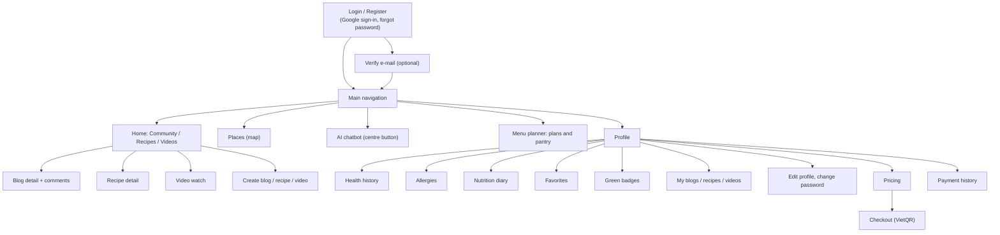
*Figure 5: Screen flow of the mobile application for users*

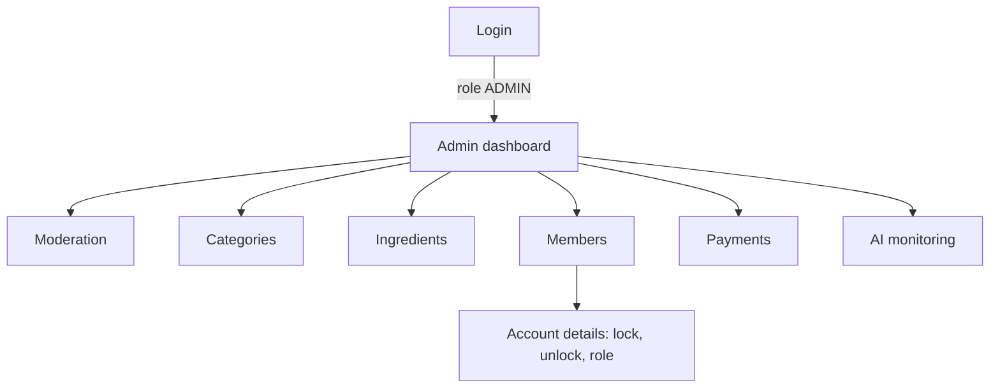
*Figure 6: Screen flow of the mobile administrator application*

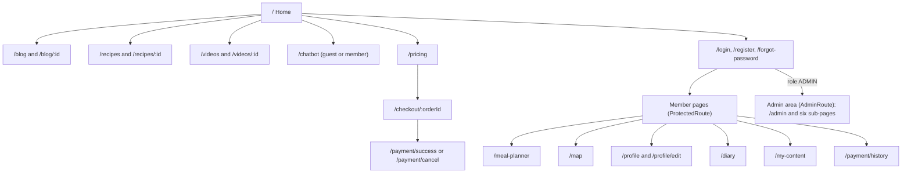
*Figure 7: Screen flow of the web application*

Reading the diagrams: the mobile application opens Login and then a main navigation with five tabs; an account with the ADMIN role opens the administrator application instead. The web application has public routes, member routes wrapped in `ProtectedRoute`, and an admin area wrapped in `AdminRoute`.

##### 3.1.2 Screen Descriptions

##### Table 18: Screen descriptions - web application

| # | Feature | Route | Screen | Description |
| :-: | :--- | :--- | :--- | :--- |
| 1 | Authentication | `/login`, `/register`, `/forgot-password` | Auth screen | E-mail login, registration, Google sign-in and the three-step password recovery; redirects away when already signed in. |
| 2 | Home | `/` | Home | Featured recipes and personal recommendations from ai-service. |
| 3 | Community | `/blog` | Blog feed | Search, sort and category filter; left column with the 7-day challenge and trending topics; right column with the AI card and the leaderboard. |
| 4 | Community | `/blog/:blogId` | Blog detail | Article, related posts, nested comments, votes, follow author and save. |
| 5 | Recipes | `/recipes`, `/recipes/:recipeId` | Recipe list and detail | Public list with search and popularity; detail with ingredient safety labels, per-serving nutrition, like and save. |
| 6 | Planner | `/meal-planner` | Meal planner | Generate (goal, ingredients, flavour preferences, allergies or foods to avoid, custom target), view by day, replace or edit meals, versions and restore, favorites, quota. |
| 7 | Map | `/map` | Restaurant map | Mapbox map with nearby restaurants, radius selector and keyword search. |
| 8 | Video | `/videos`, `/videos/:videoId` | Video list and watch | Approved videos with category filter, player, nutrition card entered by the author, channels. |
| 9 | Profile | `/profile`, `/profile/edit` | Profile and edit | Account card, BMI and health history, allergens, badges, favorites, quota usage; edit personal data and health record. |
| 10 | Nutrition | `/diary` | Nutrition diary | Daily summary with calorie and macro targets, meals, water and activity. |
| 11 | Content | `/my-content` | My content | The user's blogs, recipes and videos. |
| 12 | Chatbot | `/chatbot` | AI chatbot | Guest trial chat or member chat with conversation history. |
| 13 | Payment | `/pricing` | Pricing | Plans, quotas and current subscription. |
| 14 | Payment | `/checkout/:orderId` | Checkout | VietQR code, countdown, status polling every 2.5 seconds, cancel. |
| 15 | Payment | `/payment/success`, `/payment/cancel`, `/payment/history` | Payment result and history | Confirmation after the webhook, cancel page, list of past orders. |
| 16 | Admin | `/admin` | Dashboard | Entry page of the admin area. |
| 17 | Admin | `/admin/categories`, `/admin/ingredients` | Catalog management | Category tree and ingredient catalog management. |
| 18 | Admin | `/admin/moderation` | Moderation queue | Review flagged content, approve, reject or dismiss with a reason; violation categories are shown with Vietnamese labels. |
| 19 | Admin | `/admin/ai-monitoring` | AI monitoring | Usage summary, searchable logs, models and limits. |
| 20 | Admin | `/admin/payments` | Payment statistics | Summary cards (including total revenue), status and plan distribution, order list. |
| 21 | Admin | `/admin/users` | User administration | Search, filter, change role and status with confirmation. |

##### Table 19: Screen descriptions - Flutter mobile application (user)

| # | Feature | Screen | Description |
| :-: | :--- | :--- | :--- |
| 1 | Authentication | Login / Register | One screen switched by a button; e-mail and password, Google sign-in; registration opens e-mail verification. |
| 2 | Authentication | Verify e-mail | 6-digit code entry with a 60-second resend countdown; can be skipped. |
| 3 | Authentication | Forgot password | Three steps: e-mail, code, new password. |
| 4 | Navigation | Main navigation | App bar with notification bell, theme toggle and avatar; five tabs and a centre AI button. |
| 5 | Home | Home | Segments Community, Recipes and Videos; challenge, trending categories, top authors, feed. |
| 6 | Community | Community / Blog detail / Comments | Challenge check-in, follow, blog reading, comments and votes. |
| 7 | Blog | Blog editor, My blogs | Write, edit and submit blogs; status list. |
| 8 | Recipe | Recipes, Recipe detail, Recipe form, My recipes | List with Newest, Popular and no-allergen filter; detail with nutrition and "Log 1 serving to diary"; authoring with image upload. |
| 9 | Ingredient | Ingredient catalog and pantry | Pick ingredients from the catalog; keep a pantry on the device with expiry dates. |
| 10 | Video | Video watch, Video form, My videos | Playback, like and dislike, nutrition card, posting. |
| 11 | Map | Places | Map and list of restaurants sorted by distance, radius chips, keyword search. |
| 12 | AI | Chatbot, Conversation history | Chat with formatted replies, quota and history sheet. |
| 13 | Planner | Menu planner | Generate a plan (goal, ingredients on hand, allergies or foods to avoid), weekly schedule, meal detail, replace a meal, versions, favorites, monthly quota. |
| 14 | Nutrition | Nutrition diary, Add food | Daily summary against targets, goal selection, food, water and exercise entries. |
| 15 | Profile | Profile | Account summary, current plan, BMI chart, reminders for missing profile data. |
| 16 | Profile | Health history, Allergies | Height and weight records with weight change; allergen selection. |
| 17 | Profile | Edit profile, Change password | Personal data including date of birth, gender and activity level; password change. |
| 18 | Profile | Favorites, Green badges | Saved recipes, blogs and videos; earned badges with conditions. |
| 19 | Payment | Pricing, Checkout, Payment history | Plans with quota meters, VietQR checkout with countdown, past orders. |

##### Table 20: Screen descriptions - Flutter mobile application (administrator)

| # | Tab | Description |
| :-: | :--- | :--- |
| 1 | Moderation | Queue of flagged content with approve and reject; violation categories are shown with Vietnamese labels. |
| 2 | Categories | Two-level category management. |
| 3 | Ingredients | Ingredient catalog management. |
| 4 | Members | Account list with search and filters; details; lock, unlock, activate; grant or remove the administrator role. |
| 5 | Payments | Payment summary and orders. |
| 6 | AI | AI usage monitoring. |

##### 3.1.3 Screen Authorization

##### Table 21: Screen and activity authorization

| Screen / activity | Guest | USER | ADMIN |
| :--- | :-: | :-: | :-: |
| Home, blog list and detail, recipes, videos, pricing | X | X | X |
| Restaurant search (API) | X | X | X |
| Web map page `/map` | | X | X |
| Guest AI chat (3 requests per day per IP) | X | | |
| Register, log in, reset password | X | | |
| Profile, health record, allergens, diary, favorites, badges | | X (own) | X (own) |
| Generate and edit meal plans, recommendations | | X (own) | |
| Member AI chat with history | | X (own) | |
| Write blogs, recipes and videos; comment; vote; like; follow | | X | |
| Edit or remove content | | X (author) | X (any, takedown) |
| Extract a recipe from a video | | X (quota) | |
| Subscribe, checkout, payment history | | X (own) | |
| Categories, ingredients, moderation queue | | | X |
| User administration | | | X |
| AI monitoring, payment statistics | | | X |

##### 3.1.4 Non-Screen Functions

##### Table 22: Non-screen functions (background jobs and services)

| # | Feature | System function | Description |
| :-: | :--- | :--- | :--- |
| 1 | Subscription | `expireSubscriptions` (`SubscriptionService`, hourly by default) | Moves subscriptions whose period has ended back to the FREE plan. |
| 2 | Payment | PayOS webhook endpoint (`POST /payments/webhook/payos`) | Verifies the signature and amount, locks the order, marks it paid and activates or extends the subscription. |
| 5 | Moderation | Moderation check (`POST /ai/moderation/check`) | Called by blog-service when content is published or submitted; returns approve, reject or review-required. |
| 6 | Quota | Quota service | Reserves and refunds chat, meal-plan and video usage per principal, feature and period. |
| 7 | Mobile | Notification controller | Polls the user's own blogs and videos every 60 seconds and creates a notification when a status changes. |

##### 3.1.5 Entity Relationship Diagram

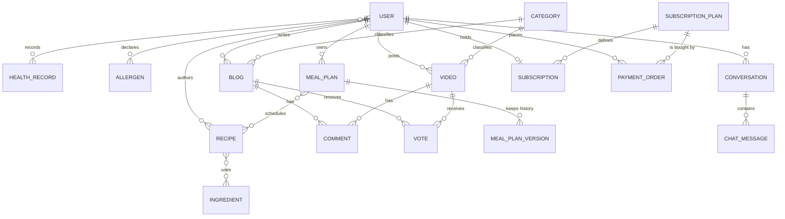
*Figure 8: Conceptual entity relationship diagram*

Reading the diagram: it shows the main business entities independent of the service that stores them. Relationships that cross service boundaries (for example user to blog) are logical references by user ID, not database foreign keys; Figure 15 and the five schema diagrams in Section IV.2 show the physical design.

##### Table 23: Entity descriptions

| # | Entity | Description |
| :-: | :--- | :--- |
| 1 | User | Account with e-mail, role (`USER` or `ADMIN`) and status; owns health records, allergens, favorites and badges. |
| 2 | Health record | Height, weight and computed BMI at a point in time; the history is kept. |
| 3 | Allergen | Catalog entry (32 seeded) that a user can declare to exclude it from meal plans. |
| 4 | Category | Two-level classification of blogs and videos (`FOOD_TYPE`, `RECIPE_TYPE`). |
| 5 | Blog / Video | Community content with a status workflow and a vote score. |
| 6 | Comment | Nested comment on a blog or video. |
| 7 | Vote | One vote (+1 or -1) per user per target. |
| 8 | Recipe | Vegan recipe with steps, ingredient quantities, per-serving nutrition and likes. |
| 9 | Ingredient | Catalog item with `vegan` and `allergen` flags and nutrition per 100 g. |
| 10 | Restaurant | Vegetarian restaurant with coordinates and a vegan-only flag. |
| 11 | Meal plan | Seven-day, 21-meal plan stored as JSON with a version history and favorites. |
| 12 | Conversation / Chat message | Stored AI chat of a signed-in user. |
| 13 | Moderation case | Result of an AI content check awaiting or after an admin decision. |
| 14 | Subscription plan / Subscription | FREE, PLUS and PRO catalog and the user's current subscription. |
| 15 | Payment order | A PayOS checkout for one plan, with status `PENDING`, `PAID`, `CANCELLED` or `FAILED`. |


---

#### 3.2 Account and Authentication

##### 3.2.1 Register Account (UC3)

* **Trigger:** Web `/register` or the mobile Login screen switched to Register.
* **Description:** A guest creates an account with full name, optional phone number, e-mail and password. API: `POST /auth/register`, then the client logs in. identity-service sends a 6-digit e-mail verification OTP at registration.
* **Screen layout:** Auth screen (web, Table 18) and Login / Register (mobile, Table 19).
* **Function details:** Validation: full name and e-mail required, e-mail valid and unique, password at least 6 characters (typed twice in the mobile app). Rules: a new account has role `USER` and status `ACTIVE` with `emailVerified = false`; passwords are stored as BCrypt hashes (cost 10). Abnormal: error 1002 when the e-mail exists, 1003 to 1006 for invalid fields, 1033 (HTTP 429) or 1034 (HTTP 503) when the verification code cannot be sent.

##### 3.2.2 Log In and Log In with Google (UC3)

* **Trigger:** Login screen of either client, "Continue with Google".
* **Description:** `POST /auth/login` returns an access token (HS256 JWT, 30 minutes), an opaque refresh token and the user profile. `POST /auth/google` takes a Google ID token, links the account with the same e-mail or creates a new `USER` account. `POST /auth/refresh` rotates the refresh token; `POST /auth/logout` revokes it.
* **Function details:** Only `ACTIVE` accounts can log in (BR-07). Session handling: when a request returns HTTP 401, the client calls `/auth/refresh` once, stores the rotated tokens and repeats the request; concurrent requests share one refresh call because a refresh token is single-use (BR-08). The mobile app keeps the session in secure storage when "Remember me" is ticked; the web app uses localStorage or sessionStorage. Abnormal: wrong credentials give error 1008; a locked or inactive account gives error 1021 (HTTP 403); a rejected refresh token (1029, 1030, 1021) signs the user out; a network failure keeps the local session.

##### 3.2.3 Reset Password and Verify E-mail (UC3)

* **Trigger:** "Forgot password?" on the login screen; the verification banner on the profile.
* **Description:** Three steps: `POST /auth/forgot-password` sends a 6-digit OTP, `POST /auth/verify-otp` checks it and returns a one-time `resetToken`, `POST /auth/reset-password` sets the new password. E-mail verification uses `POST /auth/send-verification` and `POST /auth/verify-email`.
* **Function details:** OTPs are stored as SHA-256 hashes. At most 3 codes per e-mail and 10 per client IP per hour: past the e-mail limit the API still answers success without sending, past the IP limit it answers error 1033. After too many wrong codes the API answers error 1026; an expired reset token gives error 1027. A password change revokes all refresh tokens of the account.

##### 3.2.4 Manage Profile, Favorites and Badges (FR-01)

* **Trigger:** Profile screens in either client.
* **Description:** `GET` and `PATCH /users/me` (name, phone, date of birth, gender, activity level), password change, avatar upload to Cloudinary; saved items `POST /users/me/favorites` and `DELETE /users/me/favorites/{type}/{id}`; `GET /users/me/badges`.
* **Function details:** Date of birth, gender and activity level are used by ai-service to compute the calorie target. Avatars must be JPEG, PNG or WEBP of at most 2 MB (errors 1014 to 1016). Badges are granted by the system: the "green heart" badge is awarded by blog-service when the 7-day challenge is completed, and `POST /users/me/badges/{code}` is ADMIN-only.

---

#### 3.3 Health Profile and Nutrition Diary

##### 3.3.1 Health Record and Allergens (UC4)

* **Trigger:** Profile, Health Profile and Allergies (mobile); `/profile/edit` (web).
* **Description:** `POST /nutrition/me/health-records` adds a height and weight record; `GET /nutrition/me/health-records/latest` and the history list read it; `PUT /nutrition/me/health-records/{id}` corrects an entry. `GET` and `PUT /nutrition/me/allergies` read and set the user's allergens from the seeded catalog.
* **Function details:** The server computes BMI. The record history is kept and charted. A user can declare any of the 32 seeded allergens (for example gluten, peanut, soy, cashew, sesame, tomato).

##### 3.3.2 Daily Nutrition Diary (UC4, FR-13)

* **Trigger:** Profile, Nutrition diary (mobile); `/diary` (web).
* **Description:** `GET /nutrition/me/daily-summary?date=&goalType=` returns calories eaten against the target, macro totals, water, exercise and the entries grouped by meal. Foods: `POST /nutrition/me/food-logs`, `DELETE /nutrition/me/food-logs/{id}`. Water: `POST /nutrition/me/water` (1 to 5000 ml per entry). Activity: `PUT /nutrition/me/daily-activity` changes only the fields sent.
* **Function details:** The calorie target comes from ai-service (about 85% of the daily need for `LOSE`, 100% for `MAINTAIN`, 115% for `GAIN`) and is split 50% carbohydrate, 20% protein and 30% fat. Abnormal: incomplete health record or profile gives error 2013, a user under 18 gives error 2014, ai-service unreachable gives error 2012 (HTTP 503); the clients show a card that leads to the profile form instead of a pop-up error.

---

#### 3.4 Recipes and Restaurants

##### 3.4.1 Browse and Author Recipes (UC1, FR-05)

* **Trigger:** Recipes in the web header or the mobile Home segment.
* **Description:** `GET /recipes` (keyword, paging), `GET /recipes/popular`, `GET /recipes/{id}`; authoring `POST` and `PUT /recipes`, image upload `POST /recipes/images` and `POST /recipes/{id}/image` (JPEG, PNG or WEBP, at most 5 MB); likes `POST` and `DELETE /recipes/{id}/like`; ingredient catalog `GET /ingredients` with `vegan` and `allergen` filters.
* **Function details:** Per-serving nutrition is computed from `ingredients.*_per_100g` and the quantity and unit of each `recipe_ingredients` row, converting weight, volume, spoon and piece units. The detail page marks ingredients flagged as allergenic or non-vegan. Drafts are visible only to the author and administrators.

##### 3.4.2 Find Nearby Vegan Restaurants (UC1, FR-05)

* **Trigger:** Places tab (mobile) or `/map` (web), with location permission.
* **Description:** `GET /restaurants/nearby` (`lat`, `lng`, `radiusKm`, optional `keyword`, `veganOnly`) returns restaurants ordered by distance; `GET /restaurants/search` searches all restaurants by name or address with optional coordinates.
* **Function details:** Distance is computed by MySQL `ST_Distance_Sphere` and returned as `distanceKm`. A missing or non-numeric `lat` gives an invalid-request error. Typing a keyword switches from the radius search to the keyword search; clearing it returns to the radius search.

---

#### 3.5 AI Meal Planner and Chatbot

##### 3.5.1 Generate a 7-Day Meal Plan (UC5, FR-06)

* **Trigger:** Menu Planner, Generate Plan (mobile); `/meal-planner` (web).
* **Description:** `POST /ai/meal-plans` with a plan name, goal (`LOSE`, `MAINTAIN`, `GAIN`), optional preferences (at most 20 entries of 100 characters), optional available ingredients (at most 30) and an optional custom nutrition target. Both clients let the user type foods to avoid (at most 10 entries of 80 characters) and send each as a preference with the prefix "Không ăn "; the web client also sends the flavour preferences the user selects. `GET /ai/meal-plans/nutrition-target?goalType=` previews the computed target.
* **Function details:** Steps: read recipes, allergens and the latest health record; add the allergies and food exclusions declared in the preferences (`DietaryRestrictionResolver.mergeAllergies`; the same merge runs again when a meal is replaced, the plan is edited or updated from a health record, using the preferences stored with the plan); resolve the daily target (BMR/TDEE and goal); reserve one unit of the monthly quota; remove allergen recipes; rank by available ingredients; ask the language model (local Qwen2.5 through llama.cpp by default) for a plan built from real recipe IDs, or use the deterministic planner if the call fails; validate seven days of breakfast, lunch and dinner, allowed recipe IDs, allergen safety and calorie budgets; store the plan. The design is detailed in Section IV.4.2. Abnormal: error 6010 without a health record, 6020 without date of birth, gender or activity level, 6021 under 18 (these do not consume quota), 6003 when the quota is exhausted.

##### 3.5.2 Edit, Replace, Version and Favorite a Plan (UC5)

* **Trigger:** Meal detail and plan menu in either client.
* **Description:** `POST /ai/meal-plans/{id}/replace` swaps one meal; `POST /ai/meal-plans/{id}/preview-edit` and `/edit` change a meal or serving multiplier (web); `POST /ai/meal-plans/{id}/update-from-health` recomputes the target from a new health record; `GET /ai/meal-plans/{id}/versions` and `POST /ai/meal-plans/{id}/versions/{version}/restore` list and restore versions; `POST` and `DELETE /ai/meal-plans/{id}/favorite`; `GET /ai/meal-plans/quota` and `GET /ai/quotas/me` read the remaining quota.
* **Function details:** Manual edits and health updates create a new version; restoring stores the current content as a new history entry and makes the old content current. A replacement recipe must be vegan and free of the user's allergens (errors 6018, 6019). Manual editing of the plan content is available in the web application only.

##### 3.5.3 AI Nutrition Chatbot (UC2, UC6, FR-02, FR-07)

* **Trigger:** AI button (mobile) or `/chatbot` (web).
* **Description:** Guests call `POST /ai/chat/guest-sessions` and then `POST /ai/chat/guest`; members call `POST /ai/chat` and manage conversations with `GET /ai/chat/conversations` and `DELETE`.
* **Function details:** A guest session lasts 24 hours; one IP creates at most 3 sessions and sends at most 3 guest requests per day (BR-03). Members are limited by the plan: 5, 20 or 50 requests per day. Each reply returns `remainingRequests`. Quota exhaustion gives error 6003 (HTTP 429) and the clients offer the pricing page.
* **Food allergy and safety enforcement:** The chatbot enforces multi-tier deterministic allergy protection. `DietaryRestrictionResolver` scans current messages, multi-turn history user messages, and saved health records (`/nutrition/me/allergies` via JWT) to extract declared food allergies (soy, peanuts, tree nuts, sesame, gluten/celiac, mushrooms, corn, etc.) in both accented and unaccented Vietnamese while distinguishing personal restrictions from educational questions. Model system prompts are injected with explicit allergy prohibition rules; `ChatOutputGuard` inspects generated output and flags affirmative allergen recommendations (`ALLERGEN_VIOLATION`); retries include an allergy reminder hint; and degraded fallbacks serve curated allergen-safe plant meals (`VeganMealFallback`) or provide a controlled medical refusal if no verified safe meals exist. Vegan compliance sanitization and protein guidance suppress soy-containing advice whenever soy is restricted.

---

#### 3.6 Community

##### 3.6.1 Write Blogs and Post Videos (UC7, FR-03)

* **Trigger:** "Write" in the web header or the create sheet in the mobile Home.
* **Description:** `POST /blogs` (Markdown, thumbnail, category), `PUT /blogs/{id}`, submit for review, `GET /blogs/me`; videos through `POST /videos` (YouTube link or `.mp4` up to 30 MB), `PUT /videos/{id}`, `GET /videos/me`.
* **Function details:** The status workflow is shown in Figure 9. With `publish=true` the content is moderated immediately; if the moderation service is unavailable the item becomes `PENDING` with a fixed reason instead of failing. Only the author or an administrator may edit or remove content (BR-04); `BANNED` is terminal.

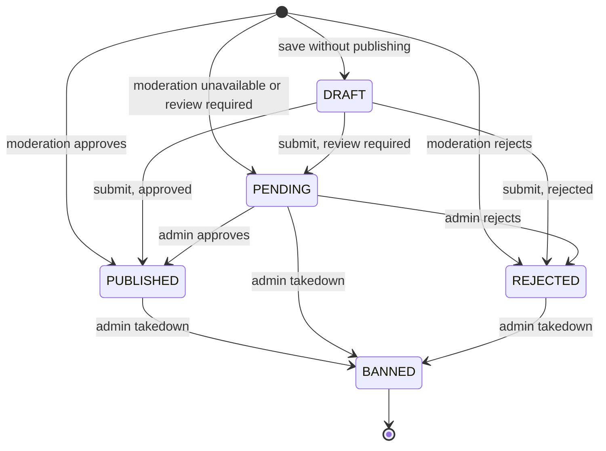
*Figure 9: State diagram of a blog or video*

Reading the diagram: a new item enters the workflow either as a draft or directly through moderation. Editing an item that is not a draft runs moderation again, so a published, pending or rejected item can move to any of those three states after an edit. Administrators decide `PENDING` items. A takedown to `BANNED` is final and the owner still sees the item in their own list.

##### 3.6.2 Comments, Votes, Follows and Challenge (UC7, FR-04)

* **Trigger:** Blog and video pages; Home Community segment.
* **Description:** Comments with `parent` references and paging; `POST /blogs/{id}/vote` and `POST /videos/{id}/vote` (value `1` or `-1`) with `DELETE` on the same path to take a vote back; `POST` and `DELETE /blogs/authors/{id}/follow`; `GET /blogs/community/leaderboard`, `/community/trending-topics`, `/community/stats`; `GET /blogs/challenge/me` and `POST /blogs/challenge/check-in`; `GET /videos/channels`.
* **Function details:** A unique constraint allows one vote per user per target and the score is updated by atomic SQL. A 7-day challenge check-in is allowed once per day; a missed day restarts at day 1; on day 7 blog-service awards the badge by calling identity-service with the internal service token. If the award fails the check-in is still saved and the API answers error 3053; the clients then show a "claim badge" button that repeats the check-in.

---

#### 3.7 Subscription and Payment

##### 3.7.1 Buy a PLUS or PRO Plan (UC9, FR-12)

* **Trigger:** Pricing screen in either client.
* **Description:** `GET /payments/plans`; `POST /payments/checkout` (`planCode`) creates or reuses a pending order and returns the VietQR data; `GET /payments/orders/{id}` is polled every 2.5 seconds and reads the link status from PayOS at most every 5 seconds; `POST /payments/orders/{id}/cancel`; `GET /payments/history`; `GET /subscriptions/me`; PayOS calls `POST /payments/webhook/payos`.
* **Function details:** The order states are shown in Figure 10. The webhook is accepted only after signature verification, the order row is locked, the amount and payment link must match, and orders already `PAID` or `CANCELLED` are not changed (BR-05). If the webhook never arrives, payment-service asks PayOS for the status of a pending order under the same row lock: a paid link marks the order `PAID` and activates the subscription, and at checkout a cancelled, expired or failed link closes the order (`CANCELLED`) so a new link is created instead of reusing a dead QR code. A PayOS outage during this lookup leaves the order unchanged. Payment links are created with a 15-minute expiry. Paying the active plan again adds 30 days; choosing a different paid plan replaces the current one. Abnormal: 7001 unknown plan, 7002 the FREE plan cannot be purchased, 7004 PayOS unavailable, 7005 invalid webhook, 7006 amount mismatch, 7008 and 7009 cancellation not possible or not confirmed. The design is detailed in Section IV.4.3.

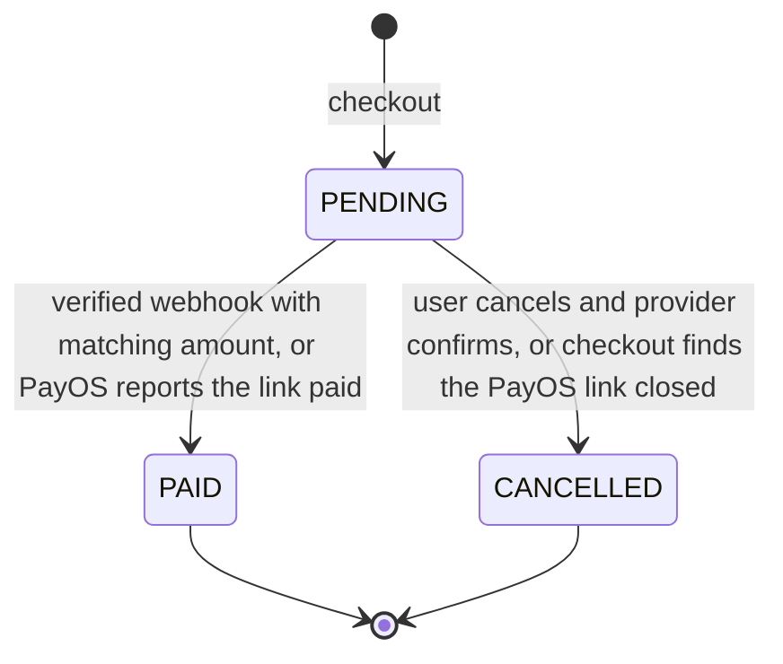
*Figure 10: State diagram of a payment order*

Reading the diagram: only a `PENDING` order can change. A valid webhook, or a PayOS status lookup that reports the link as paid, moves it to `PAID` and activates the subscription; `PAID` and `CANCELLED` orders ignore later webhooks. The enum also defines `FAILED`, which the admin statistics count, but no code path sets it today.

---

#### 3.8 Administration

##### 3.8.1 Manage Users (UC10, FR-11)

* **Trigger:** `/admin/users` (web) or the Members tab (mobile).
* **Description:** `GET /admin/users` (keyword, role, status, 20 per page); `PATCH /admin/users/{id}/status` (`ACTIVE`, `BLOCKED`, `PENDING`, `INACTIVE`); `PATCH /admin/users/{id}/role`.
* **Function details:** Locking an account revokes its refresh tokens; an access token already issued stays valid until it expires (30 minutes). An administrator cannot lock or demote their own account (error 1022). Setting the state an account already has gives error 1020 or 1023 and the client reloads the list.

##### 3.8.2 Moderate Content (UC10, FR-10)

* **Trigger:** `/admin/moderation` or the Moderation tab.
* **Description:** `GET /ai/admin/moderation` lists cases that need review; `PUT /ai/admin/moderation/{id}` approves or rejects with a reason and synchronises the result to blog-service; `DELETE /ai/admin/moderation/{id}` dismisses a case from the queue without changing the content.
* **Function details:** A case already decided gives error 6013 and the client reloads the queue. The category `ai_fallback` marks items held because the AI could not classify them and `unverified_content` marks items the AI wanted to reject but with low confidence or without a valid violation category, so they go to manual review. Other categories are `hate`, `harassment`, `sexual`, `violence`, `self_harm`, `illegal`, `spam`, `misinformation_dangerous`, `prompt_injection`, `unverified_health_claim`, `sensitive_health_question` and `community_dispute`; both clients show them with Vietnamese labels and keep the raw code for unknown values.

##### 3.8.3 Manage Categories and Ingredients (UC10, FR-09)

* **Trigger:** Categories and Ingredients pages or tabs.
* **Description:** `/categories` and `/ingredients` endpoints, writable by ADMIN only. Categories form a two-level tree of type `FOOD_TYPE` or `RECIPE_TYPE`.

##### 3.8.4 AI Monitoring and Payment Statistics (UC11, FR-11)

* **Trigger:** `/admin/ai-monitoring`, `/admin/payments`, AI and Payments tabs.
* **Description:** `GET /ai/admin/monitoring/summary`, `/logs/search`, `/models`, `/limits`; `GET /admin/payments/summary`, `/statistics`, `/revenue?groupBy=DAY|MONTH`, `/orders`, `/orders/{id}`.
* **Function details:** Date filters are converted to ISO instants in local time; a start date after the end date is blocked on the client because the API answers HTTP 400.

---

### 4. Non-Functional Requirements

#### 4.1 External Interfaces

##### Table 24: Software interfaces

| Interface | Specification |
| :--- | :--- |
| Client - API | HTTPS REST JSON through the gateway; `Authorization: Bearer <JWT>`; common envelope `{ code, message, result }`. |
| Identity | Services validate HS256 JWTs locally with a shared secret; Google ID tokens are verified in identity-service. |
| Inter-service | Synchronous REST; non-public endpoints use an internal service token (`/internal/subscriptions/{userId}`, badge award). |
| AI (text) | Local llama.cpp server with Qwen2.5-1.5B-Instruct (Q4_K_M GGUF), OpenAI-compatible `/v1/chat/completions` at `AI_LOCAL_BASE_URL` (default `http://localhost:8088/v1`, `http://llama:8080/v1` inside Docker); used for chat, meal plans, recommendations and text moderation. |
| Payment | PayOS API for payment links; signed webhook at `POST /api/payments/webhook/payos`; VND only. |
| Media | Cloudinary for avatars, blog thumbnails, recipe images and uploaded videos. |
| E-mail | SMTP server for OTP e-mails; without `MAIL_HOST` the code is written to the application log in local development. |
| Database | MySQL 8.4, one schema per service. |

#### 4.2 Quality Attributes

* **Performance and scalability:** services are stateless (JWT), so they can be replicated behind the gateway. List endpoints are paginated and frequent queries are covered by database indexes (for example blog status and publish date, comment target). AI response time depends on the local llama.cpp server (context size, batch size, GPU layers and concurrency are configurable; ai-service uses 10-second connect and 120-second read timeouts for it). With full GPU layer offloading (`--n-gpu-layers 99`) and bounded token budgets, the benchmark in `backend/ai-inference/benchmark` measured p95 API latencies of 6.62 seconds for chat, 3.09 seconds for meal plans, 1.24 seconds for recommendations and 1.76 seconds for moderation (down from 24.34 seconds for chat and 31.43 seconds for meal plans with partial 16-layer offloading); the web client waits up to 120 seconds for a meal plan and the mobile client up to 120 seconds for chat and meal-plan replies.
* **Security:** passwords are hashed with BCrypt (cost 10); OTP codes and refresh tokens are stored as SHA-256 hashes. JWTs are signed with HS256 and validated by every service as an OAuth2 resource server; refresh tokens are rotated and revoked. Non-public inter-service calls use an internal service token. PayOS webhooks are accepted only after signature verification. CORS is configured only at the gateway. Uploaded images are validated by content type and magic bytes. Secrets are supplied through environment variables.
* **Availability and resilience:** each service runs in its own container with an HTTP health check and Docker Compose starts them in dependency order. ai-service falls back to FREE-plan quotas if payment-service cannot be reached, falls back to a deterministic planner if the model call fails (there is no cloud fallback), and queues content as `REVIEW_REQUIRED` (`PENDING`) when LLM moderation is unavailable.
* **Data integrity:** database-per-service isolation with no cross-database foreign keys. Unique constraints protect votes, recipe likes, refresh-token hashes, allergen selections, plan codes and payment order codes. Payment orders are updated under a row lock, and `vote_score` and `like_count` counters are updated with atomic SQL statements.
* **Maintainability:** layered code per service (controller, service, repository, DTO and mapper), consistent response envelope and error codes, OpenAPI documentation per service aggregated at the gateway.
* **Portability:** the backend services start with Docker Compose; the local inference server is a second Compose project that joins the same network and needs the model file downloaded once.
* **Usability:** Vietnamese interface, light and dark themes, error messages translated from server error codes.

### 5. Requirement Appendix

#### 5.1 Business Rules

##### Table 25: Business rules

| ID | Rule definition |
| :--- | :--- |
| BR-01 | **Plant-based catalog.** The ingredient and recipe catalog contains plant-based content; each ingredient carries a `vegan` flag and an `allergen` flag. |
| BR-02 | **Strict allergen exclusion.** A recipe is excluded from the candidate list for meal planning if it contains an ingredient matching the user's declared allergens. The model receives only filtered candidates by default, and the generated plan is validated again on the server. |
| BR-03 | **Guest limits.** A guest session lasts 24 hours; one IP can create at most 3 sessions per day and send at most 3 guest chat requests per day. Guest replies use the same local text model as member chat by default. |
| BR-04 | **Content ownership.** Only the author or an administrator may edit or remove content. |
| BR-05 | **Idempotent webhook execution.** A payment order that is already `PAID` or `CANCELLED` is not changed or credited again when a duplicate webhook arrives; the amount in the webhook must match the order amount. |
| BR-06 | **Quota by plan.** Chat and meal-plan usage are limited by the user's active subscription; an expired or unavailable subscription is treated as FREE. |
| BR-07 | **Active accounts only.** Login, Google sign-in and token refresh are refused for accounts that are not `ACTIVE` (error 1021). |
| BR-08 | **Single-use refresh tokens.** A refresh token is rotated on every use; reusing an old token is rejected (error 1030). |
| BR-09 | **(Retired) Video job limits.** Removed together with video recipe extraction; the identifier is kept so that other rule numbers stay stable. |
| BR-10 | **Moderation fallback.** When AI moderation is unavailable, content is held as `PENDING` for manual review instead of being published or failing. |
| BR-11 | **Calorie target for adults.** A calorie target is computed only for users aged 18 or older with a complete health record and profile. |
| BR-12 | **Local AI only.** Chat, meal planning, recommendations and text moderation always call the llama.cpp server at `AI_LOCAL_BASE_URL` with the model `AI_LOCAL_MODEL`. No cloud provider is configured and there is no provider switch. When inference fails, the user gets error 6004 (HTTP 503), meal planning falls back to the deterministic planner, and moderation queues the content for manual review (BR-10). |

#### 5.2 Common Requirements

##### Table 26: Common requirements

| Topic | Requirement |
| :--- | :--- |
| Identifiers | Primary keys are auto-increment `BIGINT` values, except guest session IDs which are random strings. |
| Money | Prices and payment amounts are integer VND, never floating point. |
| Response format | Every service answers with `{ code, message, result }`; `code = 1000` means success and error codes are enum-based per service. |
| Authentication | Protected endpoints require `Authorization: Bearer <JWT>`; the webhook is public but signature-verified. |
| Paging | List endpoints are paginated (for example 20 accounts per page in user administration). |
| Upload limits | Avatar 2 MB; recipe image 5 MB; community video 30 MB; images are JPEG, PNG or WEBP validated by magic bytes. |
| Idempotency | Payment webhooks are idempotent per order; an unexpired pending order of the same plan that PayOS still reports as pending is reused at checkout; votes and likes are unique per user and target. |
| Language | Client interface and client-side error messages are Vietnamese; server messages are English. |

#### 5.3 Application Messages List

##### Table 27: Application messages

| # | Type | Context | Content |
| :-: | :--- | :--- | :--- |
| MSG01 | HTTP 400, code 1002 | Registration with an existing e-mail | Email already existed |
| MSG02 | HTTP 401, code 1008 | Wrong credentials or missing token | Unauthenticated |
| MSG03 | HTTP 403, code 1021 | Login of a locked or inactive account | User account is locked or not active |
| MSG04 | HTTP 400, code 1025 | Wrong or expired OTP | OTP code is invalid or expired |
| MSG05 | HTTP 429, code 1026 | Too many wrong OTP attempts | Too many invalid OTP attempts, please request a new code |
| MSG06 | HTTP 401, code 1030 | Refresh token reused, expired or revoked | Refresh token is invalid, expired or revoked |
| MSG07 | HTTP 429, code 1033 | OTP requests over the IP limit | Too many OTP requests; try again later |
| MSG08 | HTTP 400, code 2013 | Daily summary without a complete health record and profile | Complete your health record and profile to calculate a nutrition target |
| MSG09 | HTTP 400, code 2014 | Daily summary for a user under 18 | A calorie target is only available for users aged 18 or older |
| MSG10 | HTTP 503, code 2012 | nutrition-service cannot reach ai-service | Nutrition target is unavailable |
| MSG11 | HTTP 503, code 3053 | Challenge badge award fails | Badge award is temporarily unavailable |
| MSG12 | HTTP 429, code 6003 | AI quota used up | AI daily quota exceeded |
| MSG13 | HTTP 400, code 6019 | Meal contains a declared allergen | The dish contains an ingredient that causes an allergy for you (Vietnamese text in the API) |
| MSG14 | HTTP 400, codes 6020 and 6021 | Profile incomplete; user under 18 | Messages in Vietnamese asking for date of birth, gender and activity level, or stating the plan is for ages 18 and over |
| MSG15 | HTTP 404, code 7001 | Unknown subscription plan | Subscription plan does not exist |
| MSG16 | HTTP 400, code 7005 | Invalid PayOS webhook | Invalid payOS webhook signature or data |
| MSG17 | HTTP 400, code 7006 | Webhook amount differs from the order | Payment amount does not match the order |
| MSG18 | HTTP 409, code 7008 | Cancelling an order that is not pending | Only pending payment orders can be cancelled |
| MSG19 | Redirect | Session expired and refresh rejected | The client signs the user out and shows the session-expired message |


---

## IV. Software Design Description

### 1. System Design

#### 1.1 System Architecture

VeggiePal uses a REST-based microservices architecture: seven business services and one API gateway. Clients call only the gateway. Services call each other synchronously through REST where needed, and no message broker is used. Table 28 lists the services and Figure 11 shows how they connect.

##### Table 28: Architecture components

| Component | Container port | Gateway routes | Responsibility |
| :--- | :-: | :--- | :--- |
| api-gateway | 8080 (host 9080) | - | Routing, CORS, aggregated Swagger UI |
| identity-service | 8081 | `/api/auth/**`, `/api/users/**`, `/api/admin/users/**` | Accounts, login, OTP password reset and e-mail verification, refresh tokens, profile, user administration |
| nutrition-service | 8082 | `/api/nutrition/**` | Health records, BMI, allergen catalog and user allergens, daily food log, water and activity, daily summary |
| blog-service | 8083 | `/api/blogs/**`, `/api/categories/**`, `/api/comments/**`, `/api/videos/**` | Blogs, videos, categories, comments, votes |
| recipe-service | 8084 | `/api/recipes/**`, `/api/ingredients/**` | Recipes (per-serving nutrition, image upload, likes and popular), ingredients, steps |
| location-service | 8085 | `/api/restaurants/**` | Restaurant data, keyword search and nearby search |
| ai-service | 8086 | `/api/ai/**`, `/ai/**` | Chatbot, meal plans, recommendations and text moderation on the local model; quotas, monitoring |
| llama.cpp (`llama`) | 8080 inside Docker (host 127.0.0.1:8088) | - | Local inference server running Qwen2.5-1.5B-Instruct (Q4_K_M); started by the separate `backend/ai-inference/compose.local-ai.yml` project that joins the `veggiepal-prm-backend` network |
| payment-service | 8087 | `/api/payments/**`, `/api/subscriptions/**`, `/api/admin/payments/**` | Plans, PayOS orders and webhook, subscriptions, admin payment statistics |
| MySQL 8.4 | 3306 (host 4307) | - | One schema per service |
| Ngrok | host 5041 (inspector) | - | Tunnel from the Internet to `api-gateway:8080` for the PayOS webhook |

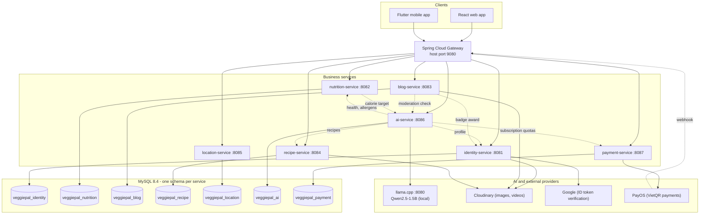
*Figure 11: REST-based microservices architecture*

Reading the diagram: every client request enters through the gateway, which fans out to seven independent services. Each service owns exactly one MySQL schema. Dotted arrows are synchronous REST calls between services: ai-service reads nutrition, recipe, identity and payment data; blog-service asks ai-service to check content and identity-service to award the challenge badge; nutrition-service asks ai-service for the daily calorie target. ai-service sends chat, meal-plan, recommendation and moderation prompts to the local llama.cpp server; it calls no cloud AI provider. Other external providers are reached directly by the service that needs them; PayOS reaches the system by sending a webhook to the gateway.

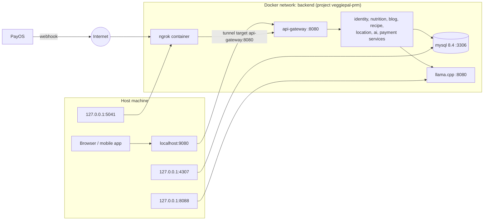
*Figure 12: Docker networking and infrastructure*

Reading the diagram: the main stack publishes three ports to the host: 9080 (gateway), 4307 (MySQL, bound to 127.0.0.1) and 5041 (Ngrok inspector, bound to 127.0.0.1). The separate local-inference Compose project publishes 8088, bound to 127.0.0.1, for host development; ai-service reaches `llama:8080` through the backend network. All other services are reachable only inside the Docker network. The Ngrok container forwards public traffic, such as the PayOS webhook, to `api-gateway:8080`.

#### 1.2 Package Diagram

Every Spring Boot service is an independent Maven project that follows the same layering; ai-service groups its code by feature instead of by layer.

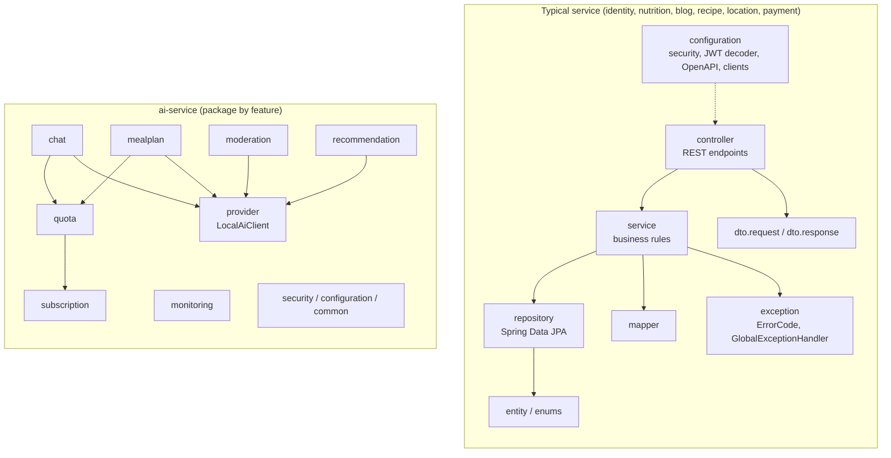
*Figure 13: Package diagram of the backend services*

Reading the diagram: in a typical service a controller calls a service, which uses repositories and mappers over JPA entities and throws exceptions defined by the service's `ErrorCode`. In ai-service, the text feature packages (chat, meal plan, recommendation, moderation) call the `provider` package, whose `LocalAiClient` sends the request to the local llama.cpp server; the chat and meal-plan packages use the `quota` package, and the quota package reads plan limits through the `subscription` client.

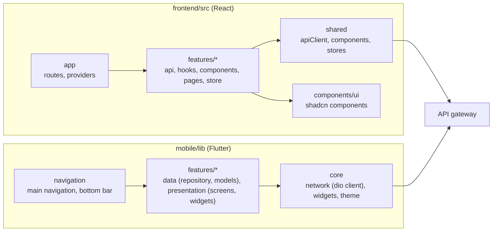
*Figure 14: Package diagram of the web and mobile applications*

Reading the diagram: both clients are organised by feature. Each web feature holds its API functions, React Query hooks, components and pages; every API call goes through the shared `apiClient`. Each mobile feature holds a data layer (repository and models) and a presentation layer (screens and widgets); calls go through the shared dio client in `core/network`.

##### Table 29: Backend package descriptions

| No | Package | Description |
| :-: | :--- | :--- |
| 1 | `com.veggiepal.<service>.configuration` | Security configuration, JWT decoder, OpenAPI and HTTP client beans. |
| 2 | `...controller` | REST controllers that validate input and call services. |
| 3 | `...dto.request`, `...dto.response` | Request and response objects. |
| 4 | `...service` | Business rules, transactions and calls to other services. |
| 5 | `...repository` | Spring Data JPA repositories, including native queries such as `ST_Distance_Sphere`. |
| 6 | `...entity`, `...enums` | JPA entities and enumerations. |
| 7 | `...exception` | `ErrorCode` enumeration and the global exception handler producing the common envelope. |
| 8 | `com.veggiepal.ai.<feature>` | ai-service feature packages: `chat`, `mealplan`, `moderation`, `quota`, `recommendation`, `monitoring`, `subscription`, `provider`, `security`, `configuration`, `common`. |
| 9 | `com.veggiepal.payment.payos` | PayOS gateway interface and SDK adapter. |

##### Table 30: Client package descriptions

| No | Package | Description |
| :-: | :--- | :--- |
| 1 | `frontend/src/app` | Routes (`routes.jsx`), providers and the content form host. |
| 2 | `frontend/src/features/<feature>` | One folder per feature: `api`, `hooks`, `components`, `pages`, `store`, `queryKeys.js`, `schema.js`. Features: auth, admin, blog, chatbot, community, diary, home, ingredient, meal-planner, my-content, payment, profile, recipe, restaurant-map, video. |
| 3 | `frontend/src/shared`, `components/ui`, `lib` | Shared `apiClient`, theme store, shared components, shadcn components, query client. |
| 4 | `mobile/lib/features/<feature>` | Feature modules: admin, ai_nutrition, auth, blog, community, home, ingredient, menu_planner, notifications, nutrition, payment, places, profile, recipe, video. |
| 5 | `mobile/lib/core`, `mobile/lib/navigation` | Network client, shared widgets and theme; main navigation and bottom bar. |

---

### 2. Database Design

Each microservice owns its private schema on MySQL 8.4. The AI schema is created by Flyway migrations V1 to V7 and validated by Hibernate (`ddl-auto=validate`); the other services let Hibernate update the schema (`ddl-auto=update`) and seed reference data with `data.sql`. There are 36 tables in 7 schemas (Table 31).

##### Table 31: Schemas and tables

| Schema | Tables |
| :--- | :--- |
| `veggiepal_identity` | `users`, `user_otps`, `refresh_tokens`, `user_favorites`, `user_badges` |
| `veggiepal_nutrition` | `allergens`, `user_allergies`, `health_records`, `food_logs`, `daily_wellness_logs` |
| `veggiepal_blog` | `categories`, `blogs`, `videos`, `comments`, `content_votes`, `user_follows`, `user_challenges` |
| `veggiepal_recipe` | `recipes`, `ingredients`, `recipe_ingredients`, `recipe_steps`, `recipe_likes` |
| `veggiepal_location` | `vegetarian_restaurants` |
| `veggiepal_ai` | `ai_meal_plans`, `ai_meal_plan_versions`, `ai_meal_plan_favorites`, `ai_conversations`, `ai_chat_messages`, `ai_guest_sessions`, `ai_daily_quotas`, `ai_usage_logs`, `ai_moderation_cases`, `ai_video_jobs` (legacy, unused by code) |
| `veggiepal_payment` | `subscription_plans`, `user_subscriptions`, `payment_orders` |

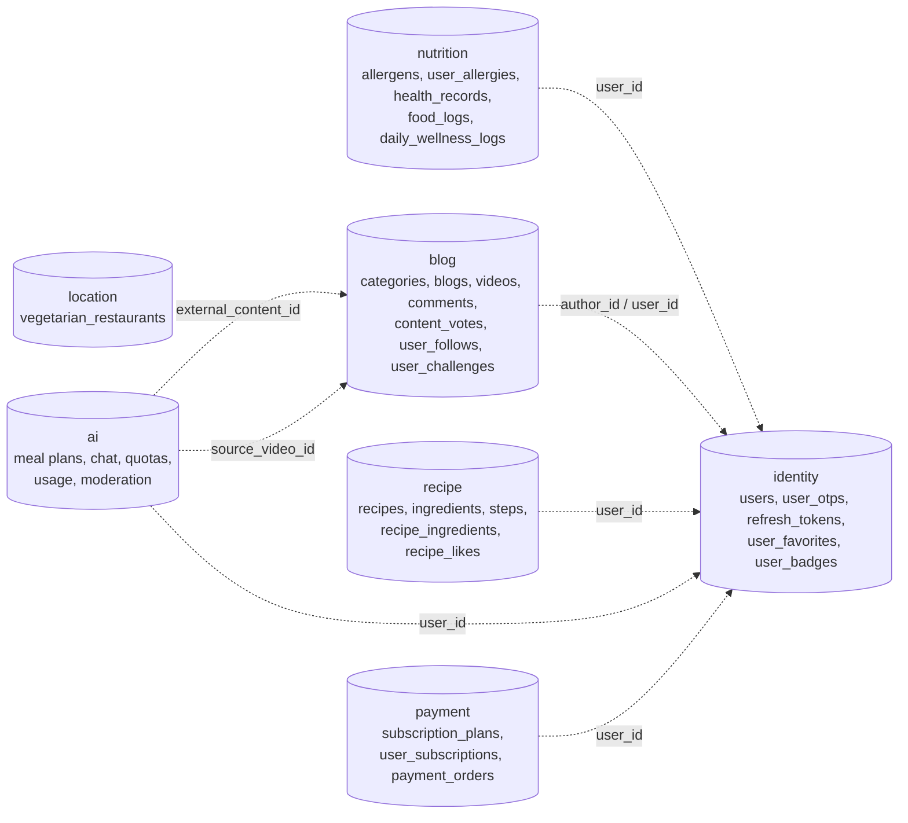
*Figure 15: Database-per-service overview and logical references*

Reading the diagram: the seven independent schemas. Dotted lines are logical references stored as plain numeric IDs (mostly the user ID from the JWT); they are not database foreign keys, which keeps every service independently deployable. Real foreign keys exist only inside a schema and are shown in Figure 16 to Figure 20.

#### 2.1 Normalisation (1NF, 2NF, 3NF)

All tables have a single-column primary key, atomic columns and no partial or transitive dependency on a non-key column, except for the deliberate exceptions in Table 32.

##### Table 32: Intentional exceptions to 3NF

| Column / table | Reason |
| :--- | :--- |
| `blogs.vote_score`, `videos.vote_score` | Cached sum of `content_votes`, updated with atomic SQL increments so lists can be sorted without aggregating votes. |
| `recipes.like_count` | Cached count of `recipe_likes` for the popular ranking. |
| `payment_orders.amount` | Copy of the plan price at checkout, so a later price change does not alter an existing order. |
| `ai_meal_plans.plan_json`, `ai_meal_plan_versions.plan_json` | The 7-day plan is one JSON document because it is always read and written as a whole; versions keep full copies. |
| `ai_moderation_cases` (content snapshot, migration V3) | Stores the checked text so the admin sees what was judged even if the content changes later. |
| `comments.target_type` / `target_id`, `content_votes.target_type` / `target_id` | Polymorphic reference to a blog or video; no foreign key is declared. |
| `user_id` columns in every service except identity | Logical reference to `users.id` in another database; cross-database foreign keys are not possible. |

#### 2.2 Table Descriptions

Figure 16 to Figure 20 show the columns, keys and relationships of each schema. Table 33 to Table 37 describe the purpose of each table.

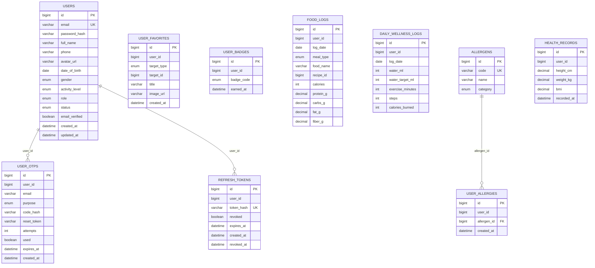
*Figure 16: Database diagram - identity and nutrition schemas*

Reading the diagram: `users`, `user_otps` (hashed 6-digit OTPs for password reset and e-mail verification) and `refresh_tokens` (SHA-256-hashed opaque refresh tokens for rotation and revocation) belong to identity-service. In nutrition-service, a user's allergen choices are rows in `user_allergies` pointing to the seeded `allergens` catalog; health records form a history of height, weight and BMI per user. `user_favorites` and `user_badges` hold profile collections and unlocked badges; nutrition-service also keeps the food diary (`food_logs`) and daily water and exercise tracking (`daily_wellness_logs`).

##### Table 33: Table descriptions - identity and nutrition

| Table | Purpose | Keys and constraints |
| :--- | :--- | :--- |
| `users` | Accounts with e-mail, BCrypt password hash, role, status, profile data | PK `id`; UK `email` |
| `user_otps` | Hashed OTP codes for password reset and e-mail verification | FK to `users` |
| `refresh_tokens` | Hashed opaque refresh tokens with expiry and revocation | UK `token_hash`; FK to `users` |
| `user_favorites` | Saved recipes, blogs and videos | logical `user_id` |
| `user_badges` | Unlocked green badges | logical `user_id` |
| `allergens` | Seeded catalog of allergens | UK `code` |
| `user_allergies` | Allergens declared by a user | FK to `allergens` |
| `health_records` | History of height, weight and BMI | logical `user_id` |
| `food_logs` | Food diary entries with nutrition values | logical `user_id` |
| `daily_wellness_logs` | Water, exercise minutes, steps and water target per day | logical `user_id` |

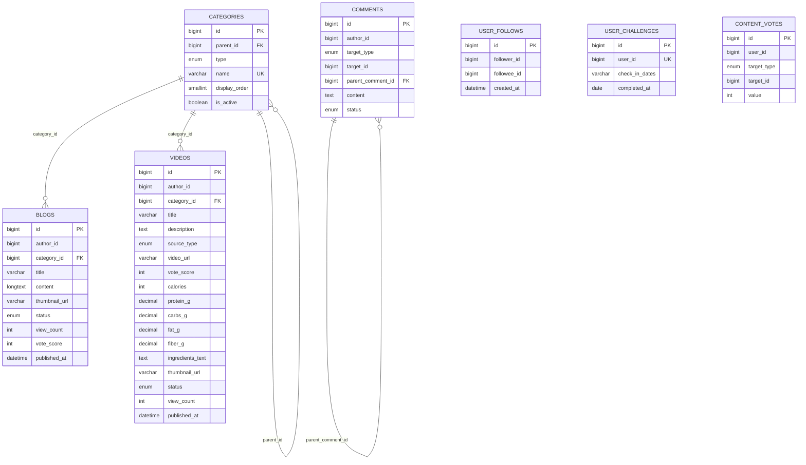
*Figure 17: Database diagram - blog schema*

Reading the diagram: categories form a two-level tree and every blog or video belongs to one category. Both `blogs` and `videos` carry a denormalized `vote_score` updated atomically; `videos` also stores optional nutrition facts and an ingredients list, and `user_follows` and `user_challenges` back author follows and the 7-day challenge. Comments and votes are polymorphic: `target_type` (BLOG or VIDEO) and `target_id` identify the content, so no foreign key is declared; comments reference their parent comment for nested replies. A unique constraint on votes allows one vote per user per target.

##### Table 34: Table descriptions - blog

| Table | Purpose | Keys and constraints |
| :--- | :--- | :--- |
| `categories` | Two-level category tree of type `FOOD_TYPE` or `RECIPE_TYPE` | Self FK `parent_id`; UK `name` |
| `blogs` | Markdown articles with status and vote score | FK `category_id` |
| `videos` | YouTube or uploaded videos with status, vote score and nutrition facts | FK `category_id` |
| `comments` | Nested comments on blogs or videos | Self FK `parent_comment_id`; polymorphic target |
| `content_votes` | One vote per user per target | Unique (user, target) |
| `user_follows` | Author follows | Columns `follower_id`, `followee_id` (logical references) with a unique constraint |
| `user_challenges` | Progress of the 7-day check-in challenge | UK `user_id` |

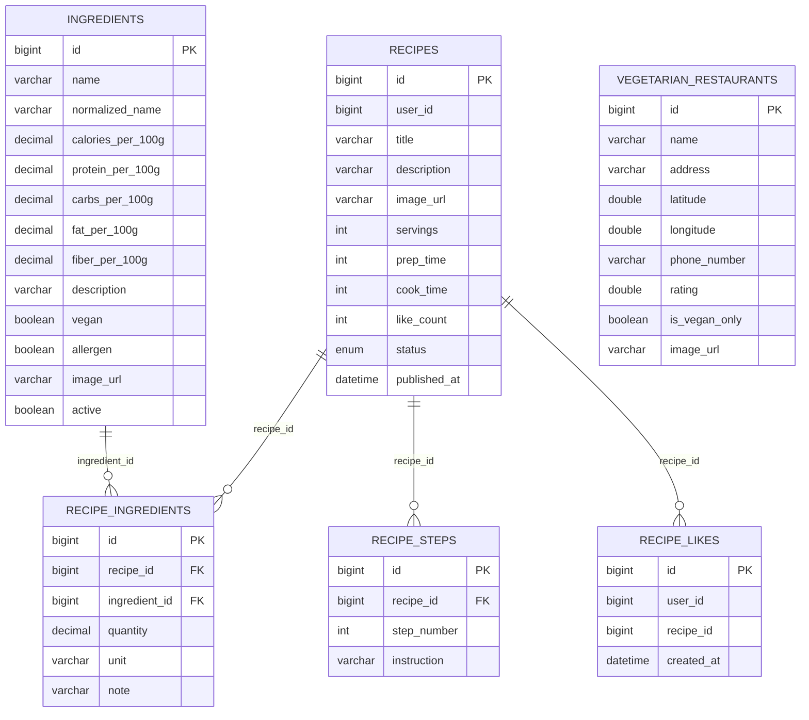
*Figure 18: Database diagram - recipe and location schemas*

Reading the diagram: `recipe_ingredients` is the associative table that gives each recipe its ingredients with quantity and unit (used together with `ingredients.*_per_100g` to compute per-serving nutrition), `recipe_steps` stores ordered cooking steps, and `recipe_likes` records per-user likes (unique on `user_id, recipe_id`) paired with the denormalized `recipes.like_count`. `vegetarian_restaurants` is a standalone table in location-service; its name, address, vegan flag and coordinates feed keyword search and `ST_Distance_Sphere` nearby search.

##### Table 35: Table descriptions - recipe and location

| Table | Purpose | Keys and constraints |
| :--- | :--- | :--- |
| `recipes` | Recipes with status, servings, image and like count | PK `id` |
| `ingredients` | Ingredient catalog with `vegan` and `allergen` flags and nutrition per 100 g | PK `id` |
| `recipe_ingredients` | Quantity and unit of an ingredient in a recipe | FK `recipe_id`, FK `ingredient_id` |
| `recipe_steps` | Ordered cooking steps | FK `recipe_id` |
| `recipe_likes` | Likes per user and recipe | Unique (`user_id`, `recipe_id`) |
| `vegetarian_restaurants` | Restaurants with coordinates, rating and vegan-only flag | PK `id` |

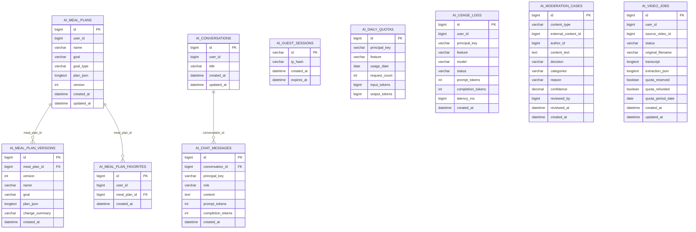
*Figure 19: Database diagram - AI schema*

Reading the diagram: a meal plan keeps its current JSON and a history of versions, and users can favorite plans (one favorite per user and plan). Conversations own their chat messages. `ai_guest_sessions` stores only a hash of the guest's IP address. `ai_daily_quotas` is unique per (principal, feature, date) and enforces usage limits; `ai_usage_logs` records every AI call with its token counts and latency for admin monitoring. Moderation cases reference content by ID only. `ai_video_jobs` is a legacy table created by migrations V1, V5 and V6; the entity, worker and endpoints were removed with the video pipeline and nothing reads or writes it.

##### Table 36: Table descriptions - AI

| Table | Purpose | Keys and constraints |
| :--- | :--- | :--- |
| `ai_meal_plans` | Current 7-day plan as JSON with goal, target and version | logical `user_id` |
| `ai_meal_plan_versions` | History of earlier plan contents | FK `meal_plan_id` |
| `ai_meal_plan_favorites` | Favorite plans | FK `meal_plan_id`; unique (user, plan) |
| `ai_conversations` | Chat conversations of signed-in users | logical `user_id` |
| `ai_chat_messages` | Messages of a conversation | FK `conversation_id` |
| `ai_guest_sessions` | Guest sessions with hashed IP and expiry | PK session ID |
| `ai_daily_quotas` | Usage counters per principal, feature and period | Unique (principal, feature, date) |
| `ai_usage_logs` | One row per AI call with model, tokens, latency and status | PK `id` |
| `ai_moderation_cases` | Moderation decisions and the checked text | content referenced by ID |
| `ai_video_jobs` | Legacy table of the removed video extraction pipeline; no code uses it | source video referenced by ID |

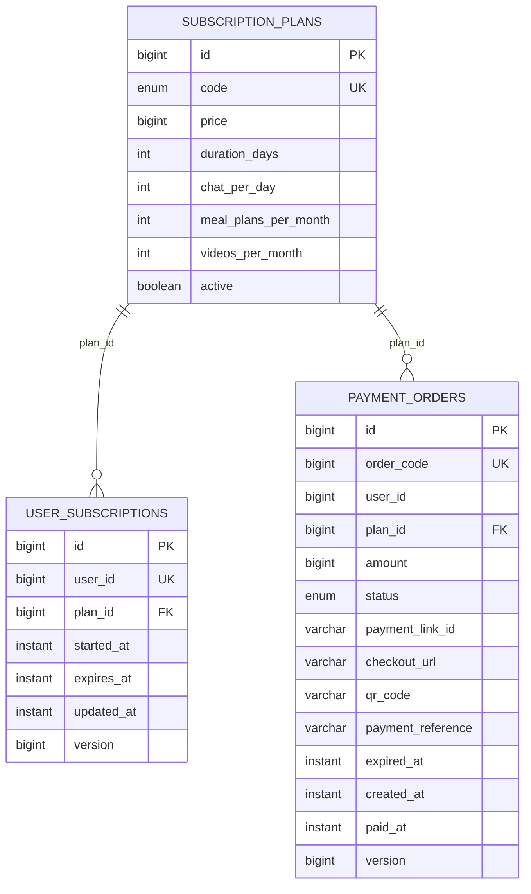
*Figure 20: Database diagram - payment schema*

Reading the diagram: the plan catalog (FREE, PLUS, PRO) holds price, duration and quotas. Each user has at most one current subscription row, and every checkout creates a payment order tied to a plan. The `version` columns provide optimistic locking.

##### Table 37: Table descriptions - payment

| Table | Purpose | Keys and constraints |
| :--- | :--- | :--- |
| `subscription_plans` | Plan catalog with price, duration and quotas (`videos_per_month` stays in the schema but no code sets or reads it) | UK `code` |
| `user_subscriptions` | The user's current subscription | UK `user_id`; FK `plan_id`; `version` |
| `payment_orders` | PayOS checkouts with status, link, QR data and expiry | UK `order_code`; FK `plan_id`; `version` |

#### 2.3 Seed Data

##### Table 38: Seed data loaded at start-up

| Service | Source | Content |
| :--- | :--- | :--- |
| identity-service | `data.sql` | Three accounts created if missing: `admin@veggiepal.com` (role `ADMIN`), `user@veggiepal.com` and `user2@veggiepal.com` (role `USER`). |
| nutrition-service | `data.sql` | 32 allergens in categories such as grain, legume, nut and seed, vegetable and fruit. |
| blog-service | `data.sql` | Category tree and sample blogs, comments and votes. |
| recipe-service | `data.sql` | 87 ingredients, 115 recipes with 508 recipe-ingredient rows and 363 steps. |
| location-service | `data.sql` | 100 vegetarian restaurants with coordinates. |
| payment-service | `PlanCatalogInitializer` | FREE (0 VND), PLUS (29,000 VND, 30 days) and PRO (59,000 VND, 30 days) with their quotas. |
| ai-service | Flyway `V1` to `V7` | Schema only; no seed rows. |

---

### 3. API Design

All clients use the gateway at `http://localhost:9080`; the aggregated Swagger UI is at `http://localhost:9080/swagger-ui.html`. Services answer with a common envelope (`code`, `message`, `result`) and use enum-based error codes grouped per service. Protected endpoints require `Authorization: Bearer <JWT>`.

##### Table 39: API groups and access rules

| Group | Examples (gateway path) | Access |
| :--- | :--- | :--- |
| Identity | `/api/auth/register`, `/api/auth/login`, `/api/auth/google`, `/api/auth/forgot-password`, `/api/auth/verify-otp`, `/api/auth/reset-password`, `/api/auth/send-verification`, `/api/auth/verify-email`, `/api/auth/refresh`, `/api/auth/logout`, `/api/users/me` (profile, password, avatar), `/api/users/me/favorites`, `/api/users/me/badges`, `/api/users/batch`, `/api/admin/users/**` | Public for auth, OTP, refresh and batch; JWT for `/api/users/me`; ADMIN for `/api/admin/users/**` |
| Nutrition | `/api/nutrition/me/allergies`, `/api/nutrition/me/health-records/**`, `/api/nutrition/me/food-logs`, `/api/nutrition/me/daily-activity`, `/api/nutrition/me/water`, `/api/nutrition/me/daily-summary` (`date`, `goalType`), allergen catalog | JWT |
| Blog and community | `/api/blogs/**` (including `/community/leaderboard`, `/community/trending-topics`, `/community/stats`, `/authors/{id}/follow`, `/me/following`, `/challenge/me`, `/challenge/check-in`), `/api/categories/**`, `/api/comments/**`, `/api/videos/**` (including `/channels`, `/{id}/nutrition`, `/{id}/vote`, `/me/votes`) | Public reads of published content, community stats and video channels; JWT to write, vote, follow and check in; ADMIN for categories and takedowns |
| Recipes | `/api/recipes/**` (`/popular`, `/{id}/image`, `/images`, `/{id}/like`, `/me/likes`), `/api/ingredients/**` | Public reads of recipe list, popular, detail and ingredients; JWT for authoring, image upload and likes; ADMIN for ingredient changes |
| Restaurants | `/api/restaurants`, `/api/restaurants/search`, `/api/restaurants/nearby` (`keyword`, `veganOnly`, `lat`, `lng`, `radiusKm`) | Public |
| AI chat | `/api/ai/chat/guest-sessions`, guest chat, member chat, conversations | Guest session or JWT |
| AI meal plans and quotas | `POST /api/ai/meal-plans`, `GET /api/ai/meal-plans`, `/quota`, `GET /api/ai/quotas/me`, `/nutrition-target`, `/favorites`, `/{id}/versions`, `/{id}/versions/{version}/restore`, `/{id}/preview-edit`, `/{id}/edit`, `/{id}/replace` | JWT |
| AI recommendations | `GET /api/ai/recommendations` | JWT |
| AI moderation and monitoring | `/api/ai/moderation/check`, `/ai/admin/moderation`, `/ai/admin/monitoring/**` | Service call / ADMIN |
| Payments | `GET /api/payments/plans`, `POST /api/payments/checkout`, `/api/payments/orders/{id}`, `/history`, `GET /api/subscriptions/me`, `POST /api/payments/webhook/payos`, `/api/admin/payments/**` | JWT; ADMIN for `/api/admin/payments/**`; webhook is public but signature-verified |
| Internal | `/internal/subscriptions/{userId}` (not routed through the gateway) | Internal service token |

Request and response schemas, status codes and examples for every endpoint are published in Swagger UI, generated from the OpenAPI definitions of each service.


---

### 4. Detailed Design

#### 4.1 Authentication and Session

identity-service issues the tokens; every other service validates them locally. Figure 21 shows the main classes and Table 40 their responsibilities.

```mermaid
classDiagram
    class UserController {
        +register(request)
        +login(request)
        +google(request)
    }
    class AuthLifecycleController {
        +forgotPassword()
        +verifyOtp()
        +resetPassword()
        +sendVerification()
        +verifyEmail()
        +refresh()
        +logout()
    }
    class UserService {
        +createUser(RegisterRequest)
        +login(LoginRequest)
        +loginWithGoogle(idToken)
    }
    class RefreshTokenService {
        +issue(userId)
        +refresh(rawRefreshToken)
        +revoke(rawRefreshToken)
        +revokeAllForUser(userId)
    }
    class JwtService {
        +generateToken(User)
    }
    class OtpService
    class GoogleTokenVerifier
    class UserRepository
    UserController --> UserService
    AuthLifecycleController --> RefreshTokenService
    AuthLifecycleController --> OtpService
    UserService --> JwtService
    UserService --> RefreshTokenService
    UserService --> GoogleTokenVerifier
    UserService --> UserRepository
    RefreshTokenService --> JwtService
```
*Figure 21: Class diagram of the authentication feature*

Reading the diagram: the two controllers expose the `/auth` endpoints. `UserService` verifies the credentials or the Google token and asks `JwtService` and `RefreshTokenService` for the two tokens; `RefreshTokenService` also rotates and revokes refresh tokens, and `OtpService` handles the 6-digit codes.

##### Table 40: Class specifications - authentication feature

| Class | Method | Responsibility |
| :--- | :--- | :--- |
| `UserController` | `register`, `login`, `google` | Exposes `POST /auth/register`, `/auth/login` and `/auth/google`. |
| `AuthLifecycleController` | `forgotPassword`, `verifyOtp`, `resetPassword`, `sendVerification`, `verifyEmail`, `refresh`, `logout` | Exposes the OTP, refresh and logout endpoints. |
| `UserService` | `createUser(request)` | Creates an `ACTIVE` account with a BCrypt hash and sends the verification code. |
| `UserService` | `login(request)` | Finds the user by normalised e-mail, verifies the password and the `ACTIVE` status (error 1021 otherwise), returns the JWT and a refresh token. |
| `UserService` | `loginWithGoogle(idToken)` | Verifies the Google token (including `email_verified`), links or creates the account and issues the same tokens. |
| `JwtService` | `generateToken(user)` | Signs an HS256 JWT with `userId` and `role`, valid 30 minutes. |
| `RefreshTokenService` | `issue(userId)` | Creates an opaque token and stores only its SHA-256 hash. |
| `RefreshTokenService` | `refresh(raw)` | Validates and rotates the token; a blocked user has all tokens revoked (error 1021); a reused token gives error 1030. |
| `RefreshTokenService` | `revoke(raw)`, `revokeAllForUser(userId)` | Revokes one token (logout) or all tokens (password change, account lock). |

```mermaid
sequenceDiagram
    autonumber
    actor C as Client
    participant GW as API Gateway
    participant ID as identity-service
    participant DB as veggiepal_identity
    participant S as Any other service

    C->>GW: POST /api/auth/login (email, password)
    GW->>ID: POST /auth/login
    ID->>DB: find user by normalized email
    DB-->>ID: user row
    ID->>ID: BCrypt verify password (cost 10)
    ID->>ID: verify user status is ACTIVE
    ID->>ID: sign JWT HS256 (userId, role, 30 min)
    ID->>DB: save SHA-256 hash of opaque refresh token
    ID-->>GW: JWT, refreshToken and user info
    GW-->>C: JWT, refreshToken and user info
    C->>GW: GET /api/... with Authorization Bearer token
    GW->>S: forward request
    S->>S: validate signature and expiry with shared secret
    S-->>C: response (401 if token invalid)
```
*Figure 22: Sequence diagram - log in and JWT issuance*

Reading the diagram: identity-service verifies the password hash and confirms that the account status is `ACTIVE` (rejecting locked or inactive accounts with HTTP 403), then signs a 30-minute HS256 JWT carrying `userId` and `role` and issues an opaque refresh token stored as a SHA-256 hash in `refresh_tokens`. Every later request carries the JWT as a Bearer header; each service validates the signature locally with the shared secret, so no service has to call identity-service for authentication. Google sign-in follows the same pattern, except identity-service verifies a Google ID token instead of a password before checking the status and issuing its own tokens. When a request returns HTTP 401, the client calls `POST /auth/refresh`, receives a rotated pair and repeats the request once.

#### 4.2 AI 7-Day Allergen-Safe Meal Plan

Figure 23 shows the classes of the meal-plan feature in ai-service and Table 41 their responsibilities.

```mermaid
classDiagram
    class MealPlanController
    class MealPlanService {
        +generate(userId, jwt, request)
        +replace(userId, id, jwt, request)
        +manualEdit(userId, id, jwt, request)
        +updateFromHealth(userId, id, jwt, request)
        +listVersions(userId, id)
        +restoreVersion(...)
        +nutritionTarget(jwt, goalType)
        +getQuota(userId)
    }
    class MealPlanValidator {
        +safeCandidates(recipes, allergies, available)
        +validateTarget(target)
        +validateAndEnrich(plan, recipes, allergies, ...)
        +mealBudgets(target)
    }
    class AllergenDetector {
        +detectAllergenCodes(name, normalizedName)
    }
    class NutritionTargetCalculator {
        +calculate(height, weight, ...)
        +guessGoal(goalText)
    }
    class LocalAiClient {
        +complete(messages, temperature, maxTokens)
    }
    class QuotaService {
        +reserveFeature(principal, feature, period, limit)
        +refundFeature(principal, feature, period)
    }
    class MealPlanRepository
    class MealPlanVersionRepository
    MealPlanController --> MealPlanService
    MealPlanService --> MealPlanValidator
    MealPlanService --> NutritionTargetCalculator
    MealPlanService --> LocalAiClient
    MealPlanService --> QuotaService
    MealPlanService --> MealPlanRepository
    MealPlanService --> MealPlanVersionRepository
    MealPlanValidator --> AllergenDetector
```
*Figure 23: Class diagram of the meal-plan feature*

Reading the diagram: `MealPlanService` orchestrates the use cases. It asks `NutritionTargetCalculator` for the target, `QuotaService` for a quota slot and `LocalAiClient`, which calls the local llama.cpp server, for the plan, and relies on `MealPlanValidator` (with `AllergenDetector`) to filter candidates and validate the result before saving through the repositories.

##### Table 41: Class specifications - meal-plan feature

| Class | Method | Responsibility |
| :--- | :--- | :--- |
| `MealPlanService` | `generate(userId, jwt, request)` | Gathers recipes, allergens and the health record from other services, resolves the target, reserves quota, builds and validates the plan, saves it. |
| `MealPlanService` | `replace`, `manualEdit` | Replaces one meal or edits a meal or serving multiplier; the edit creates a new version. |
| `MealPlanService` | `updateFromHealth(..., confirm)` | Previews or applies a recomputed target based on a new health record. |
| `MealPlanService` | `restoreVersion(...)` | Stores the current content as a history entry and makes an old version current. |
| `MealPlanValidator` | `safeCandidates(recipes, allergies, available)` | Removes recipes with a declared allergen and ranks the rest by matching available ingredients. |
| `MealPlanValidator` | `validateAndEnrich(plan, ...)` | Checks seven days x three meals, allowed recipe IDs, allergen safety and calorie budgets, and adds nutrition totals. |
| `AllergenDetector` | `detectAllergenCodes(name, normalizedName)` | Maps an ingredient name to allergen codes with word matching to avoid false positives. |
| `NutritionTargetCalculator` | `calculate(...)` | Computes BMR, TDEE and the calorie and macro target for a goal from height, weight, date of birth, gender and activity level. |
| `QuotaService` | `reserveFeature`, `refundFeature` | Atomically reserves and refunds usage per principal, feature and period. |

The numbered steps of the flow are:

1. The client sends `POST /api/ai/meal-plans` with a Bearer token (the service route is `/ai/meal-plans`).
2. ai-service calls recipe-service for the recipe list and calls nutrition-service with the user's token to read the allergens and the latest health record.
3. If the request has no daily nutrition target, ai-service computes one from the profile and health record (BMR/TDEE adjusted by the goal type) and validates it.
4. ai-service reserves one meal-plan unit from the monthly quota (plan limits are read from payment-service; an unavailable lookup is treated as FREE).
5. The validator removes every recipe that contains a declared allergen (profile allergens plus the food exclusions found in the request preferences) and ranks the remaining recipes by matching available ingredients.
6. ai-service asks the local Qwen2.5 model through llama.cpp (`AI_LOCAL_MODEL`, default `qwen2.5-1.5b-instruct`) to build a plan from these real recipe IDs. If inference fails, a deterministic planner is used.
7. The validator checks and enriches the plan: exactly seven days with breakfast, lunch and dinner, only allowed recipe IDs, allergen safety, and calories scaled toward the daily meal budgets.
8. The plan is stored in `ai_meal_plans` and returned; later edits create new versions.

```mermaid
sequenceDiagram
    autonumber
    actor C as Client
    participant GW as API Gateway
    participant AI as ai-service
    participant NU as nutrition-service
    participant RE as recipe-service
    participant PA as payment-service
    participant GQ as Local llama.cpp (Qwen2.5)
    participant DB as veggiepal_ai

    C->>GW: POST /api/ai/meal-plans (JWT, goal, preferences, ingredients)
    GW->>AI: POST /ai/meal-plans
    AI->>RE: GET /recipes (size 200)
    RE-->>AI: recipes with ingredients
    AI->>NU: GET /nutrition/me/allergies
    NU-->>AI: allergens
    AI->>AI: merge food exclusions declared in preferences
    AI->>NU: GET /nutrition/me/health-records/latest
    NU-->>AI: latest height, weight, BMI
    AI->>AI: resolve daily nutrition target (BMR / TDEE and goal)
    AI->>PA: GET /internal/subscriptions/{userId} (internal token)
    PA-->>AI: plan quotas
    AI->>DB: reserve monthly meal-plan quota
    AI->>AI: exclude allergen recipes, rank by available ingredients
    AI->>GQ: POST /v1/chat/completions with safe recipes and constraints
    alt LLM answered
        GQ-->>AI: candidate plan JSON
    else LLM failed
        AI->>AI: deterministic planner builds the plan
    end
    AI->>AI: validate 7 days x 3 meals, allergens, calorie budgets
    AI->>DB: save plan in ai_meal_plans
    AI-->>C: meal plan response
```
*Figure 24: Sequence diagram - meal plan generation*

Reading the diagram: ai-service gathers data from three services, reserves quota, filters unsafe recipes before local inference, lets Qwen2.5 choose among real recipe IDs only, and validates the result again on the server. When inference is unavailable the deterministic planner still produces a valid plan.

#### 4.3 Payment and Subscription

Figure 25 shows the classes of payment-service and Table 42 their responsibilities.

```mermaid
classDiagram
    class PaymentController {
        +plans()
        +checkout()
        +getOrder()
        +cancel()
        +history()
        +webhook()
    }
    class PaymentService {
        +checkout(userId, planCode)
        +cancel(userId, orderId)
        +getOrder(userId, orderId)
        +history(userId)
        +processWebhook(body)
    }
    class PayOsGateway {
        <<interface>>
    }
    class PayOsSdkAdapter
    class SubscriptionService {
        +expireSubscriptions()
    }
    class PlanCatalogInitializer
    class SubscriptionPlanRepository
    class PaymentOrderRepository
    PaymentController --> PaymentService
    PaymentService --> PayOsGateway
    PayOsSdkAdapter ..|> PayOsGateway
    PaymentService --> SubscriptionService
    PaymentService --> SubscriptionPlanRepository
    PaymentService --> PaymentOrderRepository
    PlanCatalogInitializer --> SubscriptionPlanRepository
```
*Figure 25: Class diagram of the payment feature*

Reading the diagram: `PaymentController` exposes the endpoints and delegates to `PaymentService`, which talks to PayOS only through the `PayOsGateway` interface (implemented by `PayOsSdkAdapter`), reads plans from `SubscriptionPlanRepository`, stores orders in `PaymentOrderRepository` and activates subscriptions through `SubscriptionService`. `PlanCatalogInitializer` seeds the plan catalog.

##### Table 42: Class specifications - payment feature

| Class | Method | Responsibility |
| :--- | :--- | :--- |
| `PaymentService` | `checkout(userId, planCode)` | Rejects the FREE plan. Reads the PayOS status of each pending order of the same plan: a paid one is marked `PAID` and returned, a closed one is cancelled, and a still-valid one is reused. Otherwise creates a `PENDING` order and a PayOS payment link (15-minute expiry) using the catalog price. |
| `PaymentService` | `getOrder(userId, orderId)` | Returns the order; for a pending order it reads the PayOS status at most every 5 seconds and marks the order `PAID` and activates the subscription if PayOS reports the link paid. |
| `PaymentService` | `cancel(userId, orderId)` | Cancels a pending order only after PayOS confirms the cancellation; a paid order is rejected without calling PayOS. |
| `PaymentService` | `processWebhook(body)` | Verifies the signature, locks the order by order code, ignores unknown, `PAID` or `CANCELLED` orders, rejects an amount mismatch, otherwise marks the order `PAID` and activates or extends the subscription once. |
| `SubscriptionService` | `expireSubscriptions()` | Scheduled hourly; moves expired subscriptions back to FREE. |
| `PlanCatalogInitializer` | start-up | Creates FREE, PLUS and PRO with price, duration and quotas. |

```mermaid
sequenceDiagram
    autonumber
    actor C as Client
    participant GW as API Gateway
    participant PA as payment-service
    participant PO as PayOS
    participant DB as veggiepal_payment
    participant B as Banking app

    C->>GW: POST /api/payments/checkout (planCode)
    GW->>PA: POST /payments/checkout
    PA->>PO: read status of an existing pending order
    PA->>DB: reuse pending order or create PENDING order
    PA->>PO: create payment link
    PO-->>PA: checkout URL and VietQR data
    PA-->>C: order with QR code
    C->>B: scan VietQR and pay
    B->>PO: bank transfer
    PO->>GW: POST /api/payments/webhook/payos (signed)
    GW->>PA: POST /payments/webhook/payos
    PA->>PA: verify webhook signature
    PA->>DB: lock order by order code
    alt order not found, PAID or CANCELLED
        PA-->>PO: acknowledge without changes
    else amount or payment link mismatch
        PA-->>PO: reject (error)
    else valid pending order
        PA->>DB: set order PAID and paid_at
        PA->>DB: activate or extend user subscription
        PA-->>PO: success
    end
    C->>GW: GET /api/subscriptions/me
    GW-->>C: active plan and quotas
```
*Figure 26: Sequence diagram - PayOS webhook payment processing*

Reading the diagram: a checkout creates a pending order and a VietQR code. After the bank transfer, PayOS calls the webhook through the Ngrok tunnel. payment-service verifies the signature, locks the order row, rejects mismatching amounts, and ignores orders that are already paid or cancelled, so a duplicate webhook cannot grant a subscription twice. If the webhook does not arrive, the status lookup that checkout and order polling make against PayOS marks the order paid under the same lock, so the plan is activated once either way.

#### 4.4 Content Moderation

blog-service asks ai-service to check text before it is published; the decision decides the content status.

```mermaid
sequenceDiagram
    autonumber
    actor U as User
    participant GW as API Gateway
    participant BL as blog-service
    participant AI as ai-service
    participant GQ as Local llama.cpp (Qwen2.5)
    participant DB as veggiepal_ai
    actor AD as Admin

    U->>GW: POST /api/blogs (publish)
    GW->>BL: forward request
    BL->>AI: POST /ai/moderation/check (title, content)
    AI->>GQ: classify the text against the violation categories (local model by default)
    alt LLM answered
        GQ-->>AI: decision
        AI->>DB: save moderation case
        AI-->>BL: APPROVED, REJECTED or REVIEW_REQUIRED
    else LLM or service unavailable
        BL->>BL: hold content as PENDING with a fixed reason
    end
    BL-->>U: blog with status PUBLISHED, REJECTED or PENDING
    AD->>GW: GET /api/ai/admin/moderation
    GW->>AI: pending cases
    AD->>GW: PUT /api/ai/admin/moderation/{id} (approve or reject, reason)
    GW->>AI: review case
    AI->>BL: synchronise the decision to the content
```
*Figure 27: Sequence diagram - content moderation*

Reading the diagram: a publish request is checked by ai-service. Approved content is published, rejected content gets the `REJECTED` status and uncertain content stays `PENDING`. If the check cannot be made, blog-service holds the content as `PENDING` instead of failing. An administrator decides the pending cases, and ai-service writes the decision back to the content.

##### Table 43: AI safeguards

| Concern | Mechanism | Location |
| :--- | :--- | :--- |
| Allergen exposure | Allergen recipes removed before the LLM call; the generated plan is validated again, including hidden allergens and missing allergen data. In the AI Chatbot, `DietaryRestrictionResolver` extracts declared food exclusions from messages, history, and health records; `ChatOutputGuard` rejects affirmative allergen recommendations (`ALLERGEN_VIOLATION`); retries inject allergy reminder hints; and `VeganMealFallback` guarantees allergen-free fallback meals. In meal planning, user preferences declaring allergies are extracted and merged into effective constraints, excluding allergen recipes before optimization. | `MealPlanValidator`, `AllergenDetector`, `DietaryRestrictionResolver`, `ChatOutputGuard`, `VeganMealFallback`, `MealPlanService` |
| Medical misinformation and health safety | Severe violation gate deterministically rejects dangerous disease cure and hospital treatment abandonment claims (`misinformation_dangerous`); benign vegan auto-approval is guarded against disease/medical terms; malformed moderation outputs default to manual review (`REVIEW_REQUIRED`). | `ModerationService` |
| Model outage or malformed output | Timeouts (10 s connect, 120 s read for the local model), deterministic planner fallback, structural validation of every plan; multi-meal chat output guard against duplicate dishes; recommendation JSON truncation recovery and grounded candidate fallbacks; no cloud fallback is configured. | `MealPlanService`, `LocalAiClient`, `ChatOutputGuard`, `RecommendationService` |
| Quota abuse | Atomic per-principal counters for chat and meal plans; guest sessions limited by hashed IP. An optional local-testing quota policy (profile `local-testing`, off by default) applies daily request and token limits per feature. | `QuotaService`, `GuestSessionService`, `LocalTestQuotaPolicy` |
| Moderation unavailable or uncertain | Content held as `PENDING` / `REVIEW_REQUIRED` for manual review; uncertain or failed classifications of the small local model also go to review. | `ModerationService`, `BlogService` |
| Invalid calorie target & meal imbalance | Target computed only for adults with a complete profile; floors and ceilings applied to the result. Per-meal substantive calorie threshold (>= 120 kcal) and distribution scoring prevent tiny meal anomalies across breakfast, lunch, and dinner. | `NutritionTargetCalculator`, `MealPlanValidator` |


---

## V. Software Testing Documentation

### 1. Scope of Testing

* **In scope:** business rules and use cases of the eight backend modules: registration, login, refresh-token rotation, OTP, BMI and calorie target calculation, allergen detection, meal-plan validation and versions, quotas and guest sessions, content moderation fallback, blog, comment and vote rules, recipe nutrition and units, restaurant search, PayOS signature and webhook handling, subscriptions, and gateway routing; and, in the Flutter mobile application, the repositories, session handling and screens (widget tests).
* **Levels:** unit tests, controller slice tests, repository and service integration tests, and CI regression runs.
* **Out of scope:** automated tests of the React web application (it is checked with `npm run lint` and by manual use), running the Flutter tests in the CI pipeline, and load tests.

### 2. Test Strategy

#### 2.1 Testing Types

##### Table 44: Testing types

| Type | Objective | Technique | Completion criteria |
| :--- | :--- | :--- | :--- |
| Unit test | Validate business rules in isolation (BMI, calorie target, allergen detection, meal-plan validation, quota, signature checks) | JUnit 5 with Mockito and AssertJ | Tests of the module pass |
| Controller slice test | Check routing, validation, authentication and authorization per endpoint | `@WebMvcTest` with MockMvc and Spring Security Test | Tests of the module pass |
| Integration test | Check repositories, native queries (`ST_Distance_Sphere`) and concurrency of counters | Spring Boot tests against H2 in MySQL mode or a MySQL 8.4 instance | Tests of the module pass |
| Flutter unit and widget test | Check mobile repositories, authentication and refresh handling, and screens | `flutter test` with `flutter_test` and fake HTTP responses (`mobile/test`) | All tests pass |
| CI regression | Detect regressions on each change to `backend/` | `mvn test` for every module in GitHub Actions | All matrix jobs are green |

#### 2.2 Test Levels

##### Table 45: Test types per test level

| Test type | Unit | Integration | System | Acceptance |
| :--- | :-: | :-: | :-: | :-: |
| Functional (business rules) | X | X | X | X |
| Concurrency and data integrity (votes, quotas, webhooks) | X | X | | |
| Security and authorization | X | X | X | |
| User interface and navigation | | | X | X |

System and acceptance checks run against the Docker Compose deployment and the two clients; there are no automated end-to-end tests in the repository.

#### 2.3 Supporting Tools

##### Table 46: Test supporting tools

| Tool | Use |
| :--- | :--- |
| JUnit 5, Mockito, AssertJ | Test framework, mocks and assertions |
| `flutter_test` | Unit and widget tests of the Flutter application |
| Spring Boot Test, Spring Security Test | Application context, MockMvc, JWT test support |
| H2 (MySQL mode) | In-memory database for ai-service, payment-service and recipe-service |
| MySQL 8.4 | Database for identity-service, nutrition-service, blog-service and location-service tests |
| Maven Surefire on OpenJDK 21 | Test execution (Temurin in CI) |
| GitHub Actions | Runs the tests of all eight modules on every backend change |
| Swagger UI | Manual check of endpoints through the gateway |

### 3. Test Plan

#### 3.1 Human Resources

##### Table 47: Testing roles

| Member | Role in testing | Evidence in the repository |
| :--- | :--- | :--- |
| Trương Hoàng Phú | Main author of the backend test suites and the CI pipeline | 11 of the 13 commits that touch `src/test` |
| Diệp Khai | Backend test contributor | 1 commit touching `src/test` |
| Phạm Gia Huy | Test contributor | 1 commit touching `src/test` |
| Lê Gia Hưng | Team leader | No commit touches `src/test` |

#### 3.2 Test Environment

##### Table 48: Test environment

| Purpose | Environment | Version |
| :--- | :--- | :--- |
| Developer machine | Windows 11 with OpenJDK 21 and the Maven wrapper | Java 21.0.12 |
| Test run for this report | Maven 3.10.0 from the wrapper, run on 2 November 2026 | H2-based modules only (ai-service re-run after the merge) |
| CI runner | GitHub-hosted runner with a MySQL 8.4 service container on port 3307 | `ubuntu-latest`, Temurin 21 |
| Flutter tests | Flutter 3.47.2 (stable) on the developer machine | `flutter test` in `mobile/` |
| Deployment check | Docker Compose on a self-hosted Windows x64 runner | Compose project `veggiepal-prm` |

#### 3.3 Test Milestones

##### Table 49: Test milestones

| Date | Milestone (from the commit history) |
| :-: | :--- |
| 22/10 | Identity authentication and storage tests; API gateway application tests. |
| 26/10 | Location, recipe, AI service, payment, blog video and moderation tests added; GitHub Actions pipeline created; payment internal-token test fixed for CI. |
| 29/10 - 30/10 | Remaining backend tasks completed and documentation synchronised. |

### 4. Test Cases

##### Table 50: Automated test suites

| Service | Test classes | Test methods | Test database | Command |
| :--- | :-: | :-: | :--- | :--- |
| api-gateway | 1 | 10 | none | `./mvnw test` |
| identity-service | 24 | 108 | MySQL 8.4 | `./mvnw test` |
| nutrition-service | 12 | 53 | MySQL 8.4 | `./mvnw test` |
| blog-service | 26 | 263 | MySQL 8.4 | `./mvnw test` |
| recipe-service | 6 | 38 | H2 | `./mvnw test` |
| location-service | 3 | 19 | MySQL 8.4 | `./mvnw test` |
| ai-service | 32 | 248 | H2 | `./mvnw test` |
| payment-service | 4 | 31 | H2 | `mvn test` |
| **Backend total** | **108** | **770** | | |
| Flutter application (`mobile/test`) | 25 files | 299 run | none | `flutter test` |

Test methods are counted from the `@Test`, `@ParameterizedTest` and `@RepeatedTest` annotations in the source; parameterized tests run more than once, so the runtime count of a module can be higher (ai-service runs 252).

The tables below list selected test cases that exist in the source. The result column states whether the test was executed for this report.

##### Table 51: Selected test cases - authentication and quota

| ID | Test method | Class | Expected result | Result |
| :-: | :--- | :--- | :--- | :-: |
| TC-01 | `login_activeUser_returnsToken` | `UserServiceTest` (identity) | An active user receives a token | Not run (needs MySQL) |
| TC-02 | `login_blockedUser_throwsUserBlocked` | `UserServiceTest` | A blocked user is refused with error 1021 | Not run (needs MySQL) |
| TC-03 | `loginWithGoogle_newEmail_createsActiveVerifiedUser` | `UserServiceTest` | Google sign-in with a new e-mail creates an active, verified user | Not run (needs MySQL) |
| TC-04 | `issueAndRotateRefreshToken` | `RefreshTokenServiceTest` | A refresh token is issued and rotated | Not run (needs MySQL) |
| TC-05 | `refresh_blockedUser_revokesTokensAndThrowsUserBlocked` | `RefreshTokenServiceTest` | Refreshing for a blocked user revokes the tokens and fails | Not run (needs MySQL) |
| TC-06 | `QuotaConcurrencyIntegrationTest` | `quota` package (ai-service) | Concurrency test of the quota counters | Pass |

##### Table 52: Selected test cases - meal planning

| ID | Test method | Class | Expected result | Result |
| :-: | :--- | :--- | :--- | :-: |
| TC-07 | `detectsSoyFromTofuAndSoyProducts` | `AllergenDetectorTest` | Tofu and soy products map to the soy allergen | Pass |
| TC-08 | `avoidsFalsePositiveSubstringMatches` | `AllergenDetectorTest` | A word that only contains an allergen keyword is not flagged | Pass |
| TC-09 | `rejectsMatchingAllergen` | `MealPlanValidatorTest` | A plan containing a declared allergen is rejected | Pass |
| TC-10 | `rejectsHiddenAllergenEvenIfFlagIsFalse` | `MealPlanValidatorTest` | A hidden allergen is caught even when the recipe flag says false | Pass |
| TC-11 | `femaleSedentaryLoseIsRaisedToTheFloor` | `NutritionTargetCalculatorTest` | A too-low calorie target is raised to the floor | Pass |
| TC-12 | `maleVeryActiveGainIsCappedAtTheCeiling` | `NutritionTargetCalculatorTest` | A too-high calorie target is capped at the ceiling | Pass |
| TC-13 | `missingOrUnknownProfileFieldsAreProfileIncomplete` | `NutritionTargetCalculatorTest` | A profile with missing fields gives the profile-incomplete error | Pass |

##### Table 53: Selected test cases - payment and restaurants

| ID | Test method | Class | Expected result | Result |
| :-: | :--- | :--- | :--- | :-: |
| TC-14 | `checkout_reusesValidPendingOrderWhenPayOsStillPending` | `PaymentServiceTest` | A valid pending order of the same plan is reused while PayOS still reports it pending | Pass |
| TC-15 | `checkout_freePlanIsRejected` | `PaymentServiceTest` | The FREE plan cannot be purchased | Pass |
| TC-16 | `processWebhook_verifiedMatchingPayment_marksPaidAndActivatesOnce` | `PaymentServiceTest` | A verified webhook with the right amount marks the order paid and activates the subscription once | Pass |
| TC-17 | `processWebhook_wrongAmountDoesNotActivate` | `PaymentServiceTest` | A wrong amount does not activate the subscription | Pass |
| TC-18 | `processWebhook_doesNotActivateCancelledOrder` | `PaymentServiceTest` | A webhook for a cancelled order is ignored | Pass |
| TC-19 | `cancel_rejectsPaidOrderWithoutCallingPayOs` | `PaymentServiceTest` | A paid order cannot be cancelled | Pass |
| TC-20 | `nearby_withoutLat_isInvalidRequest` | location-service controller test | A nearby search without `lat` is an invalid request | Not run (needs MySQL) |

### 5. Test Reports

#### 5.1 Execution Results

The modules that use H2 or no database were run on 2 and 3 November 2026 with `mvn test`; Table 54 gives the output of Maven. The other four modules need a MySQL 8.4 instance, which was not available on the machine used for this report (the Docker daemon was not running), so they were not run here; the CI `maven` job runs them against a MySQL service container.

##### Table 54: Test execution results

| Service | Tests run | Failures | Errors | Status |
| :--- | :-: | :-: | :-: | :--- |
| api-gateway | 10 | 0 | 0 | Pass (re-run on 3 November 2026) |
| payment-service | 31 | 0 | 0 | Pass (re-run on 3 November 2026 after the PayOS status check was added) |
| recipe-service | 38 | 0 | 0 | Pass |
| ai-service | 252 | 0 | 0 | Pass (`mvn test`, 3 November 2026, after self-hosted AI optimizations, food allergy safety, and AI integration defect fixes) |
| Flutter application | 299 | 0 | 0 | Pass (`flutter test`, 4 November 2026) |
| identity-service | - | - | - | Not run here (needs MySQL) |
| nutrition-service | - | - | - | Not run here (needs MySQL) |
| blog-service | - | - | - | Not run here (needs MySQL) |
| location-service | - | - | - | Not run here (needs MySQL) |

A first run of ai-service, before the self-hosted AI merge, reported 27 errors, "Unresolved compilation problem", in two test classes. They came from class files in `target/` that an IDE had compiled with errors; after `mvn clean test` all tests passed. Use `mvn clean test` when the IDE has compiled the project. The ai-service unit tests mock `LocalAiClient`; end-to-end quality, latency and hardware utilization against the live `llama.cpp` CUDA container (`Qwen2.5-1.5B-Instruct`) are measured by the reproducible benchmark suite in `backend/ai-inference/benchmark` (documented in `backend/SELF_HOSTED_AI_BENCHMARK.md`).

#### 5.2 Code Coverage

No coverage tool such as JaCoCo is configured in the service `pom.xml` files, so code coverage is not measured and the course recommendation of 60% coverage is not demonstrated. Adding the JaCoCo plugin to each service is listed in Section VII.3.

#### 5.3 Continuous Integration

The workflow `.github/workflows/ci-cd.yml` is named "VeggiePal CI/CD" and runs on a push or pull request to `dev` or `main` that changes a file under `backend/` or the workflow file itself. A change that touches only `mobile/`, `frontend/` or `docs/` does not start it.

##### Table 55: CI/CD jobs

| Job | Runs on | What it does |
| :--- | :--- | :--- |
| `maven` | ubuntu-latest, matrix of 8 modules (api-gateway, identity, nutrition, blog, recipe, location, ai, payment) | Starts a MySQL 8.4 service container, sets up Java 21 with a Maven cache, restores dependencies, runs `mvn test`, builds the Spring Boot package |
| `docker` | ubuntu-latest, same matrix, after `maven` | Builds the Docker image of each module from its Dockerfile |
| `compose-check` | ubuntu-latest, after `maven` | Validates the resolved Docker Compose configuration |
| `deploy` | self-hosted Windows x64 runner, only on push to `dev` or `main`, after `docker` and `compose-check` | Writes `.env` from the `BACKEND_ENV_FILE` secret, runs `docker compose up -d --build --wait`, then checks that every container is running and healthy; prints logs and fails otherwise |

```mermaid
flowchart LR
    T["Push or pull request to dev / main<br/>that changes backend/ or the workflow"] --> M

    subgraph M["maven job (matrix, 8 modules)"]
        M1["Restore dependencies"] --> M2["mvn test"] --> M3["mvn package"]
    end

    M --> D["docker job (matrix)<br/>build image per module"]
    M --> C["compose-check job<br/>docker compose config"]
    D --> P
    C --> P

    subgraph P["deploy job (push only, self-hosted Windows runner)"]
        P1["Prepare .env"] --> P2["docker compose up -d --build --wait"] --> P3["Verify containers running and healthy"]
    end
```
*Figure 28: CI/CD pipeline (GitHub Actions to local Docker Compose deployment)*

Reading the diagram: the pipeline starts only when a change touches `backend/` or the workflow file. Test and package run in parallel for every backend module; Docker image builds and Compose validation run next; deployment to the local runner runs only for pushes to `dev` or `main`. The pipeline covers the backend only; the web and mobile clients are built and run manually.


---

## VI. Release Package & User Guides

### 1. Deliverable Package

##### Table 56: Deliverable package

| No. | Deliverable item | Path / address | Description |
| :-: | :--- | :--- | :--- |
| 1 | Backend source code | `/backend` | 7 Spring Boot business services and 1 API gateway, each with its own Dockerfile |
| 2 | Web frontend | `/frontend` | React 19, Vite, Tailwind CSS web application |
| 3 | Mobile application | `/mobile` | Flutter client application (user app and admin app) |
| 4 | Backend deployment | `/backend/docker-compose.yml`, `/backend/docker-compose.infra.yml`, `/backend/ai-inference/compose.local-ai.yml` | The main stack starts the gateway, seven services, MySQL 8.4 and Ngrok; the local-AI file starts one llama.cpp server on the same network; the infrastructure file runs MySQL and Ngrok for host development. Flyway (ai-service), Hibernate and `data.sql` prepare the service data. |
| 5 | CI/CD pipeline | `/.github/workflows/ci-cd.yml` | Backend Maven matrix, Docker build, Compose validation, deployment to a self-hosted runner |
| 6 | API documentation | `http://localhost:9080/swagger-ui.html` | Aggregated OpenAPI / Swagger specification |
| 7 | Documentation | `/docs`, `/backend/SELF_HOSTED_AI_*.md` | This report, the course documents and the self-hosted AI architecture, setup and benchmark notes |

### 2. Installation Guides

#### 2.1 System Requirements

##### Table 57: System requirements

| Component | Requirement |
| :--- | :--- |
| Operating system | Windows 10/11 64-bit, macOS, or Ubuntu 22.04 LTS |
| Hardware | Local inference targets a 32 GB RAM Windows 11 / WSL2 machine with an NVIDIA Quadro T2000 (4 GB VRAM); a CPU fallback is provided. The Q4_K_M model file is about 1.12 GB, with extra memory for context and buffers. |
| Backend | Docker Desktop (Docker Compose v2+), Git; OpenJDK 21 only for running services outside Docker |
| Web | Node.js and npm |
| Mobile | A Flutter SDK compatible with the Dart constraint `^3.13.2` in `mobile/pubspec.yaml` |

#### 2.2 Installation Instruction

##### 2.2.1 Backend

```bash
# 1. Clone the repository
git clone https://github.com/Phu0312/VeggiePal-Microservice.git
cd VeggiePal-Microservice

# 2. Create the environment file and fill it in
cp backend/.env.example backend/.env

# 3. Download the Qwen2.5-1.5B-Instruct Q4_K_M GGUF file into backend/ai-inference/models
#    (see backend/SELF_HOSTED_AI_SETUP.md)

# 4. Start MySQL and the backend network, then the local inference server
cd backend
docker compose --project-name veggiepal-prm up -d mysql
docker compose -f ai-inference/compose.local-ai.yml up -d

# 5. Start the whole backend
docker compose --project-name veggiepal-prm up -d --build --wait
```

The local inference container joins the `veggiepal-prm-backend` network created by the main project, and `ai-service` reaches it at `http://llama:8080/v1`. Use `-f ai-inference/compose.local-ai.yml -f ai-inference/compose.cpu.yml` for the CPU fallback.

Required for the stack to start: `DB_PASSWORD`, `JWT_SECRET`, `NGROK_AUTHTOKEN`. Needed for the related features: `INTERNAL_SERVICE_TOKEN`, `CLOUDINARY_*` (images and videos), `GOOGLE_CLIENT_ID` (Google sign-in), `MAIL_*` (SMTP delivery for OTP e-mails; the code is written to the application log when `MAIL_HOST` is omitted in local development) and the `PAYOS_*` credentials (payments). The template also lists `AI_LOCAL_BASE_URL`, `AI_LOCAL_MODEL`, the local connect and read timeouts and the optional local-testing quota settings.

##### Table 58: System endpoints after start-up

| Endpoint | Address |
| :--- | :--- |
| API gateway and Swagger UI | http://localhost:9080/swagger-ui.html |
| MySQL | 127.0.0.1:4307 |
| Ngrok inspector | http://localhost:5041 |
| Local inference server (llama.cpp) | http://127.0.0.1:8088 (`/health`), bound to loopback |

Register the PayOS webhook as `https://<ngrok-domain>/api/payments/webhook/payos`.

##### 2.2.2 Web Application

```bash
cd frontend
npm install
npm run dev
```

The web application reads `VITE_VEGGIEPAL_API_BASE_URL` (gateway address), `VITE_MAPBOX_TOKEN`, `VITE_MAPBOX_STYLE` and `VITE_GOOGLE_CLIENT_ID` from `frontend/.env`.

##### 2.2.3 Mobile Application

```bash
cd mobile
flutter pub get
flutter run
```

The mobile app reads `mobile/.env` (copy `mobile/.env.example`): `API_BASE_URL` for the gateway and, for Google sign-in, `GOOGLE_CLIENT_ID` (the same OAuth web client ID as identity-service) and, on iOS, `GOOGLE_IOS_CLIENT_ID`.

### 3. User Manual

#### 3.1 Overview

VeggiePal is used through two clients:

* **Guests and users:** the web application and the mobile application. Guests can read public content, search restaurants and try the chatbot; users also keep a health profile, generate meal plans, write content and subscribe.
* **Administrators:** the admin area of the web application and the admin app that the mobile application opens for accounts with the `ADMIN` role.

The seeded accounts are listed in Table 38.

#### 3.2 Guest

1. **Browse:** open the home page, blog feed, recipes or videos; no sign-in is needed.
2. **Find restaurants:** the restaurant search API is public, but the web map page asks the guest to sign in.
3. **Try the chatbot:** open the chatbot; the client creates a guest session and allows 3 chat requests per day per IP. After that the API answers error 6003 and the client suggests registering.
4. **Register or log in:** choose "Register" or "Continue with Google". After registration the mobile app opens the e-mail verification screen (can be skipped with "Later"); the web app shows a verification banner on the profile instead.
5. **Recover a password:** "Forgot password?" opens three steps: e-mail, 6-digit code, new password (typed twice in the mobile app). After too many wrong codes (error 1026) or an expired reset token (error 1027) the screen returns to the e-mail step.

```mermaid
flowchart TD
    A["Open app"] --> B{"Account?"}
    B -- "New" --> C["Register with email / password<br/>or Google sign-in"]
    B -- "Existing" --> D["Login"]
    D -. "Forgot password" .-> R["Email OTP, reset token,<br/>new password"]
    R -.-> D
    C --> E["JWT and refresh token<br/>stored on device"]
    D --> E
    E -. "Email not verified" .-> V["Optional: verify email<br/>with 6-digit OTP"]
    E --> F["Profile > Health Profile"]
    F --> G["Enter height and weight<br/>(BMI computed by server)"]
    G --> G2["Enter date of birth, gender,<br/>activity level"]
    G2 --> H["Select allergens"]
    H --> I["Saved in nutrition-service"]
```
*Figure 29: Registration and health profile workflow*

Reading the diagram: the first-use workflow is to authenticate, store the tokens, then enter body measurements, the profile details used for the calorie target, and allergens, which later drive meal planning. The dotted branches are the optional e-mail verification and the password recovery that returns to the login screen.

#### 3.3 User

##### 3.3.1 Set up the health profile

1. Open Profile, Health Profile and enter height (cm) and weight (kg); the server computes BMI.
2. Open Personal Information and enter date of birth, gender and activity level; the meal planner needs them to compute the daily calorie target, and targets are only available from age 18.
3. Select all personal allergens.
4. The mobile Profile summarises the account: current plan, the number of the user's blogs, recipes and videos, the latest BMI and a chart of BMI or weight over the last six records, and it reminds the user of missing profile fields.

##### 3.3.2 Generate a 7-day personalized meal plan

1. Open Menu Planner, Generate Plan.
2. Name the plan, select a goal (lose, maintain or gain weight) and optionally list the ingredients you have on hand (the mobile app can copy non-expired pantry items, up to the 30 ingredients the server accepts). Both apps also accept allergies or foods you do not eat (up to 10 entries, for example "đậu nành"); the server adds them to the allergens saved in your profile and drops every recipe that contains them. The web app also accepts flavour preferences and a custom nutrition target.
3. The system computes the nutrition target, excludes recipes containing your allergens, saves the plan and shows breakfast, lunch and dinner for seven days with the totals of each day and a warning on days that miss the calorie target.
4. Open any meal to see its quantities, per-serving nutrition and steps. Replace a single meal, restore historical versions, favorite plans. Under the Create button the app shows how many meal plans remain this month.

```mermaid
flowchart TD
    A["Menu Planner > Generate Plan"] --> B["Name the plan, choose goal<br/>lose / maintain / gain weight"]
    B --> C["Optional: ingredients on hand, foods to avoid<br/>(web also: flavour preferences, target)"]
    C --> D["Submit"]
    D --> E{"Monthly plan quota left?"}
    E -- "No" --> F["Show quota exceeded<br/>offer PLUS / PRO upgrade"]
    E -- "Yes" --> G["Server filters allergens,<br/>builds and validates plan"]
    G --> H["Weekly schedule: 7 days x<br/>breakfast, lunch, dinner"]
    H --> I["Open recipe: ingredients and steps"]
    H --> J["Replace a meal / edit / favorite"]
```
*Figure 30: Meal plan workflow*

Reading the diagram: the planner workflow includes the quota check that can send the user to the subscription screen.

##### 3.3.3 Find nearby vegan restaurants

1. Open the Places tab (mobile) or `/map` (web) and allow location access.
2. The app asks location-service for restaurants within the chosen radius around the user, optionally filtered by keyword or vegan-only.
3. Results are ordered by distance computed by MySQL `ST_Distance_Sphere`, with rating and vegan-only flag.
4. In the mobile app, typing filters the loaded list; pressing Enter calls `GET /restaurants/search`, which searches every restaurant by name or address without the radius limit. In the web app, typing a keyword calls the same search after a short pause; clearing it returns to the radius search.

```mermaid
sequenceDiagram
    autonumber
    actor U as User
    participant APP as Mobile / Web app
    participant GW as API Gateway
    participant LO as location-service
    participant DB as veggiepal_location

    U->>APP: open Places tab, allow location
    APP->>GW: GET /api/restaurants/nearby (lat, lng, radius)
    GW->>LO: forward request
    LO->>DB: select within radius, order by ST_Distance_Sphere
    DB-->>LO: restaurants with distance in meters
    LO-->>APP: restaurants with distanceKm
    APP-->>U: map markers and list sorted by distance
```
*Figure 31: Nearby restaurant discovery workflow*

Reading the diagram: the client sends its coordinates and radius, the database computes the spherical distance, and the app renders the results sorted by proximity.

##### 3.3.4 Upgrade to PLUS or PRO

1. Open Profile, Subscription (pricing). The screen shows the current plan with its expiry date, the quotas of each plan and the quota already used.
2. Select PLUS or PRO; choosing a different paid plan than the current one asks for confirmation because it replaces the current plan.
3. The app creates the order and shows the VietQR code with the amount, account and transfer content. Scan it with a Vietnamese banking app. The app polls the order every 2.5 seconds, shows a countdown, offers to recreate an expired code and lets the user cancel a pending order.
4. After PayOS confirms the payment through the webhook, the order becomes `PAID` and the subscription is active for 30 days; paying again for the active plan adds 30 days. Past orders are listed under Payment history.

##### Table 59: Subscription plans and quotas

| Plan | Price | Chat per day | Meal plans per month |
| :--- | :--- | :-: | :-: |
| FREE | 0 VND | 5 | 2 |
| PLUS | 29,000 VND / 30 days | 20 | 8 |
| PRO | 59,000 VND / 30 days | 50 | 20 |

```mermaid
flowchart TD
    A["Profile > Subscription"] --> B["Choose PLUS or PRO"]
    B --> C["Create checkout (payment-service)"]
    C --> D["Show VietQR code"]
    D --> E["User pays in banking app"]
    E --> F["PayOS sends signed webhook"]
    F --> G{"Signature, amount,<br/>order state valid?"}
    G -- "No" --> H["Webhook rejected or ignored"]
    G -- "Yes" --> I["Order PAID,<br/>subscription activated"]
    I --> J["App reads /api/subscriptions/me<br/>and shows new quotas"]
```
*Figure 32: PayOS subscription workflow*

Reading the diagram: the paying workflow runs from plan selection to activation. The subscription changes only after the signed webhook has been verified.

##### 3.3.5 Track daily nutrition

1. Open Profile, Nutrition diary (`/diary` on the web). The summary for the chosen day (never later than today) shows calories eaten against the target, protein, carbohydrate and fat against their targets, water, exercise and the entries grouped into breakfast, lunch, dinner and snacks.
2. Choose a goal (lose, maintain or gain); the choice is remembered for the next visit.
3. "Log food" opens a form with the food name, the meal and optional nutrition values. Water is added with +250 ml, +500 ml or a custom amount of 1 to 5000 ml. The Exercise card edits minutes, steps, calories burned and the water target.
4. If the health record or profile is incomplete (error 2013) or the user is under 18 (error 2014), the app shows a card that leads to the profile form; if ai-service cannot be reached (error 2012) it offers a retry button. In the mobile app the recipe detail screen has "Log 1 serving to diary".

##### 3.3.6 Community, saved items and content

1. **Feed:** the Home tab has a Community segment (challenge, trending categories, top authors, blog feed), a Recipes segment (search, Newest, Popular and "no allergen" chips) and a Videos segment (recommended channels and the video feed). On the web the same cards are in the columns of `/blog` and `/videos`.
2. **Follow and challenge:** follow or unfollow an author; "Check in today" once a day for seven days. On day 7 the "green heart" badge is awarded; if the award fails the app shows "Claim badge", which repeats the check-in.
3. **Save:** the bookmark button on a recipe, blog or video saves it to Favourites; Profile lists them and the green badges.
4. **Write:** create blogs, recipes (with an image uploaded from the device) and videos (YouTube link or an `.mp4` of at most 30 MB). New blogs and videos are moderated; if the AI is unavailable the item is held as "Chờ kiểm duyệt" (pending).
5. **Vote, comment, like:** vote up or down on blogs and videos, comment on several levels, like recipes.
6. **Chat with the assistant:** members get conversation history and the remaining daily requests; formatted replies show headings, lists and tables. Replies come from the local Qwen2.5 model, so they can be slower than a cloud model on a machine without a GPU.

#### 3.4 Administrator

1. Sign in with an account whose role is `ADMIN`. The mobile app opens the admin app with six tabs: Moderation, Categories, Ingredients, Members, Payments and AI. The web app opens `/admin`.
2. **Members:** accounts are listed newest first (20 per page). Search by e-mail or name and filter by role and status. A row shows the role, the status and whether the e-mail is unverified.
3. **Lock an account:** choose "Lock account" and confirm (`PATCH /admin/users/{id}/status` with `BLOCKED`). The user can no longer sign in and their refresh tokens are revoked; an access token already issued stays valid until it expires (30 minutes). A locked account offers "Unlock account"; a pending or inactive account offers "Activate account".
4. **Change a role:** "Grant administrator role" or "Remove administrator role" with confirmation. An administrator cannot lock or demote their own account (error 1022); errors 1020 and 1023 reload the list.
5. **Moderation:** review flagged blogs and videos, approve or reject with a reason, or dismiss a case from the queue without changing the content.
6. **Categories and ingredients:** maintain the two-level category tree and the ingredient catalog.
7. **Payments and AI:** read payment statistics, revenue and orders; read AI usage, logs, models and limits.


---

## VII. Appendix

### 1. Glossary

##### Table 60: Glossary

| Term | Meaning in VeggiePal |
| :--- | :--- |
| Allergen | A substance a user declares to avoid; recipes containing it are excluded from meal plans. |
| Meal plan | A 7-day schedule of breakfast, lunch and dinner (21 meals) generated for a user and stored with its versions. |
| Deterministic planner | The server-side fallback that builds a valid plan when the LLM call fails. |
| Guest session | A 24-hour anonymous session that allows a limited number of chatbot requests per IP. |
| Quota | The usage limit of a subscription plan for chat (per day) and meal plans (per month). |
| Refresh token | An opaque, single-use token stored hashed on the server and exchanged for a new access token. |
| Moderation case | The stored result of an AI content check, reviewed by an administrator when it needs review. |
| Webhook | The signed HTTP call that PayOS sends to confirm a payment. |
| Local inference | Running the language model on the project's own host through llama.cpp instead of calling a cloud API. |
| Idempotent | Processing the same webhook or request more than once has the same effect as processing it once. |
| VietQR | The Vietnamese QR bank-transfer standard used by PayOS. |
| Database-per-service | Each microservice owns its schema; other services refer to its data only by ID. |

### 2. References

1. FPT University - Report 7 template (`docs/template.md`) and PRM393 Final Project requirements (`docs/requirement_1.md`, `docs/requirement_2.md`).
2. Dietary Guidelines for Americans, U.S. Department of Agriculture (USDA) - guidance on vegetarian eating patterns.
3. Spring Boot and Spring Cloud Gateway reference documentation, VMware Tanzu.
4. Flutter documentation - [docs.flutter.dev](https://docs.flutter.dev).
5. React documentation - [react.dev](https://react.dev).
6. MySQL 8.4 Reference Manual - spatial function `ST_Distance_Sphere`.
7. RFC 7519 - JSON Web Token (JWT), Internet Engineering Task Force (IETF).
8. PayOS developer documentation - payment link creation and webhook verification.
9. llama.cpp and Qwen2.5 documentation; project notes `backend/SELF_HOSTED_AI_ARCHITECTURE.md` and `backend/SELF_HOSTED_AI_SETUP.md`.
10. VeggiePal source code - [github.com/Phu0312/VeggiePal-Microservice](https://github.com/Phu0312/VeggiePal-Microservice).

### 3. Others

#### 3.1 Project Metrics Summary

##### Table 61: Project metrics summary

| Metric | Value |
| :--- | :--- |
| Backend modules | 8 (7 business services and 1 API gateway) |
| Database schemas | 7 isolated MySQL schemas |
| Database tables | 36 |
| Backend test classes / test methods | 108 / 770 |
| Flutter test files / tests run | 25 / 299 |
| Subscription plans | 3 (FREE, PLUS, PRO) |
| CI jobs | `maven` and `docker` (matrix of 8 modules each), `compose-check`, `deploy` |
| Published host ports | 9080 (gateway), 4307 (MySQL), 5041 (Ngrok inspector), 8088 (local inference, loopback only) |
| Client applications | React web application, Flutter mobile application |

#### 3.2 Results Achieved

* A microservices backend (7 services and a gateway) started with Docker Compose, a separate local-inference Compose project, and aggregated Swagger documentation.
* Authentication with BCrypt, HS256 JWT validation in every service, opaque refresh-token rotation and revocation, 6-digit e-mail OTP password recovery and verification, and Google sign-in.
* Allergen-aware AI meal planning with server-side validation and a fallback planner; a local Qwen2.5 model served by llama.cpp for chat, meal planning, recommendations and text moderation.
* A community module with nested comments, voting, follows, a 7-day challenge and administrator moderation.
* A domestic payment flow with PayOS VietQR, signed and idempotent webhook processing, and plan-based quotas.
* A GitHub Actions pipeline that tests, packages, builds images, validates Compose and deploys to a local runner.

#### 3.3 Future Development

* **Quality:** archive Surefire reports from CI, add JaCoCo to measure code coverage (target at least 60%), and add reproducible load tests for the gateway and the AI endpoints.
* **CI/CD:** add build and lint steps for the React and Flutter projects, and publish test reports as workflow artifacts.
* **Resilience and observability:** add retry and circuit-breaker policies and monitoring for the local inference server and the external Cloudinary, Google and PayOS dependencies.
* **Scalability:** introduce asynchronous messaging only if measured throughput requires it, for example for moderation.
* **Product:** push notifications, richer nutrition analysis (micronutrient tracking), and more recipe and restaurant data.
