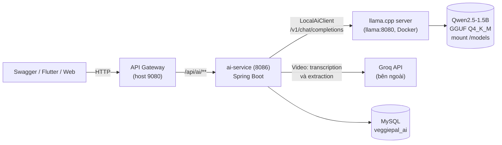
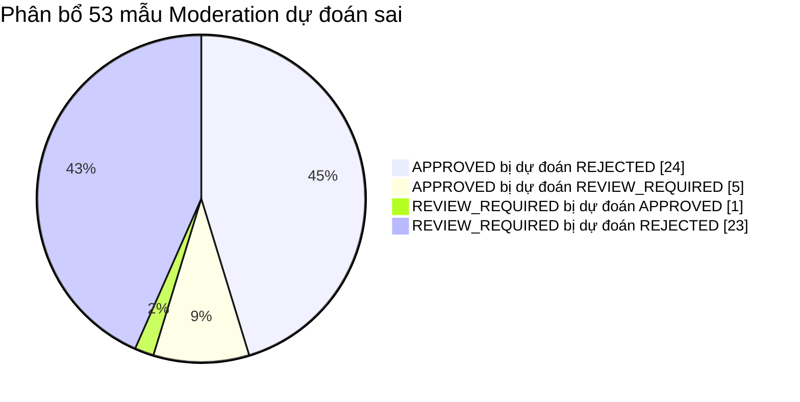

# HỒ SƠ TRIỂN KHAI AI VEGGIEPAL
## Đóng gói và tích hợp Model AI tự triển khai (Self-Hosted Model Integration) – Task 2, mục 2.3 và 2.4

**Báo cáo kỹ thuật tổng hợp** | *31/10/2026*
**Phạm vi:** Chatbot • Meal Planning • Recommendations • Text Moderation (Video Processing vẫn dùng Groq)
**Tài liệu đối chiếu:** `docs/requirement_2.md` (mục 2.3, 2.4 và Nội dung thuyết trình 8–14)

> **Trạng thái tài liệu.** Đây là hồ sơ phương án tích hợp model self-hosted và kết quả chạy thử trên một stack Docker local của nhóm. Mã tích hợp (`LocalAiClient`, thư mục `ai-inference/`, script benchmark) **chưa nằm trong repository chính**; `ai-service` trên repository chính hiện vẫn gọi Groq. Mọi con số trong tài liệu là số do công cụ benchmark của lần chạy thử báo cáo. Các mục chưa thực hiện được ghi rõ là **chưa thực hiện**, không điền số ước đoán.

> **Điểm cần trình bày chính xác.** Nhóm triển khai và tối ưu mô hình đã huấn luyện sẵn, **KHÔNG** tự huấn luyện Qwen từ đầu và **KHÔNG** fine-tune trọng số. Phần nhóm làm là đóng gói, tích hợp, kiểm tra dữ liệu bằng Java, tối ưu prompt và đo hiệu năng.

---

## Mục lục

1. [Tóm tắt và đối chiếu requirement_2](#1-tóm-tắt-và-đối-chiếu-requirement_2)
2. [Phân biệt Train, Fine-tune, Quantization và Inference](#2-phân-biệt-train-fine-tune-quantization-và-inference)
3. [Model, phần cứng và thông số](#3-model-phần-cứng-và-thông-số)
4. [Kiến trúc đóng gói và API Wrapper](#4-kiến-trúc-đóng-gói-và-api-wrapper)
5. [Tối ưu hóa suy luận: Quantization và ONNX](#5-tối-ưu-hóa-suy-luận-quantization-và-onnx)
6. [Thiết lập thực nghiệm](#6-thiết-lập-thực-nghiệm)
7. [Đánh giá hiệu năng Docker Model AI](#7-đánh-giá-hiệu-năng-docker-model-ai)
8. [Đánh giá chất lượng và các chỉ số đo](#8-đánh-giá-chất-lượng-và-các-chỉ-số-đo)
9. [Phân tích các trường hợp lỗi (Failure Cases)](#9-phân-tích-các-trường-hợp-lỗi-failure-cases)
10. [So sánh mục tiêu và kết quả thực tế](#10-so-sánh-mục-tiêu-và-kết-quả-thực-tế)
11. [Kết luận về tính khả thi](#11-kết-luận-về-tính-khả-thi)
12. [Kế hoạch tiếp theo](#12-kế-hoạch-tiếp-theo)
13. [Quy trình triển khai, CI/CD và tái lập](#13-quy-trình-triển-khai-cicd-và-tái-lập)
14. [Cách trình bày khi bảo vệ đồ án](#14-cách-trình-bày-khi-bảo-vệ-đồ-án)

---

## 1. Tóm tắt và đối chiếu requirement_2

VeggiePal là hệ thống hỗ trợ dinh dưỡng thuần chay. Phương án tích hợp dùng model ngôn ngữ **Qwen2.5-1.5B-Instruct** dạng **GGUF Q4_K_M**, chạy bằng **llama.cpp CUDA server** trong Docker, được Spring Boot `ai-service` gọi qua API tương thích OpenAI. Bốn chức năng chạy local; xử lý video tiếp tục dùng Groq. Lần chạy thử được đo trên NVIDIA Quadro T2000 4 GB.

### 1.1. Mục tiêu

* Không gọi OpenAI, Claude, Gemini cho bốn chức năng trên; không phát sinh phí token cho các chức năng này.
* Đóng gói và vận hành model bằng Docker; `ai-service` kết nối nội bộ qua HTTP.
* Giữ nguyên REST endpoint/DTO chính, JWT, quota và quy tắc an toàn thuần chay.
* Đo latency, RAM, CPU, GPU/VRAM và chất lượng đầu ra.

### 1.2. Ma trận đối chiếu với mục 2.3 và 2.4 của requirement_2

| Yêu cầu của requirement_2 | Hồ sơ | Trạng thái |
| :--- | :--- | :---: |
| Model tự triển khai, không gọi trực tiếp API thương mại (OpenAI, Claude, Gemini) | Bốn chức năng chạy local (mục 4). Video còn dùng Groq (mục 4.4) | **Một phần** |
| Dùng model mã nguồn mở pre-trained | Qwen2.5-1.5B-Instruct (mục 3) | Đạt |
| Triển khai model trong Docker Container | `llama.cpp:server-cuda-b10884`, model mount vào `/models` (mục 4) | Đạt |
| API Wrapper bằng FastAPI, Flask hoặc Triton | llama.cpp server làm inference server, `ai-service` làm lớp wrapper nghiệp vụ; **không dùng** FastAPI/Flask/Triton (mục 4.3) | **Một phần** |
| Tối ưu inference: Quantization | Dùng bản Q4_K_M có sẵn; chưa đo so sánh với FP16 (mục 5.1) | **Một phần** |
| Tối ưu inference: ONNX Export | Không áp dụng cho LLM GGUF; chưa xuất ONNX cho model nào (mục 5.2) | **Chưa thực hiện** |
| Đánh giá latency (ms) | Mean và P95 theo chức năng (mục 7.1) | Đạt |
| Đánh giá RAM | RAM `llama` và `ai-service` (mục 7.2) | Đạt |
| Đánh giá GPU/CPU | CPU, GPU utilization, VRAM, nhiệt độ (mục 7.2) | Đạt, còn hạn chế đo |
| Metrics: Accuracy, Precision, Recall, F1, Response Time, Throughput | Mục 7 và 8; Throughput chỉ là ước tính tuần tự, chưa đo concurrency (mục 7.3) | **Một phần** |
| Phân tích Failure Cases (dữ liệu nhiễu, edge case, giới hạn phần cứng) | Mục 9; edge case và dữ liệu nhiễu chưa kiểm thử | **Một phần** |
| Trực quan hóa: Confusion Matrix, ROC Curve, so sánh thời gian, phân bổ lỗi | Có Confusion Matrix, so sánh thời gian, phân bổ lỗi (mục 7.1, 8.2, 8.3); **chưa có ROC Curve** | **Một phần** |
| Kết luận về tính khả thi | Mục 11 | Đạt |

---

## 2. Phân biệt Train, Fine-tune, Quantization và Inference

| Khái niệm | VeggiePal đã làm? | Diễn giải |
| :--- | :---: | :--- |
| **Pre-training** | Không | Qwen được huấn luyện trước bởi đơn vị phát triển model. |
| **Fine-tuning / LoRA** | Chưa | Chưa có dataset huấn luyện, optimizer, epochs hay checkpoint mới. |
| **Quantization** | Dùng, không tự thực hiện | Sử dụng trọng số GGUF Q4_K_M đã được lượng tử hóa sẵn; nhóm không tự chuyển đổi hay lượng tử hóa. |
| **Self-hosted inference** | Có | Tự chạy model bằng llama.cpp CUDA trong Docker. |
| **Prompt / rule optimization** | Có | Rút gọn prompt, kiểm tra dữ liệu bằng Java, chọn recipe, điều chỉnh output. |
| **Benchmark** | Có | Đo latency, tốc độ token và tài nguyên trên phần cứng thực. |

---

## 3. Model, phần cứng và thông số

| Hạng mục | Cấu hình |
| :--- | :--- |
| **CPU** | Intel Core i7-9850H, 6 nhân / 12 luồng |
| **RAM** | 32 GB |
| **GPU** | NVIDIA Quadro T2000, 4.096 MiB VRAM |
| **Hệ điều hành** | Windows 11 + WSL2 + Docker Desktop |
| **Model** | Qwen2.5-1.5B-Instruct (mã nguồn mở, pre-trained) |
| **Định dạng / lượng tử hóa** | GGUF / Q4_K_M |
| **Dung lượng file** | 1.117.320.736 bytes (~1,04 GiB) |
| **Runtime** | llama.cpp CUDA server, image `ghcr.io/ggml-org/llama.cpp:server-cuda-b10884` |
| **Context khi benchmark** | 2.048 tokens; 1 inference slot |
| **GPU offload khi benchmark** | `--n-gpu-layers 16` (một phần model) |

File trọng số nằm ngoài image, trên ổ đĩa máy chạy thử (`backend/ai-inference/models/qwen2.5-1.5b-instruct-q4_k_m.gguf`); container mount file vào `/models`. Cách này giữ image nhỏ và cho phép đổi model mà không build lại image.

**Còn thiếu để hoàn chỉnh hồ sơ:** URL tải model, mã SHA256 của file, license của bản Qwen2.5-1.5B và lý do chọn model 1,5 tỷ tham số (vừa 4 GB VRAM) thay vì model khác. Nhóm cần bổ sung bốn thông tin này từ nguồn tải thực tế.

---

## 4. Kiến trúc đóng gói và API Wrapper

### 4.1. Sơ đồ



*Hình 4.1. Kiến trúc đóng gói Model AI. Chỉ vẽ các thành phần liên quan đến model. Chatbot, Meal Planning, Recommendations và Moderation đi qua `LocalAiClient` đến llama.cpp; xử lý video vẫn gọi Groq. Các service và container cùng nằm trên Docker network `veggiepal-prm-backend`; llama.cpp còn publish `127.0.0.1:8088` để kiểm thử trực tiếp trên máy.*

### 4.2. Phân công theo chức năng

| Tính năng | Provider mặc định | Trách nhiệm chính |
| :--- | :---: | :--- |
| **Chatbot** | LOCAL | Trả lời tư vấn dinh dưỡng thuần chay bằng tiếng Việt |
| **Meal Planning** | LOCAL | LLM đề xuất; Java kiểm tra recipe, macro, dị ứng và tối ưu thực đơn |
| **Recommendations** | LOCAL | Gợi ý recipe trong catalogue; backend trả chi tiết đã xác thực |
| **Text Moderation** | LOCAL | Phân loại APPROVED / REJECTED / REVIEW_REQUIRED |
| **Video Processing** | GROQ | Giữ nguyên trong Phase 1 (xem 4.4) |

`ai-service` và llama.cpp giao tiếp qua `http://llama:8080/v1`. Model chỉ đề xuất hoặc xếp hạng; phép tính calories, kiểm tra dị ứng và xác thực recipe do Java thực hiện trên dữ liệu đã xác minh.

### 4.3. API Wrapper

requirement_2 gợi ý dùng FastAPI, Flask hoặc Triton Inference Server làm API Wrapper. Phương án này **không dùng** ba công cụ đó:

* **Lớp suy luận:** llama.cpp server đã là một inference server độc lập, phơi API tương thích OpenAI (`/health`, `/v1/chat/completions`), chạy trong container riêng.
* **Lớp wrapper nghiệp vụ:** `ai-service` (Spring Boot) với `LocalAiClient` gọi llama.cpp, đồng thời xử lý prompt, kiểm tra JSON, fallback, quota, JWT và ghi log.

Đây là một lựa chọn thiết kế, không phải việc đã đáp ứng đúng chữ trong requirement. Nếu giảng viên yêu cầu đúng FastAPI/Flask/Triton, phương án bổ sung là thêm một container FastAPI mỏng đứng giữa `ai-service` và llama.cpp (**chưa thực hiện**).

### 4.4. Video Processing vẫn dùng Groq

`ai-service` hiện dùng Groq cho transcription (`whisper-large-v3-turbo`) và trích xuất công thức từ video. Groq là API thương mại bên ngoài; requirement_2 yêu cầu không gọi trực tiếp API thương mại trả phí. Vì vậy phần video **chưa thỏa** yêu cầu 2.3a. Whisper nằm trong danh sách model tham khảo của requirement_2, nên hướng xử lý là chạy Whisper local trong Docker (mục 12). Đến lúc đó hồ sơ cần cập nhật lại.

---

## 5. Tối ưu hóa suy luận: Quantization và ONNX

### 5.1. Quantization

* Model dùng bản **GGUF Q4_K_M** (lượng tử hóa 4-bit hỗn hợp) nên file chỉ ~1,04 GiB và chạy được trên GPU 4 GB.
* Nhóm dùng bản đã lượng tử hóa sẵn, không tự thực hiện bước chuyển đổi.
* **Chưa thực hiện:** đo so sánh với bản độ chính xác cao hơn (ví dụ FP16 hoặc Q8_0) về latency, RAM và chất lượng. Khi chưa có phép so sánh này, hồ sơ chưa thể nói quantization giúp tăng tốc bao nhiêu; chỉ có thể nói nó giúp model vừa bộ nhớ.

### 5.2. ONNX Export

* **Chưa thực hiện.** llama.cpp chạy định dạng GGUF, không nạp ONNX, nên không xuất ONNX cho Qwen trong phương án này.
* Hướng đáp ứng yêu cầu: xuất ONNX cho một model nhỏ chuyên bài toán phân loại (ví dụ BERT cho Moderation), chạy bằng ONNX Runtime, rồi đo latency, RAM và chất lượng so với LLM. Hướng này cũng nhằm cải thiện Moderation (mục 8.2). Kết quả thực nghiệm chưa có.

### 5.3. Tối ưu ở tầng ứng dụng (đã thực hiện)

* Rút prompt Meal Planning từ 10.329 tokens xuống khoảng 818 tokens để vừa context 2.048 (mục 9).
* Tạo tập ứng viên gọn trước khi gọi model; Java tối ưu tổ hợp cả tuần và phạt món lặp.
* Chuyển sang fallback `REVIEW_REQUIRED` khi model trả JSON lỗi (Moderation).

---

## 6. Thiết lập thực nghiệm

Số request đo API: **150** (20 Chat, 10 Meal Plan, 20 Recommendations, 100 Moderation), cộng warm-up, direct engine probes và kiểm tra concurrency. Chạy trên live Docker stack, phần cứng ở mục 3.

| Chức năng | Bộ test | Cách đánh giá |
| :--- | :--- | :--- |
| **Meal Planning** | 10 tình huống người dùng; catalogue 115 recipe; 63 ngày thực đơn | Rubric của benchmark: calories, macro, dị ứng, độ lặp món |
| **Recommendations** | 20 tình huống | ID hợp lệ, không trùng, trường `reason` không rỗng |
| **Chatbot** | 20 câu hỏi | Rubric của benchmark; câu trả lời nhắc sản phẩm động vật bị tính là không đạt |
| **Moderation** | 100 mẫu: 40 APPROVED, 35 REJECTED, 25 REVIEW_REQUIRED | So khớp nhãn dự đoán với nhãn chuẩn |

* Nhãn chuẩn của Moderation là `provisional_policy_curated`: do nhóm biên soạn theo chính sách, **chưa có người gán nhãn độc lập**. Kết quả Moderation chưa dùng được như kết luận khoa học cuối cùng.
* Cỡ mẫu nhỏ (10 và 20 request mỗi chức năng, trừ Moderation); chưa tính khoảng tin cậy.
* Chi tiết dataset và rubric nằm trong `benchmark/datasets/` và `scripts/` của bản chạy thử, chưa có trong repository chính.

**Các chỉ số dùng:** Accuracy, Precision, Recall, F1 (Moderation); tỷ lệ HTTP/JSON hợp lệ, latency Mean và P95, tokens/giây (tất cả); RAM, CPU, GPU, VRAM, nhiệt độ (tài nguyên).

---

## 7. Đánh giá hiệu năng Docker Model AI

### 7.1. Thời gian phản hồi (Latency)

| Chức năng | N | Mean (ms) | P95 (ms) | HTTP/JSON hợp lệ |
| :--- | :---: | ---: | ---: | :---: |
| **Chatbot** | 20 | 11.072 | 24.344 | 100% |
| **Meal Planning** | 10 | 11.512 | 31.428 | 100% |
| **Recommendations** | 20 | 4.544 | 11.106 | 100% |
| **Moderation** | 100 | 2.179 | 3.038 | 99% |

Moderation: 100/100 HTTP 200, nhưng 1 mẫu dùng fallback `REVIEW_REQUIRED` vì model sinh JSON lỗi. Tốc độ sinh token trung bình theo chức năng khoảng 26,81–30,09 tokens/giây.

```mermaid
xychart-beta
    title "Latency theo chức năng (ms): cột trái Mean, cột phải P95"
    x-axis ["Chatbot", "Meal Planning", "Recommendations", "Moderation"]
    y-axis "ms" 0 --> 35000
    bar [11072, 11512, 4544, 2179]
    bar [24344, 31428, 11106, 3038]
```



*Hình 7.1. So sánh thời gian xử lý giữa các chức năng. Với mỗi chức năng, cột thứ nhất là latency trung bình, cột thứ hai là P95. Meal Planning và Chatbot chậm nhất vì đầu ra dài; Moderation nhanh nhất vì chỉ trả JSON ngắn.*

### 7.2. Tài nguyên

| Tài nguyên | Kết quả ghi nhận |
| :--- | :--- |
| **CPU llama.cpp khi sinh token** | 412,93–466,54% theo `docker stats` (~4–5 lõi) |
| **RAM llama.cpp cao nhất** | 2.853,89 MiB |
| **RAM ai-service cao nhất** | 580,90 MiB |
| **GPU utilization khi sinh** | 27–38% |
| **VRAM (nvidia-smi)** | 745 / 4.096 MiB; số liệu WDDM tĩnh nên chưa phản ánh chính xác mức dùng thực |
| **Nhiệt độ GPU cao nhất** | 65 °C |

Chỉ mới đo cấu hình `--n-gpu-layers 16`. Chưa có số đo cho full offload và chưa có số đo chế độ CPU-only (có sẵn `compose.cpu.yml` nhưng chưa ghi nhận kết quả).

### 7.3. Throughput

Benchmark chưa báo cáo kết quả kiểm tra concurrency. Vì chỉ có **1 inference slot**, các request được xử lý nối tiếp. Ước tính throughput tuần tự suy ra từ Mean latency (1 / Mean), **không phải số đo**:

| Chức năng | Ước tính (request/giây) |
| :--- | ---: |
| Chatbot | 0,09 |
| Meal Planning | 0,09 |
| Recommendations | 0,22 |
| Moderation | 0,46 |

Hệ quả: khi nhiều người dùng cùng gọi, request sau phải chờ request trước; P95 24–31 giây của Chatbot và Meal Planning sẽ còn tăng. Throughput khi chạy đồng thời **chưa đo**.

---

## 8. Đánh giá chất lượng và các chỉ số đo

### 8.1. Tổng hợp

| Tính năng | Kết quả | Nhận xét |
| :--- | :--- | :--- |
| **Meal Planning** | 10/10 tình huống đạt rubric | 63/63 ngày đạt calories; 56/56 ngày được xếp là khả thi đạt macro (7 ngày còn lại không thuộc nhóm khả thi); 0 vi phạm dị ứng được ghi nhận |
| **Recommendations** | 20/20 tình huống | 77/77 ID hợp lệ, không trùng; **13/20 request có `reason` không rỗng, 7/20 rỗng** |
| **Chatbot** | 14/20 (70%) | 6 câu không đạt: 3 câu nhắc sản phẩm động vật (vi phạm phạm vi thuần chay); **3 câu còn lại chưa được phân loại nguyên nhân** |
| **Moderation** | 47/100 (47%) | Macro F1 = 0,362; thiên hướng REJECTED quá mạnh |

### 8.2. Moderation – Confusion Matrix và Precision/Recall/F1

| Nhãn thực tế \ Dự đoán | APPROVED | REJECTED | REVIEW_REQUIRED | Tổng |
| :--- | :---: | :---: | :---: | :---: |
| **APPROVED** | 11 | 24 | 5 | 40 |
| **REJECTED** | 0 | 35 | 0 | 35 |
| **REVIEW_REQUIRED** | 1 | 23 | 1 | 25 |

*Hình 8.1. Confusion Matrix của Moderation trên 100 mẫu (hàng là nhãn thực tế, cột là nhãn dự đoán). Đường chéo (11, 35, 1) là các dự đoán đúng. Cột REJECTED chứa 82 dự đoán, trong đó 47 là sai: model từ chối gần như mọi nội dung không chắc chắn.*

Precision, Recall, F1 theo nhãn (tính từ ma trận trên):

| Nhãn | Precision | Recall | F1 |
| :--- | :---: | :---: | :---: |
| APPROVED | 0,917 (11/12) | 0,275 (11/40) | 0,423 |
| REJECTED | 0,427 (35/82) | 1,000 (35/35) | 0,598 |
| REVIEW_REQUIRED | 0,167 (1/6) | 0,040 (1/25) | 0,065 |
| **Macro** | 0,503 | 0,438 | **0,362** |

Accuracy 47%. Đáng chú ý: một bộ phân loại luôn trả lời APPROVED đạt 40% trên tập này, nên 47% chỉ cao hơn mức đoán đa số 7 điểm phần trăm. Moderation bằng LLM 1,5B đơn lẻ **chưa đủ tin cậy** (xem mục 11).

### 8.3. Phân bổ lỗi của Moderation



*Hình 8.2. Phân bổ 53 dự đoán sai của Moderation. Hai nhóm lớn nhất (24 và 23) đều là model thiên về REJECTED: từ chối nhầm nội dung hợp lệ và không nhận ra nội dung cần admin xem lại.*

### 8.4. ROC Curve

**Chưa thực hiện.** Model có trả trường `confidence` cho Moderation nên có thể vẽ ROC theo từng nhãn (một-đối-còn-lại), nhưng benchmark hiện tại chưa lưu confidence cho từng mẫu. Cần chạy lại benchmark có ghi confidence trước khi vẽ.

---

## 9. Phân tích các trường hợp lỗi (Failure Cases)

| # | Hiện tượng | Nguyên nhân gốc | Xử lý / hướng xử lý |
| :-: | :--- | :--- | :--- |
| 1 | Meal Planning lần đầu phải fallback; 7 ngày lặp recipe 63/104/55; protein 68,51 g so với mục tiêu 90–130 g | Prompt 10.329 tokens vượt context 2.048, Qwen từ chối | Rút prompt còn ~818 tokens, tạo tập ứng viên gọn, tối ưu tổ hợp cả tuần, phạt món lặp. **Đã xử lý** |
| 2 | Plan sau tối ưu vẫn `allTargetsMet=false` (protein 76,37–84,81 g, 10 recipe khác nhau, 7 tổ hợp ngày riêng biệt) | Phân tích catalogue 115 recipe với serving tối đa 1,50 không tìm được bộ ba bữa đạt đồng thời 1.500–1.700 kcal và ≥ 90 g protein; protein lý thuyết tối đa ~84,83 g | Hạn chế dữ liệu, không phải lỗi model. Cần mở rộng catalogue món giàu protein |
| 3 | Recommendations trả HTTP 502, mã 6007 | Chưa xác định; thử lại limit = 1, 3, 6 đều thành công | Chưa đủ bằng chứng quy cho timeout hay JSON bị cắt. Cần ghi log nội dung phản hồi khi lỗi |
| 4 | Recommendations: 7/20 request có `reason` rỗng | Model không luôn điền trường này | Chưa xử lý. Cần ràng buộc schema và tạo `reason` dự phòng |
| 5 | Moderation: 1 mẫu trả JSON lỗi | Model sinh JSON sai cú pháp | Hệ thống fallback `REVIEW_REQUIRED` (đúng thiết kế an toàn) |
| 6 | Moderation: 24/40 nội dung hợp lệ bị REJECTED; 23/25 nội dung cần xem lại bị REJECTED | Model nhỏ thiên về từ chối; thiếu ví dụ phân biệt nội dung giáo dục với vi phạm | Chưa xử lý (mục 12) |
| 7 | Chatbot: 3/20 câu nhắc sản phẩm động vật | Model không bị ràng buộc cứng về phạm vi thuần chay | Chưa xử lý. Cần ràng buộc prompt và lọc đầu ra |
| 8 | Chatbot: 3/20 câu còn lại không đạt | **Chưa phân tích** | Cần xem lại từng câu trả lời |
| 9 | Tài khoản FREE hết 2/2 lượt Meal Planning tháng: HTTP 429, mã 6003 | Quota ứng dụng, không phải giới hạn model | Thêm chế độ `local-testing` (`LocalTestQuotaPolicy`) chỉ bật khi đúng profile và flag; quota production giữ nguyên |
| 10 | Gọi AI qua Swagger bị 404; ai-service chạy image cũ, cấu hình stale | Chọn nhầm server “Direct Service (/)”; image chưa rebuild | Chọn server “API Gateway (/api)”; build và recreate riêng `ai-service`. **Đã xử lý** |

**Giới hạn phần cứng:** GPU 4 GB buộc dùng model 1,5B, context 2.048 và offload một phần; 1 slot khiến request phải xếp hàng (mục 7.3).

**Chưa kiểm thử (edge case và dữ liệu nhiễu):** tiếng Việt không dấu, lỗi chính tả, câu hỏi ngoài chủ đề, prompt injection, đầu vào rất dài hoặc rỗng, nhiều người dùng đồng thời. Nhóm cần bổ sung bộ test cho các trường hợp này.

---

## 10. So sánh mục tiêu và kết quả thực tế

Các ngưỡng đánh dấu (\*) là **đề xuất của nhóm cho tài liệu này**, chưa có trong tài liệu thiết kế trước đó; nhóm cần xác nhận trước khi dùng làm mục tiêu chính thức.

| Chỉ tiêu | Mục tiêu | Thực tế | Kết luận |
| :--- | :--- | :--- | :---: |
| Vi phạm dị ứng trong Meal Plan | 0 | 0 vi phạm được ghi nhận | Đạt |
| Calories mỗi ngày trong ±10% mục tiêu | 100% số ngày | 63/63 ngày đạt calories | Đạt |
| Đạt đồng thời mọi macro (protein 90–130 g) | Đạt | Protein 76,37–84,81 g; `allTargetsMet=false` | **Chưa đạt** (do dữ liệu) |
| ID recipe gợi ý hợp lệ | 100% | 77/77 | Đạt |
| `reason` của Recommendations không rỗng (\*) | 100% | 13/20 (65%) | **Chưa đạt** |
| Chatbot không gợi ý sản phẩm động vật (\*) | 0 vi phạm | 3/20 câu vi phạm | **Chưa đạt** |
| Accuracy Moderation (\*) | ≥ 80% | 47% | **Chưa đạt** |
| HTTP/JSON hợp lệ (\*) | ≥ 99% | 99–100% | Đạt |
| P95 latency Chatbot (\*) | ≤ 10 giây | 24,3 giây | **Chưa đạt** |
| Chi phí token API cho 4 chức năng | 0 | 0 (không gọi API trả phí) | Đạt |

---

## 11. Kết luận về tính khả thi

### 11.1. Điểm mạnh

* Chạy hoàn toàn local trong Docker, không phát sinh phí token cho bốn chức năng; dữ liệu người dùng không rời máy.
* Model 1,04 GiB chạy được trên GPU 4 GB, RAM `llama` đỉnh ~2,8 GiB.
* Java kiểm tra recipe, calories và dị ứng nên Meal Planning và Recommendations an toàn về dữ liệu (0 vi phạm dị ứng, 77/77 ID hợp lệ) dù model nhỏ.
* Có fallback an toàn: JSON lỗi chuyển sang `REVIEW_REQUIRED`.

### 11.2. Điểm yếu hiện tại

* Moderation đạt 47% (cao hơn mức đoán đa số 40% chỉ 7 điểm), từ chối nhầm 24/40 nội dung hợp lệ.
* Chatbot vi phạm phạm vi thuần chay (3/20) và có 3 câu không đạt chưa rõ nguyên nhân.
* Latency Chatbot và Meal Planning cao (P95 24–31 giây), 1 slot, chưa đo concurrency.
* Chưa đáp ứng đủ requirement_2: video còn dùng Groq, chưa có ONNX, chưa có đo FP16 vs Q4, chưa có ROC Curve, API Wrapper chưa theo đúng FastAPI/Flask/Triton.

### 11.3. Đánh giá theo chức năng

| Chức năng | Khả thi? | Điều kiện |
| :--- | :---: | :--- |
| Recommendations | Khả thi | Xử lý `reason` rỗng; giữ xác thực ID bằng Java |
| Meal Planning | Khả thi | Giữ Java kiểm tra và tối ưu; mở rộng catalogue nếu cần đạt protein 90 g |
| Chatbot | Khả thi có điều kiện | Cần lọc đầu ra cấm sản phẩm động vật và giảm latency |
| Moderation | **Chưa khả thi nếu chỉ dùng LLM 1,5B** | Cần kết hợp luật từ khóa, model phân loại riêng (ví dụ BERT/ONNX) và admin review; ưu tiên `REVIEW_REQUIRED` khi không chắc chắn |
| Video Processing | Chưa thuộc phương án local | Cần Whisper local nếu muốn thỏa hoàn toàn yêu cầu không dùng API thương mại |

### 11.4. Khả năng phát triển thành sản phẩm

Hướng self-hosted là khả thi cho Recommendations, Meal Planning và Chatbot với điều kiện nêu trên. Với phần cứng 4 GB và 1 slot, hệ thống phù hợp demo và số ít người dùng, chưa phù hợp cho nhiều người dùng đồng thời. Khi triển khai thực, nên giữ khả năng chuyển provider (LOCAL hoặc GROQ) để dự phòng; quyết định này cần nhóm xác nhận vì Groq mâu thuẫn với yêu cầu không dùng API thương mại.

---

## 12. Kế hoạch tiếp theo

Sắp theo mức ưu tiên, dựa trên Failure Cases và các mục **chưa thực hiện**:

1. **Moderation:** thêm few-shot, phân biệt nội dung giáo dục và vi phạm, hiệu chỉnh confidence; ưu tiên `REVIEW_REQUIRED` khi không chắc; kết hợp luật từ khóa; thử model phân loại BERT xuất ONNX và đo lại. Gán nhãn lại bộ 100 mẫu bởi người độc lập.
2. **Chatbot:** thêm ràng buộc cấm gợi ý thịt, cá, trứng, sữa động vật, mật ong; lọc đầu ra trước khi trả về; phân tích 3 câu chưa rõ nguyên nhân.
3. **Đo bổ sung cho requirement_2:** FP16/Q8_0 so với Q4_K_M; GPU full offload (`--n-gpu-layers`) so với 16; CPU-only; throughput và concurrency; tăng cỡ mẫu; ghi `confidence` để vẽ ROC Curve.
4. **Video:** chạy Whisper local trong Docker, thay Groq để thỏa yêu cầu không dùng API thương mại.
5. **API Wrapper:** quyết định giữ llama.cpp + `ai-service` (kèm lập luận ở 4.3) hoặc thêm lớp FastAPI.
6. **Recommendations:** xử lý `reason` rỗng, giới hạn đầu ra, ghi log phản hồi khi lỗi 6007.
7. **Meal Planning:** mở rộng catalogue món thuần chay giàu protein để đạt ngưỡng 90 g.
8. **Model lớn hơn (ví dụ Qwen 3B Q4):** chỉ thử sau khi kiểm tra dung lượng, tốc độ và chất lượng trên GPU 4 GB.
9. **Tích hợp vào repository chính:** đưa mã `LocalAiClient`, compose, benchmark vào repo, gộp llama vào Docker Compose chính, viết unit test Java, rồi cập nhật báo cáo `PRM_CAPSTONE.md` theo `AGENTS.md`.

---

## 13. Quy trình triển khai, CI/CD và tái lập

### 13.1. Các bước đã làm trong lần chạy thử

1. Kiểm tra GPU bằng `nvidia-smi` (Quadro T2000 4 GB), kiểm tra Docker, Compose, WSL2.
2. Tải GGUF Q4_K_M, chạy `ghcr.io/ggml-org/llama.cpp:server-cuda-b10884`, xác nhận container healthy và gọi trực tiếp Qwen bằng tiếng Việt.
3. Rebuild riêng `ai-service` để nạp provider local, model alias và Docker network đúng; kiểm tra `/health` và `/v1/chat/completions` từ container.
4. Chạy benchmark, đo tài nguyên khi sinh token.

### 13.2. Quan hệ với Docker Compose chính và CI/CD

* llama.cpp đang chạy bằng file compose riêng, chưa nằm trong `docker-compose.yml` chính; file model ~1 GB cần đặt tay. requirement yêu cầu hệ thống chạy từ đầu bằng Docker Compose nên cần gộp lại (mục 12, ý 9).
* Pipeline GitHub Actions hiện có chạy build, test, Docker build và deploy trên self-hosted runner; runner GitHub-hosted không có GPU. Cần thêm bước tải model và tách rõ phần kiểm tra cấu hình (không cần GPU) khỏi phần chạy inference (cần GPU).
* requirement_2 mục 2.2b còn yêu cầu Linting và Integration Test; container AI chưa có integration test.

### 13.3. Lệnh kiểm tra / benchmark (bản chạy thử, chạy từ thư mục `backend`)

```bash
docker compose -f ai-inference/compose.local-ai.yml ps
docker compose ps ai-service
docker compose -f ai-inference/compose.local-ai.yml logs --tail=100
node --test ai-inference/benchmark/scripts/test_benchmark.mjs
node ai-inference/benchmark/scripts/run_benchmark.mjs --mode full
node ai-inference/benchmark/scripts/sample_inflight_hardware.mjs
```

Các đường dẫn trên thuộc bản chạy thử, chưa có trong repository chính. Benchmark full có thể tạo dữ liệu kiểm thử và dùng quota local; cần kiểm tra script cleanup, tài khoản test và trạng thái Docker trước khi chạy. Không đưa JWT, mật khẩu hay file `.env` vào tài liệu công khai.

---

## 14. Cách trình bày khi bảo vệ đồ án

* **“Nhóm có tự train AI không?”**
  “Nhóm dùng model Qwen2.5-1.5B-Instruct đã pre-trained, bản GGUF Q4_K_M, và không train lại trọng số. Phần nhóm tự làm là triển khai self-hosted bằng llama.cpp/Docker, tích hợp Spring Boot, thiết kế prompt, kiểm tra dữ liệu nghiệp vụ bằng Java, tối ưu thực đơn và đo hiệu năng trên GPU local. Hướng phát triển là fine-tune bằng LoRA với dữ liệu thuần chay được chuẩn hóa.”
* **“Token có mất phí không?”**
  “Không có phí API theo token khi inference chạy local cho bốn chức năng. Vẫn tốn CPU/GPU, điện, RAM/VRAM và thời gian xử lý. Phần xử lý video hiện vẫn gọi Groq và là điểm nhóm sẽ chuyển sang Whisper local.”
* **“Tại sao không dùng Qwen để tự tính calories?”**
  “Model chỉ đề xuất hoặc xếp hạng. Backend dùng dữ liệu recipe/ingredient đã xác minh và phép tính Java để bảo đảm nhất quán và có thể kiểm thử.”
* **“Kết quả Moderation 47% có chấp nhận được không?”**
  “Chưa. Model 1,5B từ chối nhầm nhiều nội dung hợp lệ; nhãn chuẩn cũng chưa được người độc lập kiểm duyệt. Nhóm đánh giá không nên dùng LLM nhỏ đơn lẻ cho Moderation, mà kết hợp luật, model phân loại riêng và admin review.”
* **“Tại sao không dùng FastAPI/Triton làm API Wrapper?”**
  “llama.cpp server đã là inference server độc lập trong container, và `ai-service` là lớp wrapper nghiệp vụ. Đây là lựa chọn thiết kế; nếu cần, nhóm có thể thêm lớp FastAPI mỏng.”
* **“Quantization và ONNX đã làm gì?”**
  “Nhóm dùng bản Q4_K_M để model vừa 4 GB VRAM. Nhóm chưa đo so sánh với FP16 và chưa xuất ONNX; ONNX dự kiến áp dụng cho model phân loại Moderation.”

---

## Kết luận

Phương án giúp hoàn thành phần chính của **Self-Hosted Model Integration**: dùng model pre-trained mã nguồn mở, quantization, đóng gói Docker, cung cấp inference API và đo latency, RAM, CPU/GPU. Chất lượng Recommendations và Meal Planning chấp nhận được nhờ kiểm tra bằng Java; Moderation và Chatbot chưa đạt. So với requirement_2, còn thiếu: ONNX Export, đo so sánh quantization, ROC Curve, đo throughput/concurrency, API Wrapper theo đúng công cụ gợi ý, và xử lý video bằng model local. Khi báo cáo, cần giữ ranh giới trung thực giữa huấn luyện trọng số và kỹ thuật tích hợp suy luận.
